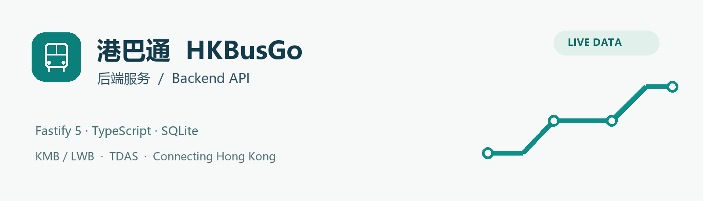

# 港巴通 HKBusGo — 后端服务 / Backend API

**TDAS 修复 / Connectivity repair:** [数据通达检查、专用出口与发布门槛](docs/DATA-REACHABILITY.md)。本次源码新增生产 TDAS 专用鉴权传输及数据健康观测，实际发布结果以该文档为准。

**正式 API / Finalized API:** `https://hkbus-api.copypaste.hk/api/` · [五端编译与 HTTPS 验证 / Builds and HTTPS verification](docs/PRODUCTION-API.md)
**任意来源跨域 / Any-origin CORS:** 默认 `CORS_ORIGINS=*`，回显 Origin 并允许凭证与任意请求头；[配置和验证 / Policy and verification](docs/CORS-OPEN.md)。



[中文说明](#中文说明) · [English](#english) · [完整图册 / Gallery](docs/GALLERY.md) · [数据与验证 / Data & validation](docs/DATA-AND-VALIDATION.md)

[总览 / Index](https://github.com/copypasteltd/HKBUS/tree/main) · [Backend](https://github.com/copypasteltd/HKBUS/tree/backend) · [Admin](https://github.com/copypasteltd/HKBUS/tree/admin) · [微信 / WeChat](https://github.com/copypasteltd/HKBUS/tree/wechat) · [支付宝 / Alipay](https://github.com/copypasteltd/HKBUS/tree/alipay) · [抖音 / Douyin](https://github.com/copypasteltd/HKBUS/tree/douyin) · [Android](https://github.com/copypasteltd/HKBUS/tree/android)

> `backend` · Fastify 5 · TypeScript · SQLite · Live KMB/LWB + TDAS · Accessible Calm Minimal

**品牌 / Brand：已确认 10 号「朱印车迹」纯图形 Logo / Approved option 10, graphic only.** [品牌规范 / Brand guide](docs/BRAND.md) · [本次品牌验证 / Current brand checks](docs/BRAND-ROLLOUT.md)

**2026-10-17 部署 / Deployment：** 后端已运行于 `43.160.221.28:39410`，SQLite 已纳入宝塔管理和每日一致性备份。服务器 56 项、公网 17 项检查通过；TDAS 道路查询被官方返回 403，尚未可用。Native Backend and BaoTa-managed SQLite are deployed; 56 server and 17 public checks passed, while TDAS remains blocked by upstream 403. [完整中英部署与运维手册 / Deployment handover](docs/DEPLOYMENT.md) · [在线接口文档 / Live API docs](http://43.160.221.28:39410/api/docs/)

## 中文说明

港巴通的独立 Backend：Node.js 22.14+、Fastify 5、TypeScript、原生 SQLite。为四个移动端及运营后台提供同一套 BFF、匿名身份、内容工作流、任务和审计。无需 Docker、WSL、容器或其他仓库才能编译；外部数据依赖 KMB/LWB 与 TDAS 官方 API。

### 架构与接口截图


截图来自实际 API 和隔离业务库；路线是真实官方记录。API 交互文档并不是图形化后端管理台，运营界面位于 `admin` 分支。更多截图见 [图册](docs/GALLERY.md)。

### 克隆与启动

```powershell
git clone --branch backend --single-branch git@github.com:copypasteltd/HKBUS.git hkbusgo-backend
cd hkbusgo-backend
npm ci
npm run bootstrap
npm run build
npm test
npm run sync:live
npm start
```

`bootstrap` 以随机 secret/初始密码生成本机 `.env.local`，已有文件不覆盖。请自行在本机文件中查看管理账号；凭证不输出到 README、Git 或截图。无管理员时首次启动才创建初始管理员。开发监听为 `npm run dev`。

入口：`http://127.0.0.1:4100/api/health`、`/api/docs`、`/api/openapi.json`。`sync:live` 等待完整官方目录同步；服务也会在初次/到期时自动同步，失败每分钟重试。禁止 fixture 模式和包含示例主数据的数据库；使用新的真实业务库。

### 功能与核心事务

| 模块 | 行为 |
|---|---|
| 官方目录 | KMB 路线、方向、service type、站点三语名称/坐标、完整站序；引用校验后事务替换 |
| 到站与首页 | KMB stop ETA、身份匹配、null/时效、请求合并、熔断/有限重试、缓存；无位置不编造附近站 |
| 查询与行程 | 搜索、分页、附近直线距离、直达/一次同站转乘候选；不生成票价或巴士车程 |
| TDAS | 实际 POST 道路距离、行驶时间、路段/替代路线；独立于巴士 ETA |
| 匿名装置 | access/轮换 refresh token、收藏别名/排序、最近查看、提醒、通知、级联删除 |
| CMS | 三语通告、有效期、平台/路线/站点、草稿→审核→批准→发布、撤回、版本历史和回滚 |
| 管理与运维 | Cookie 会话、4 种角色、乐观锁、功能/内容配置、官方同步、上游健康、指标、审计、账号与备份 |

匿名 access token 30 天，refresh 365 天，服务器只存 refresh 哈希。删除撤销全部会话与个人资料。提醒最长两小时，依新鲜官方 ETA 评估和去重；不保证关闭页面后的系统推送。通告只公开已核实的 operator 内容，不预填客户数据或改道文章。

### 配置与安全边界

| 变量 | 含义 |
|---|---|
| `HOST` / `PORT` | 默认 127.0.0.1:4100；对外由 HTTPS 代理 |
| `DATABASE_PATH` | 默认 ./data/hkbusgo.db，持久化且独立备份 |
| `JWT_SECRET` / `ADMIN_EMAIL` / `ADMIN_PASSWORD` | 本机 bootstrap 生成；生产自行安全注入 |
| `PROVIDER_MODE` / `TDAS_ENABLED` | 只接受 live；TDAS 默认 true |
| `KMB_BASE_URL` / `TDAS_BASE_URL` | 官方适配器地址；详见 .env.example |
| `PROVIDER_TIMEOUT_MS` / `CATALOG_SYNC_HOURS` | 默认 15000ms / 24h |
| `CORS_ORIGINS` / `TRUSTED_PROXIES` | CORS 默认 `*` 接受任意来源；代理独立配置，默认不信任任意代理 |
| `PUBLIC_APP_URL` | 实际分享入口，部署时替换本机地址 |
| `RATE_LIMIT_MAX` | 每 IP 每分钟默认 120 |

Admin 写入需要 HttpOnly 会话 Cookie 和 `X-HKBus-Admin: 1`；默认接受任意 Origin，登录与角色权限独立校验。角色为 viewer/editor/operator/admin。内容与配置采用版本锁，409 后应重新读取；不要强制覆盖。不要将浏览器保存的凭证复制到文档。

### API、目录与命令

成功 envelope 为 `{data, meta:{mode:"live", requestId, generatedAt}}`；错误为 `{error:{code,message,requestId,retryable,fields?}}`。

离线接口契约：[OpenAPI JSON](docs/openapi.json)，可由 `npm run openapi -- ./docs/openapi.json` 重新导出。

```powershell
Invoke-RestMethod http://127.0.0.1:4100/api/health
Invoke-RestMethod 'http://127.0.0.1:4100/api/v1/routes?q=112'
npm run typecheck
npm run smoke:live
npm run openapi
npm run backup -- ./data/backups/manual.db
```

`src/providers.ts` 是真实 KMB/TDAS 适配器；`src/database.ts` 定义 SQLite 与事务；`src/public-api.ts`、`profile-api.ts`、`admin-api.ts` 分别提供公共/个人/运营接口；`src/usecases.ts` 实现行程、通告和提醒业务；`src/contracts.ts` 维护文档契约。`test/` 含合成回归输入，**不编译进生产服务**。`scripts/` 提供构建、初始化、同步、备份和接口导出。

`smoke:live` 只在独立内存库请求官方服务，写本机 `data/live-smoke.json`。`backup` 使用 SQLite VACUUM INTO，恢复前停止服务、校验完整性并保留回退文件。SQLite worker 只运行一个服务实例，不支持多个进程共享同一库排程。

### 验证与部署

本项目基线有 22 项 Backend 自动化测试，真实接口和浏览器证据另存 [验证资料](docs/DATA-AND-VALIDATION.md)、[本仓库检查](docs/validation.json)。上游出错只返回时效内真实缓存或明确错误，不生成虚构结果。

生产环境先构建，以专用账号运行单一 Node 进程，设置 NODE_ENV=production、持久化目录、随机凭证和 HTTPS 反向代理；CORS 默认 `*`；分享入口和可信代理单独配置。保存业务库一致性备份。本次已完成 Backend 高端口部署与宝塔 SQLite 接入；TDAS 上游、域名 HTTPS、容量、真机和平台上架须按 [部署手册](docs/DEPLOYMENT.md) 的边界继续验收。

遇到 initializing，检查官方同步任务和网络；SAMPLE_DATABASE_FORBIDDEN 表示旧示例库被拒绝，应指定干净的真实库；401/403 检查会话、角色、Origin、请求头；无 ETA 则对照真实运营时间/官方空值。完整数据规则见 [Data & validation](docs/DATA-AND-VALIDATION.md)。

## English

The self-contained HKBusGo Backend uses Node.js 22.14+, Fastify 5, TypeScript and native SQLite. It serves the four mobile applications and Operations Admin through one BFF. Compilation requires neither sibling repositories nor Docker/WSL; live runtime data requires the official KMB/LWB and TDAS endpoints.

### Setup and credentials

Clone branch `backend` with the commands above, run `npm ci`, `npm run bootstrap`, `npm run build`, `npm test`, `npm run sync:live`, then `npm start`. `npm run dev` enables development watching. Bootstrap creates an ignored local `.env.local` with random credentials and never replaces an existing file. Read the administrator credentials locally; they are not embedded in the documentation. The initial administrator is created only when the database has none.

Health: `http://127.0.0.1:4100/api/health`; interactive contract: `/api/docs`; machine-readable contract: `/api/openapi.json`. The screenshots above show the actual API UI/HTTP responses. Graphical operations belong to branch `admin`.

### Features and transactions

The catalogue preserves official route number/direction/service-type identity, multilingual stops, coordinates and complete sequences, and validates references before atomic publication. ETA preserves provider nulls/timestamps and matches direction, service type and stop sequence. Requests are deduplicated, retried within limits, circuit-controlled and cached with explicit freshness. Home requires a real position or selected stop.

Search, paging, nearby straight-line distances and direct/one-same-stop-transfer journey candidates use the actual catalogue, without invented fares or bus journey durations. TDAS supplies a separate road reference with real distance, time, segments and alternatives. It does not predict bus waiting time.

Anonymous-device profiles support rotating credentials, bookmark aliases/order, recent history, reminders, notifications and cascading deletion. Access tokens last 30 days, refresh tokens 365 days; only refresh hashes are stored. Deletion revokes all sessions. Reminders last up to two hours and require fresh ETA with deduplication; closed-page push is not promised.

CMS supports three languages, validity windows, platform/route/stop targeting, draft→review→approved→published transitions, withdrawal, history and rollback. Only verified operator notices are public; no seeded users, activities or disruption articles are provided. Operations include configuration, upstream health, sync jobs, actual request metrics, audits and administrator management.

### Configuration and API contract

See `.env.example`. `HOST`/`PORT` default to 127.0.0.1:4100; `DATABASE_PATH` defaults to ./data/hkbusgo.db. `JWT_SECRET`, `ADMIN_EMAIL` and `ADMIN_PASSWORD` are local/private values. `PROVIDER_MODE` accepts only live; `TDAS_ENABLED` defaults true. Official adapter addresses use `KMB_BASE_URL`/`TDAS_BASE_URL`; default provider timeout is 15000ms and catalogue interval 24h. `CORS_ORIGINS=*` is the default and permits any origin. Configure bounded `TRUSTED_PROXIES`, real `PUBLIC_APP_URL` and the default per-IP 120/minute rate limit separately.

Admin mutations require an HttpOnly session cookie and `X-HKBus-Admin: 1`; any origin is accepted by default, with authentication and roles checked independently. Roles are viewer, editor, operator and admin. Optimistic version locks return 409 on conflicts; reload and review rather than overwriting. Successful responses contain `{data,meta:{mode:"live",requestId,generatedAt}}`; errors contain `{error:{code,message,requestId,retryable,fields?}}`.

An offline [OpenAPI JSON contract](docs/openapi.json) is included; regenerate it with `npm run openapi -- ./docs/openapi.json`.

### Development and operations

`src/providers.ts` adapts real providers; `database.ts` implements persistence/transactions; `public-api.ts`, `profile-api.ts` and `admin-api.ts` expose the three API areas. `usecases.ts` implements planning, notices and reminders. `contracts.ts` documents requests. Synthetic inputs live only in `test/` and are excluded from the production compilation.

Run `npm run typecheck`, `npm test` (22 baseline cases), `npm run smoke:live`, `npm run openapi` and `npm run backup -- ./data/backups/manual.db` as needed. Live smoke uses a separate memory database and writes a local result. Backup uses SQLite VACUUM INTO; stop before restoring, check integrity and preserve a rollback copy. Run one service instance: workers must not compete on a shared SQLite file.

For production, build first, run one dedicated Node service with NODE_ENV=production and persistent storage, inject real credentials, and expose it through an HTTPS reverse proxy. Keep `CORS_ORIGINS=*` for any-origin access, configure trusted proxies and sharing URL separately, and retain consistent backups. This release now has a deployed Backend high port and BaoTa-managed SQLite. TDAS upstream access, domain TLS, capacity, device and store acceptance remain separate; see the [deployment handover](docs/DEPLOYMENT.md).

For initializing, inspect official sync/network status. SAMPLE_DATABASE_FORBIDDEN rejects a historical sample database; select a clean live database. For 401/403, check the session, role, Origin and mutation header. A null ETA may reflect actual operation. Upstream failure returns bounded real cache or an explicit error, never invented arrivals. See [validation and sources](docs/DATA-AND-VALIDATION.md), [checkout checks](docs/validation.json) and [asset provenance](docs/ASSETS.md).
