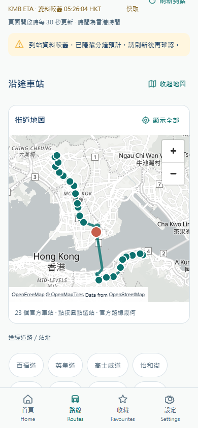
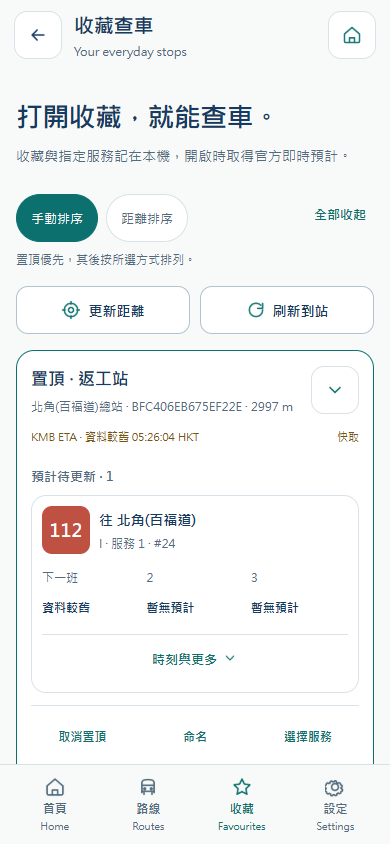
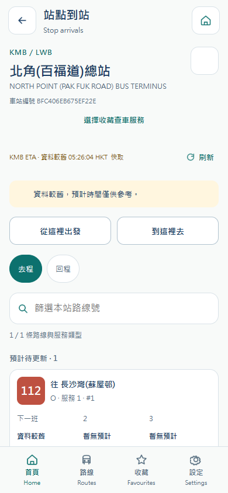
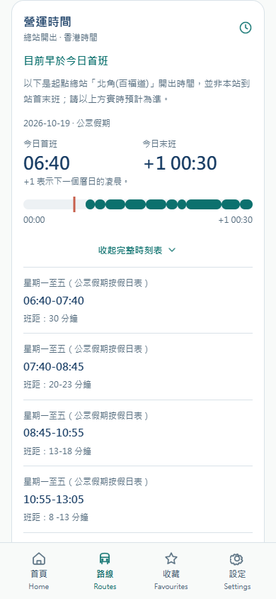
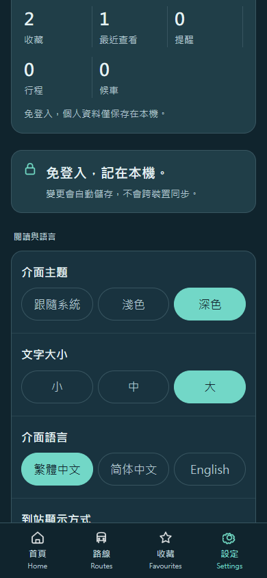

# 港巴通 HKBusGo — 支付宝小程序 / Alipay mini-program

**2026-10-19 七项对标更新 / SG Bus alignment:** 地图、实时到站、总站时刻、收藏查车、收藏管理、道路搜索和个性化已更新。/ Real street maps, configurable arrivals, origin timetables, selected-service favourites, management, road search and local appearance controls are available. 共 17 页，客户端各 55 项测试及目标构建通过；实际 H5 专项 18 组、业务回归 28 组通过。/ 17 pages; each client passed 55 tests and its target build; the public H5 passed 18 feature and 28 regression groups.

[业务与验收 / Requirements](docs/SGBUS-ALIGNMENT.md) · [正式网站 / Live website](https://hkbus.copypaste.hk/) · [品牌 / Brand](docs/BRAND.md) · [数据 / Data](docs/DATA-AND-VALIDATION.md)

 

## 中文说明

这是港巴通 **支付宝小程序的独立 Git 工程**，包含完整 Taro 4.3、React、TypeScript 源码、测试、素材、平台配置和锁文件，不依赖其他分支的本地路径或子模块。沿用 10 号纯图形 Logo 和 Accessible Calm Minimal。

正式 API：`https://hkbus-api.copypaste.hk/api/`。KMB/LWB 提供真实目录及 ETA；九巴官网公开接口补充经核对的道路、路线几何和总站时刻，香港政府 1823 提供假期，TDAS 提供独立道路参考。道路索引匹配 6,472 / 6,775 个站，约 95.5%。没有车辆 GPS、车型或拥挤度；总站首末班不是中途站到站首末班。

| 板块 | 已实现业务 |
| --- | --- |
| 地图与发现 | 街道底图、全部站序、官方道路几何、点站/缩放/恢复视野；附近默认 500 米、地图/道路分组列表及视图记忆 |
| 到站与营运 | 精确方向/服务/站序、网格/列表、两班/三班、分钟/香港时刻、30 秒前台更新；总站时间线、星期/假期、班距和跨日 |
| 收藏查车 | 直接看 ETA，全部或指定服务，置顶、24 字命名、手动/距离排序、展开/收起、确认删除及最近 10 个站点 |
| 搜索与喜好 | 线路/站点/道路、繁简/全半角/大小写/英文道路简称；浅/深/跟随系统，小/中/大三档，三语及本机显示偏好 |
| 其他出行 | 官方分段成人票价、12 条常用行程、6 项候车看板、直达/同站转乘与三方案比较、前台提醒、通告及 12 个三语指南 |

17 页：Home、Routes、Search、Nearby、Arrivals、Route detail、Bookmarks、Settings、Notices、Notice detail、Help、Reminders、Planner、Traffic、Regular journeys、Waiting board、Road stops。

### 安装、检查与构建

```powershell
git clone --branch alipay --single-branch git@github.com:copypasteltd/HKBUS.git hkbusgo-alipay
cd hkbusgo-alipay
npm ci
npm run typecheck
npm test
npm run build
```

要求 Node.js >=22.14，输出 dist/alipay。仅使用 Windows 原生工具，不调用 Docker、WSL、虚拟机或模拟器。默认接入正式 API；本地后端调试可在构建前设置 TARO_APP_API_BASE。

使用自己的 AppID 在 **支付宝开发者工具 / Alipay DevTools** 打开 dist/alipay，登记正式 HTTPS 请求域名，完成定位用途及平台地图权限配置。构建不代表官方 IDE、真机、平台上传或上架通过。

Open dist/alipay with your own AppID in 支付宝开发者工具 / Alipay DevTools. Register the production HTTPS request domain and configure location disclosure and map permissions. A build is separate from official IDE, physical-device and platform/store acceptance.

### 本机资料与验证边界

乘客无需账号，不创建匿名云档案、不发送会话凭据或访问个人 profile API。偏好、收藏、历史、提醒、行程和看板仅存本机；schema 1/2 和旧大字配置迁移到 schema 3，保存失败保留旧值。重设偏好保留出行集合；清除全部才移除集合与本应用缓存。精确定位只用于主动查询的当次内存，各设备/平台不互相同步。

Web/Android 采用 MapLibre / OpenFreeMap 并保留署名、独立 worker 和 JavaScript 模块 MIME；小程序采用平台 Map，坐标只在渲染层转换。数据缺失、较旧、离线和接口失败各自表达，不把空 ETA 当停驶，也不伪造路线或车辆位置。提醒只在前台检查，关闭后没有后台推送承诺。

客户端各 55 项测试和目标构建通过；实际生产 H5 专项 18 组、业务回归 28 组通过。官方 IDE、原生地图/定位/系统主题、真机和上架仍须独立验收。下图是**已发布 H5 的移动浏览器截图**，供共享界面参考，不能替代 支付宝小程序 的原生验收。

| 到站 | 总站时刻与班距 | 深色大字 |
| --- | --- | --- |
|  |  |  |

较早设计、票价、本机喜好和交互验收保留于 docs/；其中 14/16 页和旧测试数量是历史发布快照。

## English

This self-contained **Alipay mini-program** repository contains Taro 4.3 / React / TypeScript source, tests, assets, platform configuration and a lockfile. It needs no sibling checkout or submodule. Logo 10 and Accessible Calm Minimal remain the visual baseline.

The production API is `https://hkbus-api.copypaste.hk/api/`. KMB/LWB supplies live transit data; verified official KMB website metadata adds roads, complete route geometry and origin timetables. The government calendar identifies Hong Kong holidays. TDAS remains a separate road reference. Road matching covers 6,472 of 6,775 current stops. Vehicle GPS, occupancy and vehicle type are unavailable. Origin departure times must not be interpreted as intermediate-stop first/last arrivals.

The 17 pages cover discovery, route/stop arrivals, road stops, selected-service favourites, timetables, local preferences, fares, regular journeys, the waiting board, planning, traffic, notices and help. Two/three predictions, grid/list, minutes/clock, light/dark/system, three text sizes, map/list and favourite ordering persist locally. Exact direction, service and stop occurrence prevent substitution; stale or missing forecasts remain explicit.

Use Node >=22.14 and the clone/install/check/test/build commands above. Output is dist/alipay; build with native Windows tools only. See the platform-specific instructions above and [complete requirements](docs/SGBUS-ALIGNMENT.md).

Passenger preferences and travel collections stay on-device without accounts or credentials. Versioned migration preserves old favourites and large text; failed writes retain old data. Location is actively requested and held only in memory for the session. Reset preferences preserves collections; clear all removes them and app query caches. Browsers, mini-programs and devices do not sync.

Each client passed 55 tests and its target build. The actual public H5 passed 18 feature checks and 28 regression groups. This does not constitute official mini-program IDE checks, physical-device acceptance, platform upload or store submission. Screenshots are real public-H5 captures, used as a shared UI reference. Native maps, location, system themes, sharing and notifications require separate device verification.

## 工程导航 / Repositories

[Main](https://github.com/copypasteltd/HKBUS/tree/main) · [Backend](https://github.com/copypasteltd/HKBUS/tree/backend) · [Admin](https://github.com/copypasteltd/HKBUS/tree/admin) · [WeChat](https://github.com/copypasteltd/HKBUS/tree/wechat) · [Alipay](https://github.com/copypasteltd/HKBUS/tree/alipay) · [Douyin](https://github.com/copypasteltd/HKBUS/tree/douyin) · [Android / H5](https://github.com/copypasteltd/HKBUS/tree/android)
