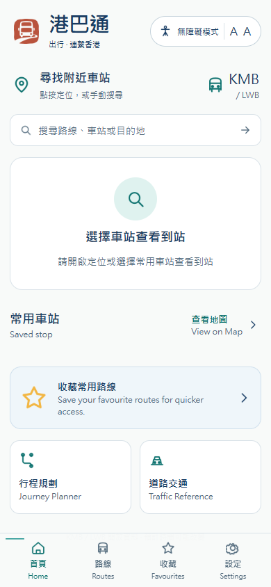
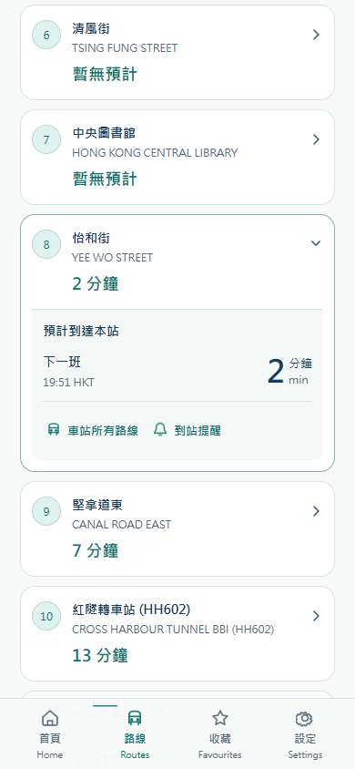
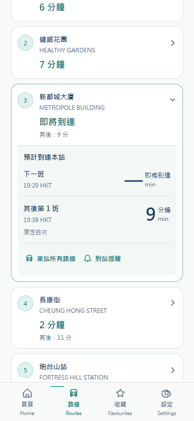
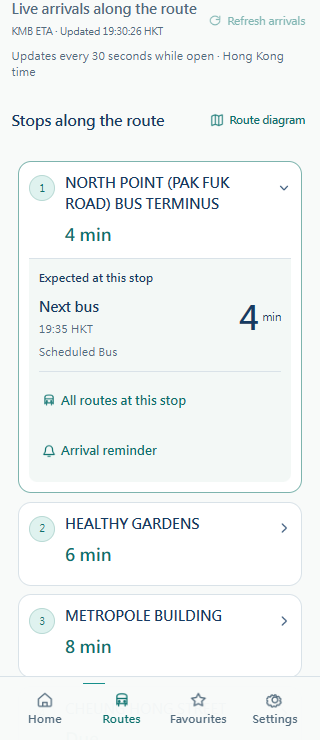
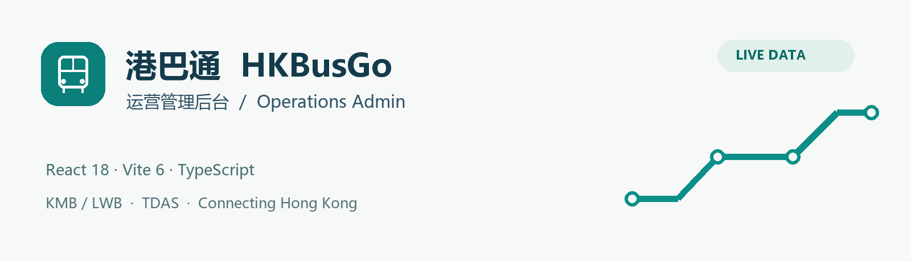

# 港巴通 HKBusGo — 运营管理后台 / Operations Admin

**2026-10-17 实际网站已更新 / Actual website updated:** [打开港巴通 / Open HKBusGo](https://hkbus.copypaste.hk/) · [正式发布与验收 / Release and acceptance](docs/H5-SITE-LIVE.md)。线路详情已显示真实逐站 ETA、未来班次和香港时刻；245 个公网文件、14 页加载及 11 组线上浏览器检查通过。后续实际前端更新将按用户授权同步对应服务器路径。 / Real route arrivals are now published; future frontend updates are authorized to deploy after verification.

 

**2026-10-17 线路到站更新 / Live route arrivals:** [缺口检查、修复与验收 / Audit, fix and acceptance](docs/ROUTE-ARRIVALS.md)。各站 ETA、未来三班、香港时刻、官方备注、方向与站序隔离已补齐；首页/站点倒计时与前台刷新同步修复。 / Route details now show real station predictions, upcoming buses, Hong Kong times and official remarks, with direction/service/sequence isolation and foreground refresh.

共享实际页面的浏览器渲染 / Browser rendering of shared real UI；不是小程序官方 IDE 或真机截图 / These are not official mini-program IDE or physical-device screenshots.

 


**最新数据通达 / Current data status · 2026-10-17:** [真实 TDAS 修复、正式 Admin 和完整验收 / Live-data and Admin handover](docs/DATA-REACHABILITY.md)。正式 API 与 Admin 已通过实际 HTTPS 和浏览器检查；旧部署记录保留作历史快照。Production TDAS and the published Admin passed live acceptance; earlier reports are historical snapshots.

**正式 API / Finalized API:** `https://hkbus-api.copypaste.hk/api/` · [2026-10-17 编译与交付 / Build and delivery](docs/PRODUCTION-API.md)


[中文说明](#中文说明) · [English](#english) · [完整图册 / Gallery](docs/GALLERY.md) · [数据与验证 / Data & validation](docs/DATA-AND-VALIDATION.md)

[总览 / Index](https://github.com/copypasteltd/HKBUS/tree/main) · [Backend](https://github.com/copypasteltd/HKBUS/tree/backend) · [Admin](https://github.com/copypasteltd/HKBUS/tree/admin) · [微信 / WeChat](https://github.com/copypasteltd/HKBUS/tree/wechat) · [支付宝 / Alipay](https://github.com/copypasteltd/HKBUS/tree/alipay) · [抖音 / Douyin](https://github.com/copypasteltd/HKBUS/tree/douyin) · [Android](https://github.com/copypasteltd/HKBUS/tree/android)

> `admin` · React 18 · Vite 6 · TypeScript · Live KMB/LWB + TDAS · Accessible Calm Minimal

**品牌 / Brand：已确认 10 号「朱印车迹」纯图形 Logo / Approved option 10, graphic only.** [品牌规范 / Brand guide](docs/BRAND.md) · [本次品牌验证 / Current brand checks](docs/BRAND-ROLLOUT.md)

## 中文说明

独立 React 18 / Vite 6 / TypeScript 运营后台，连接 `backend` 分支真实 API。沿用暖白、深蓝与青绿 Accessible Calm Minimal。无需其他前端源码即可构建，运行时需要 Backend 和授权管理账号。

### 实际截图


| 登录 / Login | 数据来源 / Providers |
|---|---|
|  |  |

截图来自实际 Admin 构建与真实官方数据。请求量是隔离文档检查流量，通告为空，不代表真实客户运营规模。[完整图册](docs/GALLERY.md)包含登录及全部 10 个后台板块。

### 克隆与运行

```powershell
git clone --branch admin --single-branch git@github.com:copypasteltd/HKBUS.git hkbusgo-admin
cd hkbusgo-admin
npm ci
npm run dev
```

Node.js 22.14+、npm 10。开发入口 `http://127.0.0.1:5174`；默认 API 为 `https://hkbus-api.copypaste.hk/api`。正式浏览器管理台建议同源托管，避免开发站点与正式站点之间的 Cookie 限制。本机联调请显式设置 `VITE_API_BASE=/api` 后使用本机 Backend 和本机账号；前端不内置密码。

```powershell
npm run typecheck
npm run build
npm run preview
```

产物 `dist/`，本机构建预览 `http://127.0.0.1:4174`。`VITE_API_BASE` 默认 `https://hkbus-api.copypaste.hk/api`；静态资源使用相对路径，支持根目录或 `/admin/`。建议静态后台与 API 同源。`ADMIN_API_PROXY` 调整开发/预览代理地址，需要在启动进程前设置环境变量；`.env.example` 是参考。更改 `VITE_API_BASE` 后重新构建。

### 功能与权限

| 板块 | 业务 |
|---|---|
| 总览 | 当前路线/站点、有效已发布通告、提醒、实际 API 流量/时延、同步和操作 |
| 路线 / 站点 | 官方目录搜索、分页、方向/服务类型、完整站序、真实 ETA 预览；主数据只读 |
| 服务通告 | 三语、有效期、平台/路线/站点、多阶段发布、撤回、历史和回滚 |
| 产品内容 / 功能设置 | 三语覆盖、隐私、帮助、来源、维护、功能开关、ETA 时效策略 |
| 数据来源 / 同步任务 | KMB/TDAS 实际成功率和延迟、目录质量、任务状态、缓存清理和提醒评估 |
| 审计 / 账号 | 关键操作追溯、账号新建/角色/停用/密码重设/会话撤销、最后管理员保护 |

| 角色 | 可执行操作 |
|---|---|
| viewer | 只读授权页面 |
| editor | 内容编辑和送审 |
| operator | 内容审核/批准/发布、配置和运维 |
| admin | operator 能力及管理账号 |

UI 与 Backend 双重限制。Admin 使用 HttpOnly Cookie、允许的 Origin 和 `X-HKBus-Admin: 1`。表单仅在 API 成功后显示成功，401 恢复登录，409 版本冲突须重载后核对。只接受 live envelope，不能连接历史 fixture 服务。

### 目录、联调与发行

`src/App.tsx` 管理会话和导航；`src/api.tsx` 统一真实请求、错误与资源状态；`src/pages` 包含各业务板块；`src/ui.tsx` 提供角色、表单、弹窗和反馈组件；`src/styles.css` 实现设计系统；`docs` 为素材与验证。

实际 Admin 已发布到 `https://hkbus-api.copypaste.hk/admin/`，保留 `/api/admin` Cookie 路径；六个编译资源、真实登录/退出与十个功能页已检查。同源 HTTPS 直接连接定稿 API，Backend CORS 接受任意来源。不上传 `.env.local`、密码或服务器数据库。没有新增 demo 或 Vercel 部署。

| 问题 | 处理 |
|---|---|
| 无法连接 | 检查正式 API、CORS、HTTPS 和 Cookie；本机开发另查 Backend 4100 与代理 |
| 401 / 403 | 检查会话、角色、Origin 和 X-HKBus-Admin；失效后重新登录 |
| 409 | 其他人已改版，重新读取后核对，不强制覆盖 |
| 指标为空 | 尚无真实请求或发布内容，不填充假增长 |
| 同步失败 | 查看实际任务与上游状态；旧完整目录继续可用 |

类型/编译与真实浏览器登录/目录/数据源已检查；实际生产站点另有本次验收记录，四端真机仍需独立验证。[验证记录](docs/validation.json)、[数据边界](docs/DATA-AND-VALIDATION.md)、[素材来源](docs/ASSETS.md)。

## English

This is the independent React 18 / Vite 6 / TypeScript Operations Admin. It connects to the real Backend API and uses the Accessible Calm Minimal warm-white, navy and teal design. Building requires no sibling frontend checkout; runtime requires the Backend and an authorised administrator.

### Screenshots and setup

The screenshots above and the [full gallery](docs/GALLERY.md) show the actual Admin build with official data. Request metrics reflect isolated documentation traffic, not customers. Empty notice content is intentional. The gallery covers login and all 10 navigation areas.

Clone branch `admin`, run `npm ci` then `npm run dev` with Node.js 22.14+ and npm 10. Development runs on `http://127.0.0.1:5174`. The default API is `https://hkbus-api.copypaste.hk/api`; use same-origin HTTPS static hosting for the production cookie. For local integration explicitly set `VITE_API_BASE=/api` and use the local Backend and credentials. No password is embedded in the frontend.

Run `npm run typecheck` and `npm run build`; output is `dist/`. `npm run preview` serves the local build at `http://127.0.0.1:4174`. `VITE_API_BASE` defaults to `https://hkbus-api.copypaste.hk/api`. Relative asset paths support root or `/admin/` static hosting; the production Admin should share the API origin. Set `ADMIN_API_PROXY` in the process environment before starting dev/preview when changing its target; `.env.example` documents the values. Changes to `VITE_API_BASE` require rebuilding.

### Features and access control

Overview shows current catalogue/publication/reminder counts, actual API traffic/latency, sync and recent operations. Routes and Stops support official directory search, paging, directions/service types, sequences and live ETA previews; official master data is read-only.

Notices support three languages, validity windows, platform/route/stop targeting, staged review/approval/publication, withdrawal, history and rollback. Product Content and Controls manage coverage, privacy, help, sources, maintenance, feature switches and ETA freshness. Providers and Jobs show real upstream success/latency, data quality, task state, cache purging and reminder evaluation. Audit and Team Access track operations and manage users, roles, disabling, password reset and session revocation, with last-admin protection.

Viewer is read-only; editor edits/submits content; operator reviews/publishes and operates settings/jobs; admin additionally manages accounts. Both UI and Backend enforce access. Mutations use an HttpOnly session cookie, allowed Origin and `X-HKBus-Admin: 1`. Success is shown only after actual API success. A 401 restores login; a 409 requires reloading/reviewing the latest version. Non-live envelopes are rejected.

### Structure, deployment and troubleshooting

`src/App.tsx` handles navigation/session; `src/api.tsx` implements transport/errors/resources; `src/pages` contains business areas; `src/ui.tsx` handles role-aware shared controls/forms/dialogs; `src/styles.css` contains the design system; `docs` holds images/evidence.

For production, serve `dist` at `https://hkbus-api.copypaste.hk/admin/`, preserving the `/api/admin` cookie path. The actual Admin site is now published there; all six static resources, real login/logout and ten sections passed acceptance. Backend CORS permits any origin. Cross-origin cookies require additional correct credential policy; same-origin hosting is the documented default. Keep local environment files, passwords and server databases outside Git. No demo or Vercel deployment is part of this work.

For connection failure, check the finalized API, CORS, HTTPS and cookie policy; local development additionally uses Backend 4100 and its proxy. For 401/403, inspect session, role, Origin and mutation header, then re-authenticate. For 409, reload/review rather than force overwrite. Empty metrics mean no actual traffic/content; sync failures retain the last complete catalogue. Types/build and real browser login/catalogue/provider checks are recorded separately from production and physical-device acceptance. See [checkout validation](docs/validation.json), [data rules](docs/DATA-AND-VALIDATION.md) and [provenance](docs/ASSETS.md).
