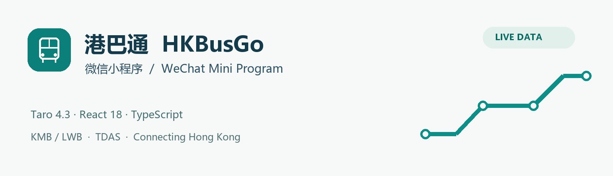
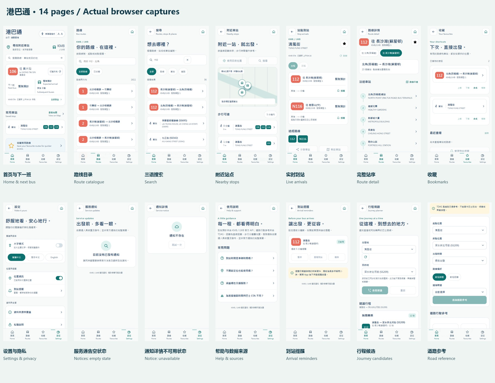
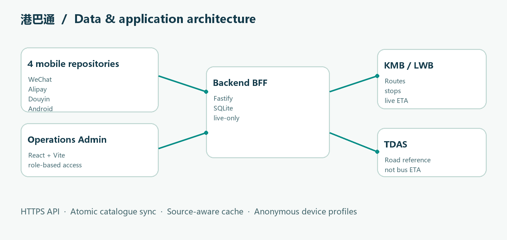

# 港巴通 HKBusGo — 微信小程序 / WeChat Mini Program



[中文说明](#中文说明) · [English](#english) · [完整图册 / Gallery](docs/GALLERY.md) · [数据与验证 / Data & validation](docs/DATA-AND-VALIDATION.md)

[总览 / Index](https://github.com/copypasteltd/HKBUS/tree/main) · [Backend](https://github.com/copypasteltd/HKBUS/tree/backend) · [Admin](https://github.com/copypasteltd/HKBUS/tree/admin) · [微信 / WeChat](https://github.com/copypasteltd/HKBUS/tree/wechat) · [支付宝 / Alipay](https://github.com/copypasteltd/HKBUS/tree/alipay) · [抖音 / Douyin](https://github.com/copypasteltd/HKBUS/tree/douyin) · [Android](https://github.com/copypasteltd/HKBUS/tree/android)

> `wechat` · Taro 4.3 · React 18 · TypeScript · Live KMB/LWB + TDAS · Accessible Calm Minimal

## 中文说明

这是港巴通 **微信小程序** 的独立 Git 工程。完整 Taro 源码、图标、测试、配置及锁文件均在本分支内；不引用其他分支的本地目录、不依赖子模块，也不需要克隆共享 Mobile 工程。独立仓库不代表离线后端：运行时仍需要 `backend` 分支的 API。

### 产品与页面

面向香港 KMB／LWB 客户，采用暖白、深蓝和青绿的 Accessible Calm Minimal 设计。支持繁体中文、简体中文、English、大字偏好和明确的数据新鲜度。

| 功能域 | 实际行为 |
|---|---|
| 发现与查询 | 首页下一班、真实路线目录、三语搜索、附近站点、方向/服务类型、完整站序、30 秒可见页面刷新 |
| 到站状态 | 官方 ETA、暂无预计、较旧、上游失败、上次查询资料；不生成天气或固定分钟 |
| 个人功能 | 匿名装置收藏、别名与排序、最近查看、删除本机资料、到站提醒与通知 |
| 内容与帮助 | 运营核实的通告及详情、覆盖范围、隐私、数据来源；空内容如实显示 |
| 出行参考 | 真实站序产生直达/一次同站换乘候选；TDAS 独立道路查询，不生成票价或巴士车程 |

共 14 页：Home、Routes、Search、Nearby、Arrivals、Route detail、Bookmarks、Settings、Notices、Notice detail、Help、Reminders、Planner、Traffic。

### 截图与图册

下面是实际 Taro 界面的浏览器截图，**不是 微信小程序官方 IDE 或真机截图**。三个小程序采用共用界面作为参考；原生能力验收另记。附近定位采用官方站点坐标作为浏览器测试输入。

| 首页 / Home | 实时到站 / Arrivals | 收藏 / Bookmarks |
|---|---|---|
|  |  |  |



完整的 14 页、提醒编辑器、后台截图和素材来源见 [图册](docs/GALLERY.md)与 [素材说明](docs/ASSETS.md)。通告为空、详情不可用和深夜 ETA 暂无预计均保留真实状态。

### 独立克隆与快速开始

```powershell
git clone --branch wechat --single-branch git@github.com:copypasteltd/HKBUS.git hkbusgo-wechat
cd hkbusgo-wechat
npm ci
npm run typecheck
npm test
# 本机 Backend 可用时可先使用默认地址；网络包请设置实际 HTTPS API。
$env:TARO_APP_API_BASE='https://你的实际后端域名/api'
npm run build
```

要求 Node.js 22.14+、npm 10 与原生 Windows 工具。构建产物：`dist/weapp`。`TARO_APP_API_BASE` 在**构建前**设置，修改后重新编译；`.env.example` 是配置参考，不包含真实域名或凭证。先从 Backend 分支启动并同步 KMB 主数据。

### 微信小程序平台配置

使用 **微信开发者工具 / WeChat DevTools** 导入 `项目根目录，project.config.json 指向 dist/weapp`。先在本机完成 `npm run build`，然后配置你持有的真实 AppID、HTTPS request 合法域名、定位权限/隐私说明、原生分享和平台审核。微信配置中的 `touristappid`、抖音空 AppID 都是本机编译占位，不能作为发行身份；支付宝在 IDE 中关联 AppID。

默认 API 是 `http://127.0.0.1:4100/api`，只适合本机开发工具。手机的 localhost 指向手机自身，正式包必须使用真实 HTTPS BFF。不要把开发域名校验关闭设置当成发行方案。编译不等于官方 IDE 或真机通过。


### 目录与命令

| 目录 / 命令 | 作用 |
|---|---|
| `src/pages/`、`src/screens/` | Taro 页面入口及业务界面 |
| `src/services/`、`src/state.tsx` | 真实 API、缓存/身份隔离、平台能力、状态 |
| `src/assets/` | 随源码交付的本地图标 |
| `config/index.ts` | 本端编译及 API 常量 |
| `test/` | 缓存、来源与会话竞态回归 |
| `docs/` | 双语数据说明、完整图册、构建/截图证据 |
| `npm run dev` | 本端开发构建/监听；不是部署 |
| `npm run build` | 本端默认编译 |
| `npm run typecheck` / `npm test` | 类型检查及 7 项客户端回归 |
| `npm run assets` | 重新生成图标 |



### 数据、验收与故障定位

只接受 live envelope；拒绝 fixture 内容，使用按 API 和匿名身份隔离的缓存。目录 24h、首页/ETA 180s；离线标注旧结果，通告/通知/提醒不离线复用。删除时在途个人响应不能恢复旧资料。详见 [完整数据与验证规则](docs/DATA-AND-VALIDATION.md)。

检查结果见 [本分支验证](docs/validation.json)。源码/类型、编译、实际 API、浏览器、官方 IDE、真机和商店审核分开记录。暂无已验收的公网后端、官方 IDE、真机或商店版本。

| 现象 | 排查 |
|---|---|
| 首页没有下一班 | 授权定位或收藏真实站点；无位置不任意预选车站 |
| 请求失败 / 401 | 检查 API、Backend、平台域名、会话；失效身份可在设置清除 |
| 无预计 / 较旧 | 对照官方 ETA 与资料时间；这可能是正常服务状态 |
| 无通告 | 当前没有经核实且有效的已发布内容；仍应查运营商消息 |
| 提醒未出现 | 页面是否开启、提醒有效期、方向、门槛、新鲜 ETA；Android 还需 OS 权限 |

独立分支包含共享代码的一份完整快照，没有自动跨分支更新。修改 API 契约/共用逻辑后，应将相关改动同步到其他移动端并分别编译；维护记录以各分支提交与验证为准。仓库不包含本机数据库、`.env.local`、密钥、keystore 或 `node_modules`。

## English

This is the self-contained **WeChat Mini Program** Git checkout for HKBusGo. Taro sources, icons, tests, configuration and the lockfile are included. There are no sibling-checkout imports or submodules. You do not need a shared Mobile checkout to build it. Runtime data still requires the API from the `backend` branch.

### Product and feature scope

HKBusGo serves Hong Kong KMB/LWB users with the Accessible Calm Minimal warm-white, navy and teal design. It supports Traditional Chinese, Simplified Chinese, English, large-text preferences and explicit freshness states.

| Area | Behaviour |
|---|---|
| Discovery | Next bus, official route catalogue, multilingual search, nearby stops, direction/service type, complete sequences, 30-second refresh while visible |
| Arrivals | Real provider ETA, null estimates, stale/upstream-failure/previous-result states; no invented weather or countdowns |
| Personal | Anonymous-device bookmarks, aliases/order, recent history, deletion, reminders and notifications |
| Content | Operator-reviewed notices/details, coverage, privacy and data attribution; honest empty states |
| Planning | Direct/one-same-stop-transfer candidates from official sequences; separate TDAS road reference, without bus fares or duration predictions |

The 14 pages are Home, Routes, Search, Nearby, Arrivals, Route detail, Bookmarks, Settings, Notices, Notice detail, Help, Reminders, Planner and Traffic.

### Screenshots

The images above and the [complete gallery](docs/GALLERY.md) show the actual Taro renderer in a browser, **not WeChat Mini Program IDE or phone captures**. Native acceptance remains separate. Browser nearby-location input is an official stop coordinate, not physical GPS. Empty/unavailable notices and genuine night-time no-estimate states are preserved. See [asset provenance](docs/ASSETS.md).

### Clone and build

Clone only branch `wechat` with the PowerShell commands above, run `npm ci`, `npm run typecheck` and `npm test`, then `npm run build`. Use Node.js 22.14+, npm 10 and native Windows tooling. Before building a network-capable package, set `$env:TARO_APP_API_BASE` to your actual HTTPS Backend `/api` URL. Changing the endpoint requires rebuilding. `.env.example` is a reference, not a deployed endpoint. Start and synchronise the Backend first. Output: `dist/weapp`.

### WeChat Mini Program platform configuration

Import `项目根目录，project.config.json 指向 dist/weapp` using **微信开发者工具 / WeChat DevTools** after `npm run build`. Configure your actual AppID, HTTPS request-domain allowlist, location/privacy declarations and native sharing, then complete platform review. The WeChat `touristappid` and empty Douyin AppID are local compilation placeholders; Alipay associates its AppID in the IDE.

The default `http://127.0.0.1:4100/api` is a local development endpoint. On a phone, localhost is the phone itself. Build with your real HTTPS BFF for network use. Disabling development domain checks is not a release configuration. Compilation is not official IDE or physical-device acceptance.


### Development layout

`src/pages` and `src/screens` implement page entry points and UI. `src/services` and `src/state.tsx` implement API transport, partitioned identity/cache and platform capabilities. Icons are local in `src/assets`. `config/index.ts` controls compilation. `test` contains meaningful client data-policy/transport regression cases. `docs` contains bilingual guidance, screenshots and evidence.

`npm run dev` watches this platform, `npm run build` produces its deliverable, `npm run typecheck` checks types, `npm test` runs 7 client regression cases, and `npm run assets` regenerates icons. None of these commands deploys a demo.

### Data, validation and troubleshooting

Only live envelopes are accepted; fixture entities are rejected. API endpoints and anonymous identities partition cache and credentials. Catalogue cache lasts 24h; home/ETA cache 180s. Fallback is labelled as previous data. Notices, notifications and reminders are not reused offline. Deletion invalidates in-flight personal writes. See [data rules](docs/DATA-AND-VALIDATION.md) and [this checkout's validation](docs/validation.json).

If home has no next bus, provide location or save an official stop; the app does not choose an arbitrary location. For network/401 failures, check the endpoint, running Backend, platform domain policy and session, then clear an invalid profile in Settings when needed. Null or stale ETA may reflect the actual service. No notices means no currently published verified content, not that all Hong Kong routes are unaffected. Reminders require an open page, valid subscription, matching direction/threshold and fresh ETA; Android also requires OS permission.

Source/types, build, real API, browser, official IDE, physical-device and store acceptance are separate. Production hosting, native IDE/device acceptance and store publication are not claimed. Each branch contains a full shared-code snapshot, without automatic cross-branch updates. Port common API/logic changes to the other mobile branches and validate each. Local databases, `.env.local`, credentials, signing keys and `node_modules` are excluded from Git.
