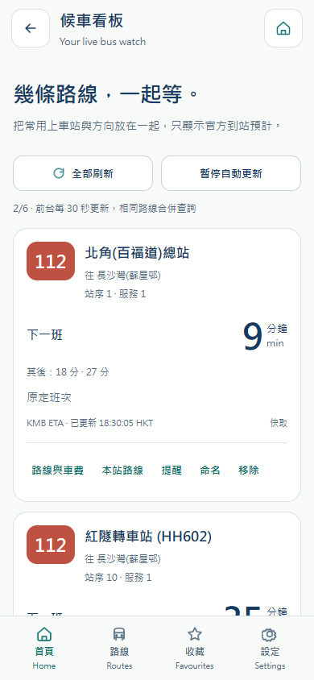
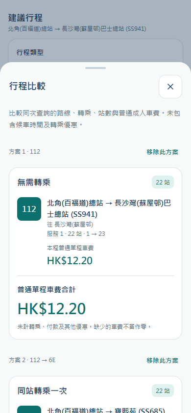
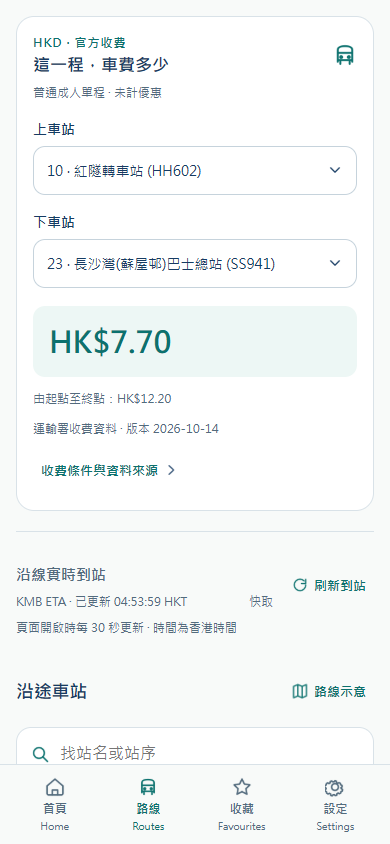
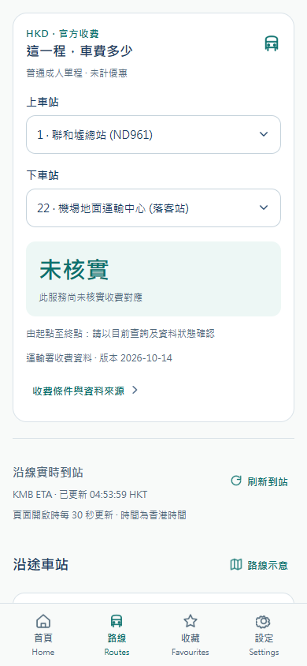
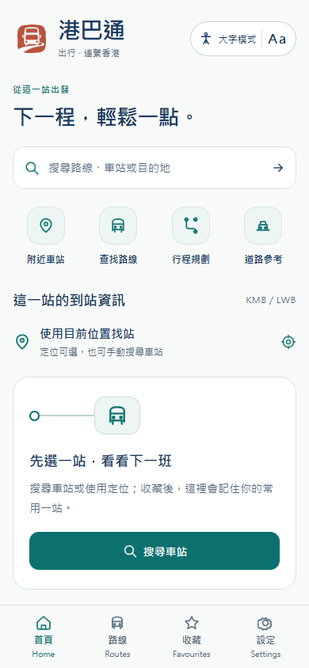
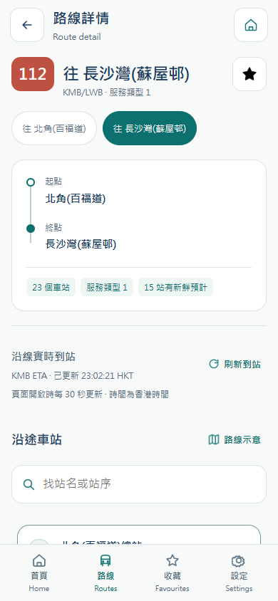
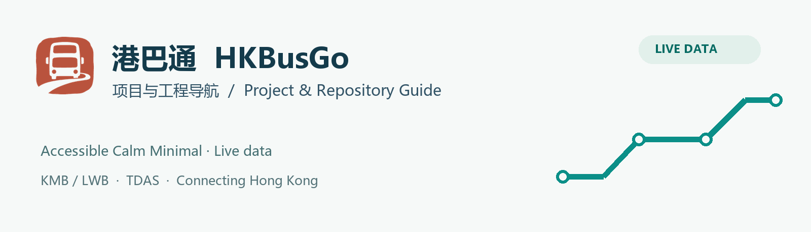

# 港巴通 HKBusGo — 项目与工程导航 / Project & Repository Guide

**2026-10-19 七项对标更新 / SG Bus alignment:** 地图、实时到站、总站时刻、收藏查车、收藏管理、道路搜索和个性化已更新。/ Real street maps, configurable arrivals, origin timetables, selected-service favourites, management, road search and local appearance controls are available. 共 17 页，客户端各 55 项测试及目标构建通过；实际 H5 专项 18 组、业务回归 28 组通过。/ 17 pages; each client passed 55 tests and its target build; the public H5 passed 18 feature and 28 regression groups. [完整规则与验收 / Requirements](docs/SGBUS-ALIGNMENT.md) · [实际网站 / Live website](https://hkbus.copypaste.hk/)。

本分支为工程导航；各运行工程保持独立。/ This branch is the project guide; runtime projects remain independent.

较早版本记录 / Earlier release records:

<!-- interactive-2026-10-18 -->
**2026-10-18 常用出行扩展 / Interactive travel extensions:** 常用行程（12 条）、精确站序候车看板（6 项）、直达/转乘和已核实票价筛选、三方案比较已上线；16 页、三语、大字、本机保存，无乘客账号。四端各 44 项测试及目标编译通过。 / Regular journeys, exact-stop live waiting board, journey filters and comparison are live. Preferences and travel collections stay on this device. Each client passed 44 tests and its target build. [需求与验收 / Requirements and acceptance](docs/INTERACTIVE-EXTENSIONS.md) · [实际网站 / Live website](https://hkbus.copypaste.hk/)。以下较早记录为历史快照 / Earlier entries are historical snapshots.

 
<!-- /interactive-2026-10-18 -->

<!-- fares-2026-10-18 -->
**2026-10-18 官方收费 / Official fares:** 路线分段查价、逐站至终点金额、行程逐段/合计和管理后台收费同步已发布。金额来自运输署官方 XML，普通成人单程、未计优惠；未核实不当作零。完整/部分/未映射方向：1150/17/444。本机喜好继续无需账号。 / Official stop-specific fares, journey totals and operations sync are live. Missing prices stay unverified; preferences stay on this device. [需求及验收 / Requirements and acceptance](docs/FARES-INTEGRATION.md) · [打开网站 / Open website](https://hkbus.copypaste.hk/)。以下较早记录为历史快照 / Earlier entries are historical snapshots.

 
<!-- /fares-2026-10-18 -->

<!-- design-refinement-2026-10-17 -->
**2026-10-17 页面与内容更新 / Passenger UI refinement:** 14 页保持 Accessible Calm Minimal，新增首页任务/收藏/继续查看、路线与站序筛选、收藏站行程选择和八个三语指南。本机资料无需账号；真实公交与 TDAS API 保持接入。四端各 26 项测试、类型检查与构建，实际网站 11 组功能 + 13 组本机回归通过。 / All 14 passenger pages have been refined with real transit data, local-only preferences and contextual guides. Four builds and actual website acceptance passed. [完整规格与验收 / Specification and acceptance](docs/DESIGN-REFINEMENT.md) · [打开正式网站 / Open HKBusGo](https://hkbus.copypaste.hk/)。以下同日较早发布记录保留为历史快照 / Earlier records below are historical snapshots.

 
<!-- /design-refinement-2026-10-17 -->

**2026-10-17 本机喜好更新 / On-device preferences:** 乘客端无需账号，语言、大字、分钟/香港时刻、首页车站、提醒阈值和历史开关即改即存；收藏、历史与提醒统一前端本机保存。真实公交 API 保持使用，旧匿名服务端资料仅兼容保留。 / Passenger preferences, favourites, history and reminders now stay on the current device without creating a server profile. Transit remains live. [需求、迁移与验收 / Requirements and acceptance](docs/LOCAL-PREFERENCES.md) · [打开实际网站 / Open actual website](https://hkbus.copypaste.hk/)。

 

**2026-10-17 实际网站已更新 / Actual website updated:** [打开港巴通 / Open HKBusGo](https://hkbus.copypaste.hk/) · [正式发布与验收 / Release and acceptance](docs/H5-SITE-LIVE.md)。线路详情已显示真实逐站 ETA、未来班次和香港时刻；245 个公网文件、14 页加载及 11 组线上浏览器检查通过。后续实际前端更新将按用户授权同步对应服务器路径。 / Real route arrivals are now published; future frontend updates are authorized to deploy after verification.

 

**2026-10-17 线路到站更新 / Live route arrivals:** [缺口检查、修复与验收 / Audit, fix and acceptance](docs/ROUTE-ARRIVALS.md)。各站 ETA、未来三班、香港时刻、官方备注、方向与站序隔离已补齐；首页/站点倒计时与前台刷新同步修复。 / Route details now show real station predictions, upcoming buses, Hong Kong times and official remarks, with direction/service/sequence isolation and foreground refresh.

共享实际页面的浏览器渲染 / Browser rendering of shared real UI；不是小程序官方 IDE 或真机截图 / These are not official mini-program IDE or physical-device screenshots.

 

**最新数据通达 / Current data status · 2026-10-17:** [真实 TDAS 修复、正式 Admin 和完整验收 / Live-data and Admin handover](docs/DATA-REACHABILITY.md)。正式 API 与 Admin 已通过实际 HTTPS 和浏览器检查；旧部署记录保留作历史快照。Production TDAS and the published Admin passed live acceptance; earlier reports are historical snapshots.

**服务端任意来源跨域 / Any-origin Backend CORS:** 正式 API 已接受任意 Origin 和请求头，55 项 HTTPS、8 项浏览器检查通过。[当前配置及证据 / Policy and evidence](docs/CORS-OPEN.md)。

**H5 dist / 浏览器版本：** [正式 API 前端导出与验证 / Production H5 export](docs/H5-DIST.md) · [部署说明 / Deployment](docs/H5-DEPLOYMENT.md)
**正式 API / Finalized API:** `https://hkbus-api.copypaste.hk/api/` · [五端编译与 HTTPS 验证 / Builds and HTTPS verification](docs/PRODUCTION-API.md)

[中文说明](#中文说明) · [English](#english) · [完整图册 / Gallery](docs/GALLERY.md) · [数据与验证 / Data & validation](docs/DATA-AND-VALIDATION.md)

[总览 / Index](https://github.com/copypasteltd/HKBUS/tree/main) · [Backend](https://github.com/copypasteltd/HKBUS/tree/backend) · [Admin](https://github.com/copypasteltd/HKBUS/tree/admin) · [微信 / WeChat](https://github.com/copypasteltd/HKBUS/tree/wechat) · [支付宝 / Alipay](https://github.com/copypasteltd/HKBUS/tree/alipay) · [抖音 / Douyin](https://github.com/copypasteltd/HKBUS/tree/douyin) · [Android](https://github.com/copypasteltd/HKBUS/tree/android)

> `main` · Accessible Calm Minimal · Live data · Live KMB/LWB + TDAS · Accessible Calm Minimal

**品牌 / Brand：已确认 10 号「朱印车迹」纯图形 Logo / Approved option 10, graphic only.** [品牌规范 / Brand guide](docs/BRAND.md) · [本次品牌验证 / Current brand checks](docs/BRAND-ROLLOUT.md)

**2026-10-17 正式部署 / Production:** API 为 `https://hkbus-api.copypaste.hk/api/`，端口 39410；TDAS/KMB 真实查询和正式 Admin 已通过验收。58 项业务、31 项数据、55 项 CORS/认证检查通过。BaoTa SQLite and daily consistent backups remain active. [当前完整中英交付 / Current handover](docs/DATA-REACHABILITY.md) · [Admin](https://hkbus-api.copypaste.hk/admin/)

## 中文说明

港巴通（HKBusGo）是面向香港 KMB／LWB 客户的巴士查询产品，参考 SG Bus 的信息结构，采用已确认的 **Accessible Calm Minimal** 视觉。路线、站点、站序与 ETA 使用 KMB/LWB 官方数据；道路参考使用 TDAS。没有接口支撑的天气、票价、车辆追踪、客流不会补造。

### 六个独立工程

同一 GitHub 远程存储六条独立工程分支，每条分支根目录就是可独立安装/构建的源码仓库。本地各有自己的 `.git`，不依赖子模块、符号链接或工作区外源码；它们不是要合并到 main 的功能分支。`main` 只承载总览、图册和跨端契约。

| 工程 / Project | 分支 / Branch | 单独克隆 / Independent clone |
|---|---|---|
| 后端服务 / Backend API | [`backend`](https://github.com/copypasteltd/HKBUS/tree/backend) | `git clone --branch backend --single-branch git@github.com:copypasteltd/HKBUS.git hkbusgo-backend` |
| 运营管理后台 / Operations Admin | [`admin`](https://github.com/copypasteltd/HKBUS/tree/admin) | `git clone --branch admin --single-branch git@github.com:copypasteltd/HKBUS.git hkbusgo-admin` |
| 微信小程序 / WeChat Mini Program | [`wechat`](https://github.com/copypasteltd/HKBUS/tree/wechat) | `git clone --branch wechat --single-branch git@github.com:copypasteltd/HKBUS.git hkbusgo-wechat` |
| 支付宝小程序 / Alipay Mini Program | [`alipay`](https://github.com/copypasteltd/HKBUS/tree/alipay) | `git clone --branch alipay --single-branch git@github.com:copypasteltd/HKBUS.git hkbusgo-alipay` |
| 抖音小程序 / Douyin Mini Program | [`douyin`](https://github.com/copypasteltd/HKBUS/tree/douyin) | `git clone --branch douyin --single-branch git@github.com:copypasteltd/HKBUS.git hkbusgo-douyin` |
| Android 应用 / Android App | [`android`](https://github.com/copypasteltd/HKBUS/tree/android) | `git clone --branch android --single-branch git@github.com:copypasteltd/HKBUS.git hkbusgo-android` |

先启动 Backend，再运行 Admin 或一个移动端。移动端四个分支各自包含完整 Taro 共用代码快照和锁文件；Android 额外包含原生工程。共用逻辑/API 变更应跨四端同步并分别验证，没有自动跨分支合并机制。

在 main 克隆目录可执行 `pwsh -NoProfile -File scripts/clone-all.ps1 -Destination ../hkbusgo-workspace` 建立六个并列克隆；配置好 SDK/API 后，以 `pwsh -NoProfile -File scripts/build-all.ps1 -Workspace ../hkbusgo-workspace` 依序安装、检查和构建。脚本拒绝覆盖已有克隆，不负责部署。

### 产品截图

| 首页 / Home | 到站 / Arrivals | 道路 / Traffic |
|---|---|---|
|  |  |  |

截图为实际应用与真实 API 的浏览器结果；**不是小程序官方 IDE 或手机截图**。附近定位使用官方站点坐标作浏览器输入，后台流量仅为隔离文档检查请求。没有生成虚构通告或隐藏真实无预计状态。查看 [全部 14 页与后台图册](docs/GALLERY.md)、[图片来源](docs/ASSETS.md)。

### 功能与交付边界

四端包含首页、路线、搜索、附近、到站、完整站序、收藏、设置、通告、通知详情、帮助、提醒、行程、道路 14 页；支持繁中、简中、英文、大字、位置拒绝恢复、明确时效与匿名数据删除。Admin 提供真实目录、运营内容审核发布、功能配置、数据源、同步任务、审计和账号。Backend 提供事务持久化、官方适配、缓存隔离、身份和权限。

提醒仅在页面开启时接收，Android 可产生本地通知；不承诺关 App 后推送。行程为官方站序候选，步行为直线估算，地图为坐标示意；TDAS 不替代巴士 ETA。覆盖仅为 KMB/LWB。数据规则见 [Data & validation](docs/DATA-AND-VALIDATION.md)。

### 开始与验证

所有工程使用 Node.js 22.14+、npm 10、Windows 原生工具；Android 还需 JDK 21 和 SDK 36。各分支 README 提供安装、配置、构建、联调、故障定位和发行说明。默认接口为本机 4100，网络使用需要真实 HTTPS BFF；三个小程序需要各自 AppID/合法域名，Android 需要发行签名。

既有真实数据基线通过 29 项回归及 14 项真实 API/浏览器检查。分仓后 `npm ci`、类型、测试与各自构建结果见 [分仓验证](docs/validation.json)。编译、接口、浏览器、官方 IDE、真机、商店验收彼此不能替代；后三者仍未完成。Backend 高端口与宝塔数据库已部署，当前数据与平台验收边界见 [本次部署记录](docs/DEPLOYMENT.md)。历史 demo、纯假数据原型及 Vercel 未修改或部署。

各工程固定提交与素材核查清单见 [repositories.json](docs/repositories.json)。

仓库不含本机环境、数据库、客户记录、令牌、keystore、node_modules 或构建缓存。文档不授予未经权利人确认的开源许可。

## English

HKBusGo is a Hong Kong KMB/LWB bus information product with a SG Bus-inspired information structure and the approved **Accessible Calm Minimal** visual direction. Official KMB/LWB data provides routes, stops, sequences and ETA; TDAS provides a separate road reference. Unsupported weather, fares, vehicle positions and crowding are not invented.

### Six independent projects

One GitHub remote stores six independent project branches. Each branch root is a complete installable/buildable project with its own local `.git`, without submodules, symlinks or external sibling source dependencies. These are project branches, not feature branches to merge into main. `main` contains the index, gallery and cross-platform contracts.

Use the branch table above to clone only the project you need. Start Backend first, then Admin or a mobile client. Each mobile branch includes its own complete Taro shared-code snapshot and lockfile; Android additionally includes the native project. Common logic/API changes must be ported and validated across all four; there is no automatic cross-branch merge.

From the main checkout, `pwsh -NoProfile -File scripts/clone-all.ps1 -Destination ../hkbusgo-workspace` creates six sibling clones. After configuring SDK/API values, `pwsh -NoProfile -File scripts/build-all.ps1 -Workspace ../hkbusgo-workspace` installs, checks and builds them sequentially. Existing clones are never overwritten. Neither script deploys services.

### Product, images and scope

The 14 mobile pages cover Home, Routes, Search, Nearby, Arrivals, Route detail, Bookmarks, Settings, Notices, Notice detail, Help, Reminders, Planner and Traffic. They support Traditional/Simplified Chinese and English, large text, location-denial recovery, freshness and anonymous-data deletion. Admin manages the real catalogue, reviewed content, configuration, providers, jobs, audit and accounts. Backend provides persistence, real adapters, partitioned caching, identity and permissions.

The screenshots above and [gallery](docs/GALLERY.md) show actual browser UI and real APIs, **not mini-program IDE or physical-device captures**. Browser location uses official stop coordinates as input. Admin metrics are isolated documentation traffic. Genuine empty notices and no-estimate states are preserved. See [provenance](docs/ASSETS.md).

Reminders are received while open; Android can issue local notifications, without promised closed-app push. Journey candidates derive from official sequences. Walking is a straight-line estimate, the stop diagram is not navigation, and TDAS is not bus ETA. Coverage remains KMB/LWB. See [data and validation](docs/DATA-AND-VALIDATION.md).

### Development and acceptance

Use Node.js 22.14+, npm 10 and native Windows tooling; Android also needs JDK 21 and SDK 36. Each branch README documents setup, configuration, build, integration, troubleshooting and release. The default endpoint is local port 4100; network use requires a real HTTPS BFF. Mini-programs need their own AppIDs/domain configuration, and Android needs release signing.

The preceding real-data baseline passed 29 regression and 14 real API/browser checks. Standalone installation, types, tests and builds are recorded in [validation.json](docs/validation.json). Source, build, API, browser, official IDE, physical-device and store acceptance are separate. Backend hosting and BaoTa SQLite are now deployed; Current connectivity and platform acceptance are documented in the [deployment handover](docs/DEPLOYMENT.md). IDE/device/store acceptance remains outstanding. Historical demos/prototypes/Vercel were not changed or deployed.

Pinned project commits and documentation checks are listed in [repositories.json](docs/repositories.json).

No local environments, databases, customer records, tokens, keystores, node_modules or build caches are committed. This documentation does not grant an unconfirmed open-source licence.
