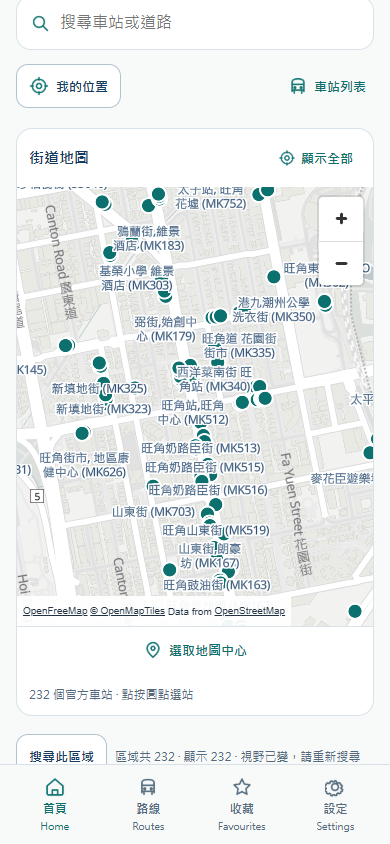
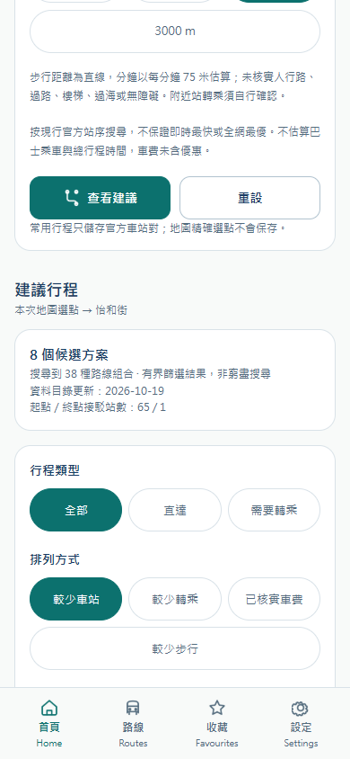
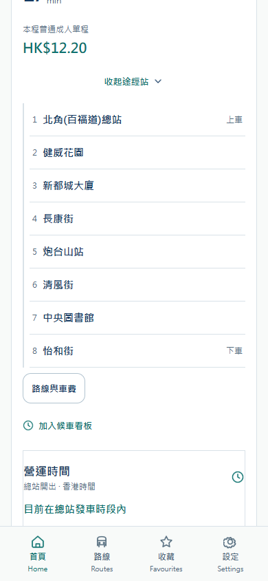
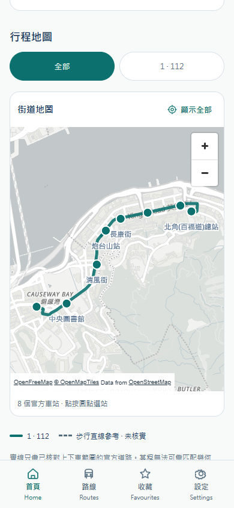
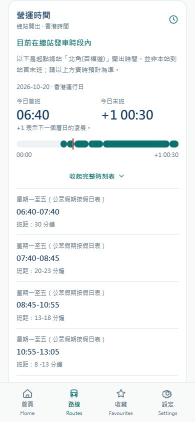
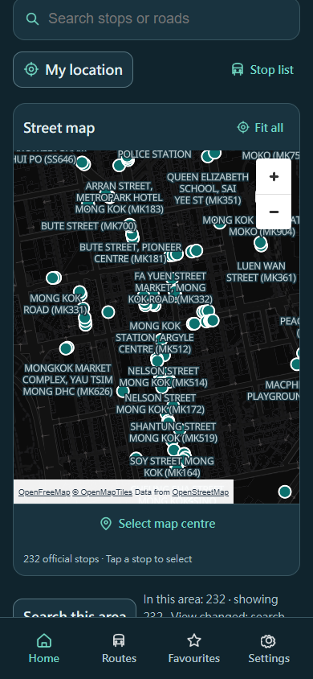

# 港巴通 HKBusGo — Android / H5 / Android / H5

2026-10-20 · Accessible Calm Minimal · Logo 10 · Taro 4.3 / React / TypeScript

[需求与验收 / Requirements](docs/MAP-PLANNER.md) · [API 与事务 / API contracts](docs/MAP-PLANNER-API.md) · [SG Bus 对照 / Comparison](docs/SGBUS-COMPARISON.md) · [正式网站 / Live website](https://hkbus.copypaste.hk/) · [品牌 / Brand](docs/BRAND.md)

  

## 中文说明

本分支是 **Android / H5独立 Git 工程**，含源代码、测试、锁文件、配置与图形资源，不依赖兄弟仓库或子模块。实际正式 API 为 `https://hkbus-api.copypaste.hk/api/`。KMB/LWB 提供真实目录/ETA，核对后的九巴官网元数据提供道路/几何/总站时刻，政府假期日历辅助运行日；TDAS 道路时间独立展示。

| 功能 | 业务内容 |
| --- | --- |
| 地图与发现 | 独立地图、真实视野站数/截断、搜索区域/车站/道路、点站/列表、定位及本次地图选点；小程序原生 Map，H5/Android MapLibre/OpenFreeMap |
| 完整行程 | 官方站或内存点起终点、最多两次转乘、默认同站/可选邻站、接驳与总步行限制、筛选/排序/三方案比较、完整途经站与分段地图 |
| 出发核查 | 当前精确路线/方向/服务/重复站序、连接、真实本站 ETA、官方总站运营参考和各程成人普通单程报价；不承诺后续换乘成功 |
| 到站和收藏 | 两班/三班、网格/列表、分钟/香港时刻、前台更新、收藏内直接到站/指定服务、置顶/命名/排序/确认删除、最近十站 |
| 本机工具 | 常用官方站对、候车看板、前台提醒、繁简英、浅/深/系统主题、小/中/大字、显示记忆、迁移与保存失败反馈 |
| 交通与内容 | 独立 TDAS 道路参考、通告、12 个三语帮助主题与实际来源/数据年龄 |

共 **19 页**：Home、Routes、Search、Nearby、Arrivals、Route、Bookmarks、Settings、Notices、Notice、Help、Reminders、Planner、Traffic、Trips、Watchboard、Road、Map、Journey。四栏导航不变。地图完成本站流程，当前网络仍仅 KMB/LWB。

### 安装和构建

```powershell
git clone --branch android --single-branch git@github.com:copypasteltd/HKBUS.git hkbusgo-android
cd hkbusgo-android
npm ci
npm run typecheck
npm test
npm run build:h5
```

Node.js >=22.14；输出 `dist/h5`。使用 Windows 原生工具，不调用 Docker、WSL、虚拟机或模拟器。本地调试可在构建前设置 `TARO_APP_API_BASE`。不要在 README/源码保存服务器密码或平台私钥。

原生构建需 JDK 21 和 Android SDK 36，设置 JAVA_HOME/ANDROID_HOME，再运行 `npm run build`，输出 `android/app/build/outputs/apk/debug/app-debug.apk`。`npm run release:h5` 做验证构建，`npm run deploy:h5` 发布已授权正式站并保留回滚。[H5 发布说明](docs/H5-DEPLOYMENT.md)。APK 为 Debug，未做商店签名和上架。

Set native JDK 21 / Android SDK 36, then run `npm run build` for a debug APK. `release:h5` verifies the web build; `deploy:h5` publishes the authorized actual website with rollback. Store signing and submission are separate.

### 数据、隐私和验证

乘客没有账号或匿名云档案；不调用 profile API 或发送乘客凭据。偏好、收藏、最近、提醒、常用站对及看板仅本机保存，各设备/平台不互相同步。重设偏好保留集合，完整清除才移除集合、查询缓存和内存草稿；同源标签页共享清除边界。精确 GPS/地图点/视野只在内存和当次查询，不持久化或写入地址栏；常用行程只能保存官方站对。详情最多保留本次 30 分钟，刷新需重新规划。

路线搜索有界且非穷尽，最多三程；结果不代表实时最快/全网最低票价。步行按 75 米每分钟直线参考，未验证道路、过街、过海或无障碍。没有可靠乘车/总时间、车辆 GPS/车型/拥挤度、其他香港营办商/铁路或关闭后的推送。总站时刻不是中途站首末班；结构核查 valid 不是班次营运保证；空 ETA/旧值/接口失败分开处理。官方几何失配只显示站点，不画假公交线。

本次各客户端 **62 项测试**及目标构建通过；Backend 72 项业务/3 项出口测试；正式 H5 **22 组地图规划 + 18 组既有能力 + 28 组回归**通过，19 页与 256 文件核验。下面是**实际正式 H5 移动浏览器截图**，不是本端官方 IDE 或真机截图。官方 IDE、原生地图/定位/主题/分享、手机长时运行、平台上传与商店发行仍未验收。

| 行程地图 | 总站参考 | 深色英文大字 |
| --- | --- | --- |
|  |  |  |

## English

This self-contained **Android / H5** repository includes source, tests, locked dependencies, assets and platform configuration. It needs no sibling checkout. The production API is `https://hkbus-api.copypaste.hk/api/`. KMB/LWB provides live transit data; verified official metadata supplies roads, selected geometry and origin timetables. TDAS remains a separate road reference.

The 19 pages add independent viewport discovery and a complete checked itinerary to the existing arrivals, favourites, planning, regular journeys, waiting board and local settings. Planning accepts an official stop or session-only WGS84 point per endpoint, up to two transfers and explicit walking limits. It revalidates exact route/direction/service/stop occurrences, shows current boarding-stop forecasts and fares, and clips official geometry to each selected leg. All walking is an unverified straight-line estimate; results are bounded and do not promise fastest/cheapest travel or a successful future connection.

Use Node >=22.14 and the native Windows commands above; output is `dist/h5`. Configure your own platform AppID and native map/location permissions. Android requires native JDK 21 / SDK 36 and produces a debug APK, not a store-signed release.

Preferences and collections remain on-device without accounts or cloud profiles. Precise points and location stay in memory and the current request, outside persistent caches and address-bar parameters. Reset preferences preserves travel collections; clear all removes them and invalidates session drafts. Remembered itineraries expire after 30 minutes or refresh. Official-stop pairs remain reusable locally; precise-point journeys are not saved.

Each client passed 62 tests and its target build; the backend passed 72 business and three egress tests. The actual public H5 passed 22 map/journey, 18 existing-feature and 28 regression groups, with 256 matching assets. Screenshots demonstrate the real public H5 only. Official IDE, physical-device, native map/location/theme, platform-upload and store acceptance remain separate. Vehicle GPS/type/occupancy, rail, verified pedestrian routing and closed-app push are unavailable. Earlier documents retain dated historical counts.

## 独立工程 / Repositories

[Main](https://github.com/copypasteltd/HKBUS/tree/main) · [Backend](https://github.com/copypasteltd/HKBUS/tree/backend) · [Admin](https://github.com/copypasteltd/HKBUS/tree/admin) · [WeChat](https://github.com/copypasteltd/HKBUS/tree/wechat) · [Alipay](https://github.com/copypasteltd/HKBUS/tree/alipay) · [Douyin](https://github.com/copypasteltd/HKBUS/tree/douyin) · [Android / H5](https://github.com/copypasteltd/HKBUS/tree/android)
