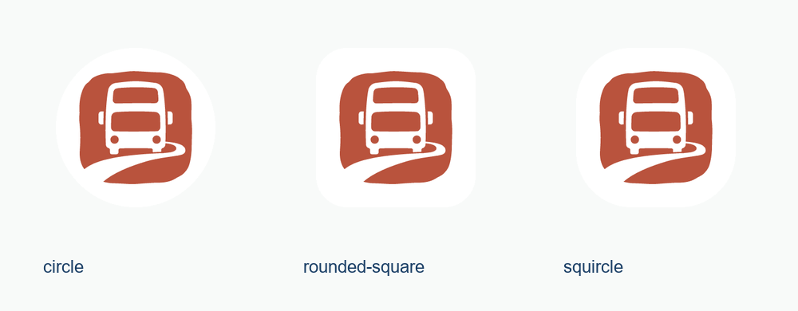

# 港巴通品牌图形规范 / HKBusGo Graphic Brand Guide

- 品牌资产版本 / Asset version：**1.0.0**
- 确认日期 / Approved：**2026-10-17**
- 已确认方案 / Approved option：**10 · 朱印车迹 / Contemporary Seal**
- 图形约束 / Graphic constraint：**纯图形，无中文、英文、字母、数字或宣传语 / Graphic only, no wordmark, letters, numbers or slogan**
- 界面基线 / UI baseline：Accessible Calm Minimal

## 中文规范

### 图形与母版

采用用户确认的 10 号图形：朱红印章轮廓、双层巴士白色负形与向前延伸的道路。保留原始印章边缘的轻微不规则感。根据选定图形提取闭合矢量轮廓、统一为实色，并保留两个车窗、车灯、后视镜与道路负形；不重新生成另一款图形。

原始生成稿为选型依据；[矢量母版](assets/brand/logo-primary.svg)是后续导出和工程引用的唯一图形来源。原图与规范化母版都保留在素材目录，来源和哈希记录在 [manifest.json](assets/brand/manifest.json)。

### 配色与界面关系

| 用途 | 色值 | 规则 |
|---|---|---|
| Logo 主色 | `#B9533D` | 朱红实色，浅色背景使用 |
| 单色 Logo | `#163B63` | 深蓝单色，适合单色输出 |
| 反白 Logo | `#FFFFFF` | 深色背景使用 |
| 界面操作色 | `#0C716E` | 沿用实际工程青绿色，用于按钮和选中状态 |
| 文字与页面 | `#163B63` / `#F8FAF9` | 沿用深蓝文字与暖白页面 |

Logo 朱红不是错误、延误或即将到站状态色。业务状态继续通过原有图标、文字和状态 token 表达。产品名称可作为页面文字独立排在 Logo 外侧，不能嵌进图形文件。

### 比例、留白与尺寸

| 项目 | 规格 |
|---|---|
| SVG 画布 | `viewBox="0 0 1024 1024"` |
| 图形最大边长 | 768 单位，保持原图比例 |
| 基础留白 | 四侧至少约 128 单位，即图形最大边长的 1/6；应用导出已包含 |
| 独立图形建议尺寸 | 48 CSS px 或更大；32 px 为紧凑用途；24 px 仅作浏览器小图标使用 |
| 小程序与高密度屏 | 使用对应 PNG 导出，256 px 文件用于页面 Logo，避免下载 1024 px 原图 |
| App / 平台头像 | 提供 512 与 1024 px 白底实色 PNG，平台后台上传与官方预览另行验收 |
| 图形内文字 | 不允许；选型编号也不能保留在正式素材中 |

不得拉伸、旋转、裁掉道路尾部、填平白色负形，或用通用巴士图标替换。朱红版用于浅色表面，深色表面使用反白版；不对 Logo 施加阴影、发光或动画。

### 无障碍与页面使用

Logo 与可见「港巴通」文字相邻时作为装饰图形，设置 `aria-hidden` / `ariaHidden`，避免重复朗读。Logo 单独承担品牌含义时提供「港巴通」替代文本。图形不是按钮，不增加无意义的点击行为。独立的返回、首页、路线与公交功能图标保留各自语义。

首页品牌区允许换行，品牌图形固定比例，不挤压大字模式按钮或造成窄屏横向滚动。关于页、后台登录和侧栏使用相同图形来源。浏览器 favicon、Android 启动、桌面、单色主题图标与本地通知小图标均由母版导出。

移动端品牌区的 Logo 显示框最小为 48 CSS px，相邻大字模式按钮触控高度最小为 44 CSS px。这两项下限不随 Taro 的视口单位换算缩小；320 px 窄屏、三语和大字模式的浏览器检查单独留存。

### Android

提供五档 legacy/round 图标和透明 adaptive 前景，背景为白色。API 33+ 另提供单色主题图标，通知小图标使用纯白图形 alpha。启动画面使用独立矢量标志与暖白背景。

圆形、圆角方形和 squircle 的静态遮罩检查都保留完整图形。上图是计算生成的适配预览，不是真机桌面截图；编译产物和资源检查、官方 IDE、设备启动及通知验收分别记录。

启动图形采用同一安全范围，避免系统遮罩裁掉印章和道路。画布与遮罩处理参考 Android 官方的 [Adaptive icons](https://developer.android.com/develop/ui/compose/system/icon_design_adaptive) 和 [Splash screens](https://developer.android.com/develop/ui/views/launch/splash-screen) 规范。

### 素材入口

| 素材 | 文件 |
|---|---|
| 朱红矢量母版 | [logo-primary.svg](assets/brand/logo-primary.svg) |
| 深蓝单色矢量 | [logo-ink.svg](assets/brand/logo-ink.svg) |
| 深色表面反白矢量 | [logo-white.svg](assets/brand/logo-white.svg) |
| 透明 PNG | [256 px](assets/brand/logo-primary-256.png) · [1024 px](assets/brand/logo-primary-1024.png) |
| 平台头像 / App 图标 | [512 px](assets/brand/app-icon-512.png) · [1024 px](assets/brand/app-icon-1024.png) |
| 已选原图 | [selected-source-10.png](assets/brand/selected-source-10.png) |
| 规范总览 | [brand-overview.png](assets/brand/brand-overview.png) |
| 素材清单 | [manifest.json](assets/brand/manifest.json) |

## English

**Option 10, Contemporary Seal, is the approved HKBusGo graphic logo.** The mark combines a vermilion seal silhouette, a double-decker bus and a sweeping road in negative space. It contains no words, Chinese characters, alphabetic monogram, numbers or slogan. Product-name text belongs outside the graphic.

The selected raster concept is retained for provenance. Its closed contours are traced and simplified within 0.55 source pixels, then exported as solid-colour SVG paths with the original negative-space construction. The primary SVG is the source of truth for all future exports; do not regenerate or replace it with a generic bus icon.

Use vermilion `#B9533D` on light surfaces, navy `#163B63` for monochrome reproduction, and the white version on dark surfaces. Keep the existing Accessible Calm Minimal navy, teal and warm-white interface palette. Brand colour does not replace operational error, delay or arrival states.

The SVG canvas is 1024 × 1024; the mark spans at most 768 units, leaving about 128 units per side. Keep proportions and included clear space. Prefer a display box of 48 CSS px or more; 32 px is for compact use and 24 px is reserved for favicon use. PNG exports support mini-program compatibility and high-density screens. White-background 512/1024 px assets support platform upload workflows, whose actual acceptance remains separate.

Do not stretch, rotate, crop the road, fill negative spaces, add words, recolour arbitrarily, or apply shadows/glow. Decorative logos next to a visible product name are hidden from the accessibility tree. Standalone meaningful logos have a brand text alternative. The logo itself has no invented click action.

The mobile brand header preserves a minimum 48 CSS-pixel logo box and a minimum 44 CSS-pixel target height for the adjacent reading-mode control. These minimums are excluded from viewport scaling. Narrow-screen, language and large-text browser checks are recorded separately.

Android includes legacy/round images at five densities, a transparent adaptive foreground, API 33+ monochrome resources, a white-alpha notification symbol and a vector splash mark. The mask illustration is a calculated static preview, not a phone screenshot. Compilation, resource inspection, official IDE review, physical launch/notification checks and publication remain distinct.

The asset links above are self-contained within this checkout. Runtime assets are bundled locally; no image-generation gateway or external image CDN is required to render the logo.
