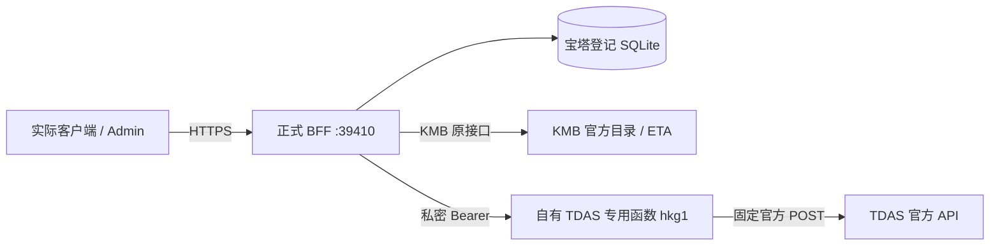

# 港巴通数据通达检查与修复 · 2026-10-17

本次范围是实际 Backend、Admin、微信/支付宝/抖音小程序与 Android/H5 共用的数据链路。正式 API 继续为 `https://hkbus-api.copypaste.hk/api/`，服务端口 39410。历史纯假数据原型及 demo 不在本次范围内。

本文先记录已核实的原因和实现；生产 BFF 的发布、完整接口与浏览器验收结果将在实际执行后补齐。不能用下面的独立出口成功，代替正式产品查询成功。

## 已核实的原因

2026-10-17，生产主机访问 TDAS 官方规格 PDF 为 200，但对官方道路 API 的合法 POST 收到 `403 / awselb/2.0`。相同请求从 Windows 本机返回 200，取得官方道路分段、3,953 米距离与 `00:06` 时间。生产主机对官方当前三个 DNS 节点及 HTTP/1.1 的请求均是 403。因此已经证明拒绝与请求来源有关；没有证据确定是哪个地区、ASN 或运营商访问策略，不能把推断当作官方解释。

这与本服务的 CORS 无关。此前后端把所有上游 HTTP 错误视为可重试，并按供应商累计最近失败，导致重复请求和 TDAS 熔断；仅重启、放开 CORS 或打开功能开关都不能解决源站拒绝。

证据：[服务器基线](assets/data-reachability/2026-10-17/baseline-server.json)、[本机基线](assets/data-reachability/2026-10-17/baseline-windows.json)、[生产出口矩阵](assets/data-reachability/2026-10-17/upstream-network-matrix.json)。这些是修复前的历史事实，不代表修复后的正式链路状态。

## 实际数据路径与修复

新建的 `hkbusgo-tdas-egress` 是实际后端传输组件，位于现有受管理账号下。生产服务器调用它已验证：无鉴权 401；合法鉴权查询 200，`X-HKBus-Region: hkg1`、`X-HKBus-Upstream-Status: 200`；错误坐标 422。成功响应是官方 JSON，未生成替代时间、距离、道路分段或 ETA。[出口实测](assets/data-reachability/2026-10-17/egress-probe.json)。

后端通过私密 `TDAS_EGRESS_URL` / `TDAS_EGRESS_SECRET` 使用该传输；不配置出口的主机仍可直连官方 API。客户端继续只调用正式 BFF，既不持有出口密钥，也不修改其正式 API 地址。出口不接收任意 URL，只允许 TDAS 已定义的香港起终点、时段、语言、路径类型和海隧参数。平台网页 SSO 只对本新建专用项目关闭；应用层 Bearer 仍强制校验。

后端保留公开道路结果契约，真实解析官方 `HH:MM` 为秒、距离米、平均速度、道路段和海隧替代结果。`generatedAt` 表示取得本次响应的时间；官方响应没有给出独立数据更新时间字段，不能把该字段宣称为交通观测时间。道路结果保持 60 秒缓存，不用过期结果冒充新数据；缓存和并发合并按实际传输地址及完整请求区分。

错误处理现在区分：无匹配道路 422 / ROAD_MATCH_FAILED、出口认证失败、官方拒绝、上游限流、连接失败、超时和格式错误。位置无匹配不触发供应商熔断；明确认证/拒绝不重复尝试；真正暂时故障最多两次请求。熔断按供应商与操作/传输隔离，旧直连失败不能阻止新出口。TDAS JSON 和时间校验成功后才记录成功；失败记录与历史成功率保留。

第一轮密集场景检查在多次成功后遇到短暂官方 403。随后低频复查，同一个无匹配请求为官方 400，前后正常请求均为 200，证明不能把该次拒绝解释成坐标本身不被支持。准确的上游策略与阈值未公布，不能声称已测得官方限额。[首次矩阵](assets/data-reachability/2026-10-17/https-data-initial.json)、[事后诊断](assets/data-reachability/2026-10-17/boundary-diagnosis.json)、[原请求低频对照](assets/data-reachability/2026-10-17/original-no-match-controlled.json)。

为降低突发请求，BFF 新增 `TDAS_MIN_INTERVAL_MS=4000` 默认节流：不同道路请求发往上游的起始时间至少相隔四秒；相同请求继续合并或使用真实 60 秒缓存。排队最多四秒，超出时明确 429 / TDAS_BUSY，不假报上游失败；一次 TDAS 请求含重试最多占用约 30 秒预算，给客户端 35 秒超时保留余量。KMB 不进入该节流队列。四秒是本产品的保守配置，不是官方公布的限额，也不代表无限容量保证。

`GET /api/health` 的 `status` 继续表示应用及目录是否就绪；新增 `dataStatus`、`dataServices` 分别报告 KMB、TDAS 最近五分钟的实际请求结果。没有近期请求是 `unverified`，近期失败是 `degraded`，两个来源都有近期有效请求才是 `healthy`。这个接口不会自己反复调用上游，也不承诺未来请求永远成功。

## 数据与业务检查清单

| 数据/业务 | 真实来源与规则 | 验收所需证据 |
|---|---|---|
| 线路、方向、服务类型 | KMB 官方目录；route/bound/service_type 合成身份 | 实际全量同步成功、方向独立、真实数量 |
| 车站、经纬度、三语名称 | KMB 官方车站；原 ID 保留 | 详情、搜索、三语字段、坐标有效 |
| 完整站序 | KMB route-stop；引用完整后原子发布 | 顺序及外键校验、同步失败保留完整旧版 |
| KMB 实时到站 | 官方 stop-eta；按路线/方向/服务/站序过滤 | 冷请求真实 fresh 结果、缓存状态、非空实际 ETA |
| TDAS 道路 | 专用鉴权传输至固定官方 API | 正式域名冷请求 200、分段/时间/距离有效，与官方原始响应对应 |
| TDAS 语言/时段/海隧 | 官方 tc/sc/en、0 至 90 分钟、ST/SD、cht/eht/wht | 多个真实请求组合；不将道路时间混作巴士 ETA |
| 首页、附近、搜索 | 真实 KMB 目录/ETA 与用户定位 | 无定位明确提示；指定站首页与距离排序正确 |
| 行程候选 | 真实站序的直达/同站转乘 | 候选引用真实线路及站点；不伪造票价、步行导航或巴士总耗时 |
| 服务通告 | 经运营审核发布的业务内容 | 查询链路正常；空结果如实显示，不填入假通告 |
| 收藏、最近查看 | 当前用户在生产数据库的实际操作 | 写入、读取、排序、删除、越权与会话轮换 |
| 提醒、通知 | 当前用户设置与真实新鲜 ETA | 建立/暂停/恢复/删除；仅页内提醒，不宣称平台推送已接入 |
| Admin 与配置 | 正式账号、版本化设置、审计/任务 | Cookie 登录/身份/退出、目录/数据源/任务读取、真实同步 |
| 数据库存储和恢复 | 宝塔登记的同一 SQLite | 重启持久化、一致性快照、完整性与外键检查 |
| 实际客户端 | 当前已编译客户端与正式 HTTPS BFF | 浏览器实际页面/网络截图；编译与 IDE/真机/上架分别登记 |

## 发布与验证门槛

Windows 原生执行 Backend 类型检查、34 项后端测试及 3 项出口测试、编译；生产服务器原生执行同样检查后再发布。新增测试涵盖私密鉴权、直连保留、原始结果映射、并发合并、缓存、认证/拒绝不重试、无匹配不熔断、可重试错误、非法响应不记录成功、传输隔离、配置校验、请求间隔与有界排队。[本机构建记录](assets/data-reachability/2026-10-17/backend-build.json)。

新 `deploy/linux/update-data.sh` 在已有安装上先做一致性备份并构建隔离 release；私密出口配置单独以 0600 文件传输，只改两个 TDAS_EGRESS 环境项。原子切换后必须取得真实 TDAS 和 KMB 数据，否则恢复旧 release 与旧环境。端口、数据库、宝塔登记、每日备份和其他环境项保持原配置。不能重跑首次安装脚本，也不能把单纯 `status: ok` 当作数据验收。

生产发布、完整 HTTPS 检查、多场景道路检查、客户端真实页面和最终交付记录：待实际执行后补齐。

## 运维与外部边界

专用函数与其账号使用额度是新增运维依赖。迁移时应先验证替代的自有香港出口，再原子替换 BFF URL/密钥；轮换时先部署新值并验证，再切换后端并撤销旧部署。不能仅换一端密钥。任何密码、JWT、Cookie、出口密钥或平台 token 均不进入 Git、截图、公开文档或编译包。

本次不会把 browser 检查冒充微信/支付宝/抖音官方 IDE 或真机验收；发行 AppID、平台请求合法域名、隐私资质、签名和商店审核依然需要对应平台身份。这个边界不改变本次对正式数据接口必须真实可用的要求。

TDAS 的请求参数与道路参考语义以[官方 API 规格](https://tdas-api.hkemobility.gov.hk/tdas/specification/TD_TDAS_API_Specifications.pdf)及[官方数据集](https://data.gov.hk/en-data/dataset/hk-td-tis_28-traffic-data-tdas)为准。KMB 以[官方开放数据集](https://data.gov.hk/en-data/dataset/hk-td-tis_21-etakmb)为准。

## English

This repair concerns the actual production data chain. The production host's legitimate TDAS POST receives 403, while the identical request succeeds from Windows and from an owned authenticated function in Hong Kong. The exact policy behind the source-dependent refusal is unknown. Opening this service's CORS cannot fix it.

The BFF uses a private TDAS-only egress with a fixed official upstream and unchanged public result contract. Official successful JSON is preserved, credentials remain server-side, and no alternative estimates or datasets are substituted. Errors, retries, schema checks, operation-scoped circuits and sixty-second road caching are explicit. Health now separates process readiness from provider observations in the last five minutes; no recent observation means unverified.

Publication requires actual TDAS and KMB results after an isolated tested release switch, with rollback of both release and private environment on failure. Source, automated tests/builds, real HTTPS requests and browser acceptance are separate from official mini-program IDE, physical-device and store acceptance. Production acceptance evidence and final delivery details will be added only after execution.
