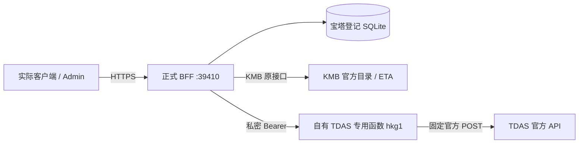
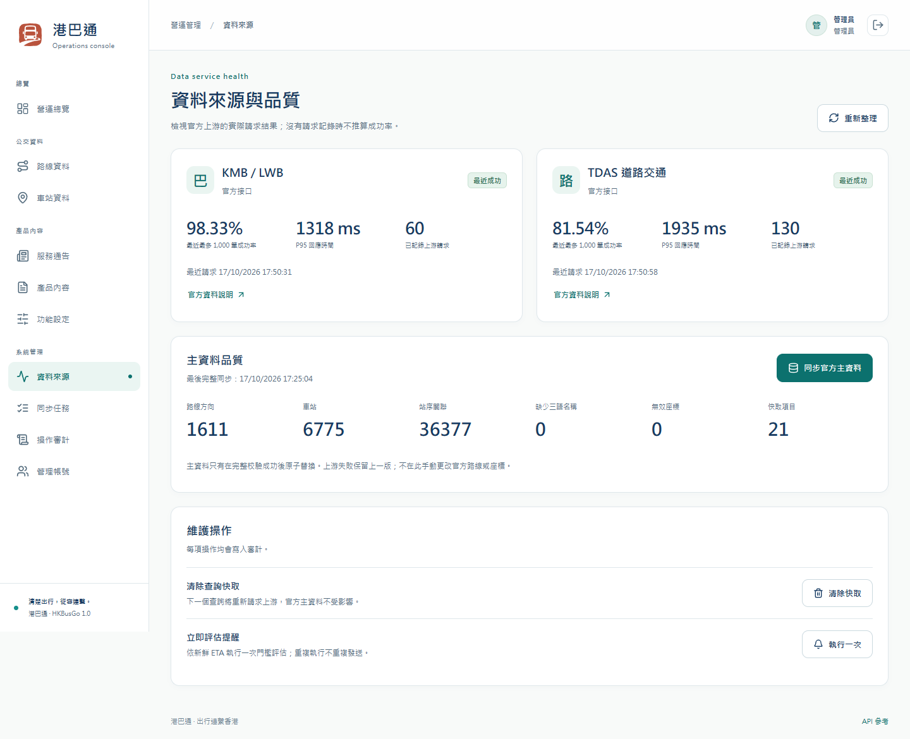
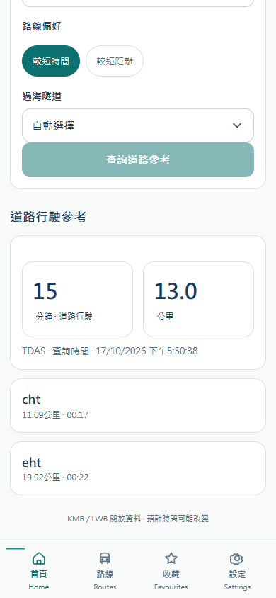

# 港巴通数据通达检查与修复 · 2026-10-17

本次范围是实际 Backend、Admin、微信/支付宝/抖音小程序与 Android/H5 共用的数据链路。正式 API 继续为 `https://hkbus-api.copypaste.hk/api/`，服务端口 39410。历史纯假数据原型及 demo 不在本次范围内。

正式 BFF 已发布并取得真实 TDAS/KMB 数据。31 项正式 HTTPS 数据检查、58 项服务业务检查、55 项 CORS/认证检查全部通过；Windows 原生浏览器验证了 H5 全部 14 页、Android 渲染层及真实已发布 Admin 的 10 个功能页。具体证据、网络范围与平台验收边界见下文。

## 已核实的原因

2026-10-17，生产主机访问 TDAS 官方规格 PDF 为 200，但对官方道路 API 的合法 POST 收到 `403 / awselb/2.0`。相同请求从 Windows 本机返回 200，取得官方道路分段、3,953 米距离与 `00:06` 时间。生产主机对官方当前三个 DNS 节点及 HTTP/1.1 的请求均是 403。因此已经证明拒绝与请求来源有关；没有证据确定是哪个地区、ASN 或运营商访问策略，不能把推断当作官方解释。

这与本服务的 CORS 无关。此前后端把所有上游 HTTP 错误视为可重试，并按供应商累计最近失败，导致重复请求和 TDAS 熔断；仅重启、放开 CORS 或打开功能开关都不能解决源站拒绝。

证据：[服务器基线](assets/data-reachability/2026-10-17/baseline-server.json)、[本机基线](assets/data-reachability/2026-10-17/baseline-windows.json)、[生产出口矩阵](assets/data-reachability/2026-10-17/upstream-network-matrix.json)。这些是修复前的历史事实，不代表修复后的正式链路状态。

## 实际数据路径与修复

新建的 `hkbusgo-tdas-egress` 是实际后端传输组件，位于现有受管理账号下。生产服务器调用它已验证：无鉴权 401；合法鉴权查询 200，`X-HKBus-Region: hkg1`、`X-HKBus-Upstream-Status: 200`；错误坐标 422。成功响应是官方 JSON，未生成替代时间、距离、道路分段或 ETA。[出口实测](assets/data-reachability/2026-10-17/egress-probe.json)。

后端通过私密 `TDAS_EGRESS_URL` / `TDAS_EGRESS_SECRET` 使用该传输；不配置出口的主机仍可直连官方 API。客户端继续只调用正式 BFF，既不持有出口密钥，也不修改其正式 API 地址。出口不接收任意 URL，只允许 TDAS 已定义的香港起终点、时段、语言、路径类型和海隧参数。平台网页 SSO 只对本新建专用项目关闭；应用层 Bearer 仍强制校验。

后端保留公开道路结果契约，真实解析官方 `HH:MM` 为秒、距离米、平均速度、道路段和海隧替代结果。`generatedAt` 表示取得本次响应的时间；官方响应没有给出独立数据更新时间字段，不能把该字段宣称为交通观测时间。道路结果保持 60 秒缓存，不用过期结果冒充新数据；缓存和并发合并按实际传输地址及完整请求区分。

错误处理现在区分：无匹配道路 422 / ROAD_MATCH_FAILED、出口认证失败、官方拒绝、上游限流、连接失败、超时和格式错误。位置无匹配不触发供应商熔断；明确认证/拒绝不重复尝试；真正暂时故障最多两次请求。熔断按供应商与操作/传输隔离，旧直连失败不能阻止新出口。TDAS JSON 和时间校验成功后才记录成功；失败记录与历史成功率保留。

第一轮密集场景检查在多次成功后遇到短暂官方 403。随后低频复查，同一个无匹配请求为官方 400，前后正常请求均为 200，证明不能把该次拒绝解释成坐标本身不被支持。准确的上游策略与阈值未公布，不能声称已测得官方限额。[首次矩阵](assets/data-reachability/2026-10-17/https-data-initial.json)、[事后诊断](assets/data-reachability/2026-10-17/boundary-diagnosis.json)、[原请求低频对照](assets/data-reachability/2026-10-17/original-no-match-controlled.json)。

第二轮四秒间隔仍在持续查询后遇到官方拒绝，证据保留于 [四秒版本矩阵](assets/data-reachability/2026-10-17/https-data-four-second.json)。当前改为更保守的 `TDAS_MIN_INTERVAL_MS=20000`：不同道路请求发往上游的起始时间至少相隔二十秒；相同请求继续合并或使用真实 60 秒缓存。最多排队二十秒，超出时明确 429 / TDAS_BUSY，不假报上游失败；一次 TDAS 请求含排队及重试的预算为 30 秒，给客户端 35 秒超时保留余量。KMB 不进入该队列。二十秒是本产品的配置，不是官方公布的限额；新的冷查询可能需要等待，当前单实例也不承诺无限吞吐量。最终持续验收必须跨越五分钟以上。

`GET /api/health` 的 `status` 继续表示应用及目录是否就绪；新增 `dataStatus`、`dataServices` 分别报告 KMB、TDAS 最近五分钟的实际请求结果。没有近期请求是 `unverified`，近期失败是 `degraded`，两个来源都有近期有效请求才是 `healthy`。这个接口不会自己反复调用上游，也不承诺未来请求永远成功。

## 数据与业务检查清单

| 数据/业务 | 真实来源与规则 | 验收所需证据 |
|---|---|---|
| 线路、方向、服务类型 | KMB 官方目录；route/bound/service_type 合成身份 | 实际全量同步成功、方向独立、真实数量 |
| 车站、经纬度、三语名称 | KMB 官方车站；原 ID 保留 | 详情、搜索、三语字段、坐标有效 |
| 完整站序 | KMB route-stop；引用完整后原子发布 | 顺序及外键校验、同步失败保留完整旧版 |
| KMB 实时到站 | 官方 stop-eta；按路线/方向/服务/站序过滤 | 冷请求真实 fresh 结果、缓存状态、非空实际 ETA |
| TDAS 道路 | 专用鉴权传输至固定官方 API | 正式域名冷请求 200、分段/时间/距离有效，与官方原始响应对应 |
| TDAS 语言/时段/海隧 | 官方 tc/sc/en、0 至 90 分钟、ST/SD、cht/eht/wht | 多个真实请求组合；不将道路时间混作巴士 ETA |
| 首页、附近、搜索 | 真实 KMB 目录/ETA 与用户定位 | 无定位明确提示；指定站首页与距离排序正确 |
| 行程候选 | 真实站序的直达/同站转乘 | 候选引用真实线路及站点；不伪造票价、步行导航或巴士总耗时 |
| 服务通告 | 经运营审核发布的业务内容 | 查询链路正常；空结果如实显示，不填入假通告 |
| 收藏、最近查看 | 当前用户在生产数据库的实际操作 | 写入、读取、排序、删除、越权与会话轮换 |
| 提醒、通知 | 当前用户设置与真实新鲜 ETA | 建立/暂停/恢复/删除；仅页内提醒，不宣称平台推送已接入 |
| Admin 与配置 | 正式账号、版本化设置、审计/任务 | Cookie 登录/身份/退出、目录/数据源/任务读取、真实同步 |
| 数据库存储和恢复 | 宝塔登记的同一 SQLite | 重启持久化、一致性快照、完整性与外键检查 |
| 实际客户端 | 当前已编译客户端与正式 HTTPS BFF | 浏览器实际页面/网络截图；编译与 IDE/真机/上架分别登记 |

## 发布与验证门槛

Windows 原生执行 Backend 类型检查、35 项后端测试及 3 项出口测试、编译；生产服务器原生执行同样检查后再发布。新增测试涵盖私密鉴权、直连保留、原始结果映射、并发合并、缓存、认证/拒绝不重试、无匹配不熔断、可重试错误、非法响应不记录成功、传输隔离、配置校验、请求间隔、有界排队及重试不能超出总期限。[本机构建记录](assets/data-reachability/2026-10-17/backend-build.json)。

新 `deploy/linux/update-data.sh` 在已有安装上先做一致性备份并构建隔离 release；私密出口配置单独以 0600 文件传输，只改两个 TDAS_EGRESS 环境项。原子切换后必须取得真实 TDAS 和 KMB 数据，否则恢复旧 release 与旧环境。端口、数据库、宝塔登记、每日备份和其他环境项保持原配置。不能重跑首次安装脚本，也不能把单纯 `status: ok` 当作数据验收。

生产验收记录：[版本切换](assets/data-reachability/2026-10-17/deployment.json)、[服务与事务](assets/data-reachability/2026-10-17/service-business.json)、[31 项真实数据检查](assets/data-reachability/2026-10-17/https-data.json)、[55 项 CORS/认证检查](assets/data-reachability/2026-10-17/https-cors.json)、[浏览器](assets/data-reachability/2026-10-17/browser.json)、[最终运维回读](assets/data-reachability/2026-10-17/final-audit.json)。

## 运维与外部边界

专用函数与其账号使用额度是新增运维依赖。迁移时应先验证替代的自有香港出口，再原子替换 BFF URL/密钥；轮换时先部署新值并验证，再切换后端并撤销旧部署。不能仅换一端密钥。任何密码、JWT、Cookie、出口密钥或平台 token 均不进入 Git、截图、公开文档或编译包。

本次不会把 browser 检查冒充微信/支付宝/抖音官方 IDE 或真机验收；发行 AppID、平台请求合法域名、隐私资质、签名和商店审核依然需要对应平台身份。这个边界不改变本次对正式数据接口必须真实可用的要求。

TDAS 的请求参数与道路参考语义以[官方 API 规格](https://tdas-api.hkemobility.gov.hk/tdas/specification/TD_TDAS_API_Specifications.pdf)及[官方数据集](https://data.gov.hk/en-data/dataset/hk-td-tis_28-traffic-data-tdas)为准。KMB 以[官方开放数据集](https://data.gov.hk/en-data/dataset/hk-td-tis_21-etakmb)为准。

## 正式发布与实际验收

| 项目 | 实际结果 |
|---|---|
| 正式 API | https://hkbus-api.copypaste.hk/api/ |
| 实际管理后台 | https://hkbus-api.copypaste.hk/admin/ |
| 接口文档 | https://hkbus-api.copypaste.hk/api/docs/ |
| 后端端口 | 39410，专用 hkbusgo 账号和同一 systemd 服务 |
| 当前运行 release | `20261017T091351Z-c04a08dbe501` |
| 运行源码 | `c04a08dbe501461466bd194f4f828fc30b8fee71`；最终交付提交另含后续验收脚本与文档，业务运行源码未再次更改 |
| 数据模式 | live；TDAS 与 traffic 均启用；CORS 接受任意来源 |
| KMB 目录 | 1,611 个线路/方向/服务身份，6,775 站，36,377 条站序关系；缺少三语名称 0、非法坐标 0 |
| 本机与 Linux 构建 | 类型检查、35 项 Backend + 3 项出口测试和编译全部通过 |
| 实际服务业务 | 58 通过、0 失败、0 阻塞；包括真实全量同步、重启持久化、会话轮换、收藏/提醒事务和权限 |
| 正式 HTTPS 数据 | 31 通过、0 失败，持续 392 秒；覆盖支持的参数取值，非所有坐标或全笛卡儿组合 |
| 跨域与认证 | 55 通过；包括任意 Origin、请求头、七种方法预检、登录和会话撤销 |
| 浏览器 | 7 组断言、27 次页面访问；14 个 H5 页面、Android 首页/路线/道路、10 个 Admin 功能页；测试自建 2 个档案已删除 |

持续场景中，正常港岛参考为 3,953 米 / 360 秒；较短距离为 3,389 米 / 600 秒；红隧、东隧、西隧查询分别保留对应实际隧道标记及官方替代路线。实际 KMB 112 站点、48X 新界站点均得到 TDAS 正式结果。原始 `distM`、`eta`、道路分段与替代结果已与 BFF 前后的官方响应对照，未用公式或示例替换。

KMB 官方时间戳可能暂时超过 60 秒，此时返回 stale 是正确的数据语义，不能改写为 fresh。验收分别检查真实冷请求、时间戳与新鲜度一致性，以及持续道路检查结束后的实际 fresh 请求。官方 ETA 为 null 表示暂无估计；已发布通告为 0 也是实际业务状态。

早期结果与失败记录保留。验收框架还修正了一个结果汇总问题：health 的 `status: ok` 曾覆盖单项 `status: passed`，造成 31 项实际断言无失败而只计数 30；本次用修正后的脚本重新运行全套 31 项数据检查通过。未对原报告改分，未将框架修正作为产品数据修复。

## 已发布的实际 Admin

直接访问 [正式管理后台](https://hkbus-api.copypaste.hk/admin/)，使用私密渠道交付的管理员账号。账号密码不进入本文件、Git、截图或静态编译包。登录后可访问营运总览、路线、车站、通告、产品内容、功能/新鲜度设置、数据来源、任务、审计和管理账号；未修改现有管理员密码或其他账号。

Admin 的六个静态资源来自现有实际编译包，逐一核对公开 HTTPS SHA-256。使用宝塔现有 API 站点的独立扩展，静态 release 在 `/www/wwwroot/hkbusgo-admin/releases/`，当前软链为 `/www/wwwroot/hkbusgo-admin/current`。`/api/` 保持既有反代。已等待 Nginx worker 就绪并通过配置检查；`no-transform` 阻止 CDN 向 HTML 注入额外脚本，保证与原编译文件逐字节一致。失败尝试已回滚，最终版本才写入成功标记。[发布清单](assets/data-reachability/2026-10-17/admin-deployment.json)、[浏览器真实登录/身份/退出](assets/data-reachability/2026-10-17/admin-login.json)。

成功率统计仍含历史失败，未清空记录。当前连通性看最近事件及五分钟健康观察；历史百分比不会因修复自动变成 100%。

## 客户端与网络验证范围

H5 与 Android 使用现有导出的真实编译文件，测试工具只提供静态文件；所有 API 请求均到正式 HTTPS，未替换响应。Admin 页面和资源直接由线上站点加载。实际选择 KMB 车站后，ST/SD 两种道路查询的 UI 分钟/公里数与返回值逐一一致，320px 无横向溢出；行程和收藏也操作真实接口。[客户端兼容与原包校验](assets/data-reachability/2026-10-17/client-compatibility.json)。公共响应契约和定稿域名未变，因此本次无需再次重编译各客户端。

本机直连 CDN 的检查遇到间歇性超时，其中一个当前 IPv4 节点失败，另一个 curl 请求成功；这与服务端 TDAS 官方拒绝是不同链路。最终浏览器验收使用 Windows 原生 Chrome，通过自有香港服务器的临时 SSH 网络连接访问同一公开 HTTPS 域名，证书正常验证，未代换网页/API 响应、未修改系统网络设置。测试仅允许该正式主机 443，浏览器、上下文、临时监听与 SSH 连接均已关闭。[网络范围与释放记录](assets/data-reachability/2026-10-17/browser-network.json)。不将本次网络条件下的通过承诺为所有地区/CDN 节点或 IPv6 的可用性保证。

微信、支付宝、抖音与 Android 的四份 API/道路页面消费者源码相同；现有编译产物均含定稿 API，原 ZIP/APK 哈希重新核对。小程序官方 IDE、平台 AppID/域名配置、真机、Android 正式签名和商店审核未在本次完成；Android 渲染层验证不等同原生真机验收。现有 APK 为 Debug，iOS 未构建。H5 交付的是实际前端 dist，本次未发布独立 H5 网站或旧 demo。

## 宝塔、备份与维护

同一正式 SQLite 继续由宝塔登记，WAL、源库完整性和外键检查通过；未重新安装数据库或替换用户数据。已通过宝塔的既有任务 ID 2 再触发一次一致性备份，04:20 UTC+8 / 每日 / 保留 14 份配置保持有效。最新快照创建时间：`2026-10-17T09:48:58.089Z`；SHA-256：`90556bb11d4358685b52d46d10864a2363cf42fc778b57713c23199523a42c9a`；备份以只读方式重新打开并校验通过。[最终运维与备份证据](assets/data-reachability/2026-10-17/final-audit.json)。没有对正式库做破坏性恢复演练。

后续维护入口为 Backend 的 `deploy/linux/README.md`、`update-data.sh`、`verify-data.py` 和 `deploy-admin.py`。首次安装脚本不得对当前已部署环境重跑。TDAS 函数必须与 BFF 的私密密钥同步维护；客户端不配置此密钥。新的不同冷请求按二十秒间隔进入上游，当前理论起始速率约每分钟三次，缓存和同请求合并可复用真实结果；等待超过二十秒明确返回 TDAS_BUSY。该约束不是容量压测结论，不能把单实例验证等同任意并发均成功。

## 完整验收明细

| 正式数据检查 | 结果 |
|---|---|
| Administrative HTTPS identity | 通过 |
| Real road capability remains enabled | 通过 |
| KMB canonical route and stop sequence | 通过 |
| Uncached real KMB ETA with honest upstream freshness | 通过 |
| Live catalogue quality | 通过 |
| TDAS language tc | 通过 |
| TDAS language sc | 通过 |
| TDAS language en | 通过 |
| TDAS shortest-distance route | 通过 |
| TDAS departure +15 minutes | 通过 |
| TDAS departure +30 minutes | 通过 |
| TDAS departure +45 minutes | 通过 |
| TDAS departure +60 minutes | 通过 |
| TDAS departure +75 minutes | 通过 |
| TDAS departure +90 minutes | 通过 |
| TDAS cross-harbour default | 通过 |
| TDAS harbour tunnel cht | 通过 |
| TDAS harbour tunnel eht | 通过 |
| TDAS harbour tunnel wht | 通过 |
| TDAS using actual KMB-selected stops | 通过 |
| TDAS New Territories actual KMB stops | 通过 |
| BFF output matches official TDAS data and HH:MM semantics | 通过 |
| TDAS cold query and real 60-second cache | 通过 |
| TDAS input rejection: identical endpoints | 通过 |
| TDAS input rejection: invalid departure | 通过 |
| TDAS input rejection: outside Hong Kong coordinates | 通过 |
| Official no-road result is a location error, not an outage | 通过 |
| TDAS valid query still works after no-road result | 通过 |
| Final KMB refresh after sustained TDAS queries | 通过 |
| Final public HTTPS health verifies both actual providers | 通过 |
| Temporary Admin session logged out | 通过 |

58 项业务事务和 55 项跨域/认证的逐项结果在上文 JSON 证据中保留。前者包括所有临时档案清理；后者不改内容或目录。所有检查报告保存状态与请求追踪号，不保存密码、Bearer、Cookie 或出口密钥。

## 交付与源码

本次交付目录为 `output/data-reachability-2026-10-17/`，包括运行 release 的源码归档、更新后的运维/文档源码归档、逐文件清单、当前编译客户端和完整证据包。客户端复用已经重新校验的微信、支付宝、抖音、Admin、H5 ZIP 与 Android Debug APK。源码通过 [backend](https://github.com/copypasteltd/HKBUS/tree/backend)、[admin](https://github.com/copypasteltd/HKBUS/tree/admin)、[wechat](https://github.com/copypasteltd/HKBUS/tree/wechat)、[alipay](https://github.com/copypasteltd/HKBUS/tree/alipay)、[douyin](https://github.com/copypasteltd/HKBUS/tree/douyin)、[android](https://github.com/copypasteltd/HKBUS/tree/android) 及 [main 目录](https://github.com/copypasteltd/HKBUS/tree/main) 维护；远端提交核对单独保存在交付的 `source-commits.json`。

## English

The actual production BFF has been updated on port 39410. It now obtains real official TDAS data through an owned authenticated Hong Kong egress; KMB remains on its official live adapter. The production API is https://hkbus-api.copypaste.hk/api/ and the actual published Admin is https://hkbus-api.copypaste.hk/admin/. Credentials are delivered privately and are absent from source, static files, screenshots and this report.

Native Windows/Linux types, 35 Backend plus 3 egress tests and builds passed. Production acceptance passed 58 service/business checks, 31 sustained public HTTPS data checks and 55 CORS/authentication checks. The 31-case matrix covers supported option values, actual KMB stop coordinates, raw official field correspondence, cache behavior and recovery after a legitimate no-road result. It is not an exhaustive set of every coordinate or option combination. Official stale/null ETA and an empty notices list remain explicit rather than fabricated or relabeled fresh.

The existing H5 export, Android renderer and actual published Admin passed seven grouped assertions across 27 page visits. Real ST/SD values match the displayed minutes/kilometres, and two test profiles were removed. Native Windows Chrome used an ephemeral SSH network path through the owned production server because direct local CDN access was intermittent. The same public hostname and end-to-end TLS validation were retained; API responses were never substituted. All created browser contexts, listeners and SSH connections were closed. This does not certify all regions/CDN addresses, IPv6, official mini-program IDEs, physical devices, store approval or iOS.

The same BaoTa-managed WAL SQLite database, dedicated boot-enabled service and 04:20 UTC+8 backup task are retained. An additional panel-triggered consistent snapshot passed integrity, reference and restore-read checks. Historical provider failures remain visible. Health distinguishes process readiness from observations in the last five minutes. Different cold TDAS requests start twenty seconds apart, with a twenty-second bounded queue and a thirty-second total budget; caching/deduplication reuse only genuine data. This is a conservative product configuration, not an official quota or an unlimited-throughput claim.
