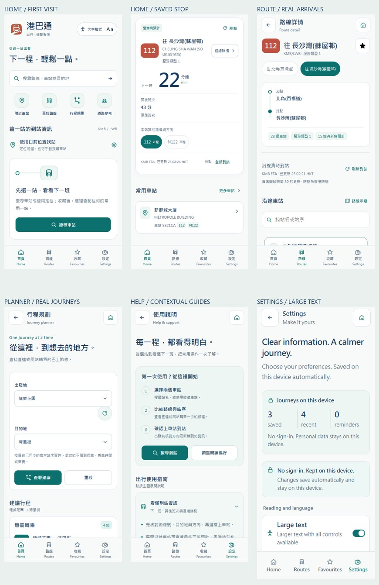
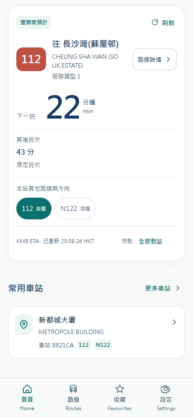
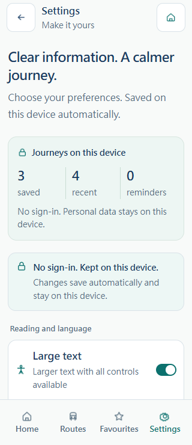

# 港巴通 · 前端设计与内容完善 / Frontend refinement

## 中文说明

目标是系统优化实际乘客端 14 页的信息层级、移动布局、交互与内容完整性。覆盖独立微信、支付宝、抖音、Android 和获授权的实际 H5。沿用用户锁定的 Accessible Calm Minimal、港巴通名称、10 号纯图形 Logo 和四栏导航；不建立账号，不改变本机个人资料策略，不使用假班次、虚构通知/热度或景点推荐填充内容。Admin 的运营功能、旧 prototype 和 demo 不在本次乘客端改版范围。

### 设计方案与自审

主体是香港 KMB/LWB 乘客，主要任务是迅速选择正确路线、方向、站序并读取可信到站信息。保持雾白 #f8faf9、深蓝 #163b63、青绿 #0c716e、分隔线 #d9e2e8、珊瑚色路线徽记与已确认朱印 Logo。正文采用现有中文系统字体链，时间/数字使用系统等宽数字特性，不加载外部字体。

视觉识别以“巴士站的路线与站序”为结构：起终点连接线、清晰路线牌、带站序的到站卡。它们编码实际公交关系，不增加装饰编号。首页把选站/到站置于阅读主线，常用与继续查看作为后续内容；帮助信息按需展开。统一页面标题、卡片留白、状态、触摸反馈与底部安全区。

初步方案中的重复英文标语与占据首屏的空白提示会挤压到站内容，修订为简短说明和可操作入口。内容丰富来自真实路线/站点元数据、本机收藏/历史、已发布通知及本产品操作指南，不构造“热门”排行或车辆位置。新的偏好入口保留但放在主要出行内容之后。

使用 frontend-design 与 ui-ux-pro-max 检查。两次 design-system 搜索返回营销演示型页面与大字几何字体，均不适合已锁定的交通工具产品，未采纳或保存为设计依据。UX 搜索匹配“Empty States / Feedback”：空状态需明确说明和下一步操作；其余基础规则按已有风格和移动端触摸/无障碍约束实施。没有新增暗色主题，检查范围为既定浅色风格与大字模式。

### 需求与完成证据清单

| 编号 | 页面/范围 | 需要完成的结果 | 验收依据 |
|---|---|---|---|
| UI-01 | 全局 | 一致排版、正文/辅助文层级、可见焦点、触摸反馈、无水平溢出、底栏不遮挡内容 | 源码 + 320/375/390/430 与横屏实际渲染 |
| UI-02 | 首页 | 真实到站主卡、路线选择、常用捷径/继续查看、清晰空状态、出行入口和指南 | 空/有本机数据状态与真实 API |
| UI-03 | 路线目录/搜索/附近 | 正确计数/检索、清晰路线和站点卡、记录/保存内容入口、定位未启用时明确人工选择 | 实际查询与本机状态 |
| UI-04 | 站点到站/路线详情 | 方向与站序明确、路线/沿途站点过滤、起终点结构、实时/过期状态、原有未来班次/提醒完整 | 实际 ETA、站序和操作 |
| UI-05 | 收藏/提醒/设置 | 本机资料概览、可理解的管理操作、状态和有效时间、不依赖账号 | 离线、重载、删除/重设回归 |
| UI-06 | 行程/道路 | 收藏站快捷选择、明确输入和结果分层、过程说明、结果不虚构车程/票价 | 实际行程/道路接口和结果 |
| UI-07 | 通知/通知详情/帮助 | 空通知下一步、清晰来源/有效期、可深链的实用指南及相关操作 | 实际空通知/无效详情和指南链接 |
| UI-08 | 所有端交付 | 四端源码同步、类型/测试/构建、实际 H5 发布与回滚、文档/截图/新版包/Git 分支 | 独立构建、线上检查、来源指纹、发布回读 |

实施与验收记录在 `assets/design-refinement/2026-10-17/`。源码、编译、真实接口、真实网站浏览器、官方 IDE、真机和上架严格分层。完成状态以最终记录为准，不能仅凭本清单宣称完成。

### 已实现的页面规则

| 页面 | 内容、操作与数据规则 |
|---|---|
| 首页 | 品牌、阅读开关、统一搜索；附近/路线/行程/道路四个任务入口，后两项按真实配置开关显示；到站主卡优先本机首页车站，否则使用当次授权位置。没有选站时给出搜索入口。主卡含营办商状态、准确路线/方向/服务类型、下一班及后续班次、本站最多五个真实路线选择和全部到站入口。 |
| 首页下部 | 最多四个可用本机收藏与两个最近查看，保留准确实体 ID；别名优先显示，无记录不编造卡片。本机偏好首次邀请放在主要交通内容之后，可关闭。增加到站和选方向指南、KMB/LWB 覆盖及真实目录更新时间。 |
| 路线目录 | 说明同一路线号可以有方向/特别服务记录；快捷路线号由当前真实目录返回项去重产生，保持接口顺序，不称为“热门”。路线卡突出号码、起点、目的地、营办商、方向和服务类型。 |
| 搜索/附近 | 增加有效输入提示、正确方向核对提示和附近指南；站点卡显示官方名称、真实路线号及站点标识，只有有实际位置结果时才显示距离/步行参考；附近图为站点示意，清楚标注最多八站。 |
| 路线详情 | 起终点连接结构、真实总站数和服务类型；新鲜预计站数只统计严格匹配路线 ID、物理站 ID、站序的首班有效预计。数字搜索优先准确站序，再匹配三语站名/至少四字符的站 ID；不改写原站序或合并重复物理站。保持逐站展开、未来三班、备注、提醒、方向切换、手动刷新和前台 30 秒更新。 |
| 站点到站 | 显示完整官方站 ID；按当前方向筛选路线号，并显示匹配/总记录数；清除恢复当前方向全部记录。路线/特别服务及重复经过站序继续隔离。过期、断网或上游失败时不显示有效倒计时。 |
| 收藏/提醒 | 显示当前装置的真实收藏、记录和提醒数量；收藏标识站点/路线种类，保留命名、排序、移除和查看；提醒增加站序与香港时间有效期，支持暂停、启用和删除，前台和两小时有效期规则保留。 |
| 设置 | 本机数据概览加六项原有偏好、定位授权、数据来源、私隐、支持及清除功能；所有确认框明确本地语言按钮。调整不依赖账号，也不会请求旧个人 API。 |
| 行程规划 | 使用真实本机收藏站快捷选择起终点；空状态解释选站→比较方向/站序→确认上车站 ETA。接口产生直达或一次同站换乘候选，展示真实上下车站和站数；不计算票价、候车或公交车程。 |
| 道路参考 | 与行程共用收藏站选择，保留 TDAS 出发时间、最短时间/距离、过海隧道参数；查询时间统一香港时间。道路距离与行驶参考来自真实返回，与巴士 ETA 分开标识。 |
| 通知/详情 | 显示当前已发布数量与有效期；目前没有已发布通知，明确显示空状态及到站查询入口。缺少或无效 ID 可返回通知列表，不制作示范通告。 |
| 帮助 | 八个三语主题：到站、方向/站序、附近、收藏、提醒、行程、道路、本机资料。每项三段操作说明及相关真实页面入口，点击展开，支持 `?topic=arrivals` 等深链及可访问展开状态；覆盖说明取真实配置。 |

本次没有更改接口合同、服务端收藏兼容接口、数据库或 Admin 运营界面。新增内容层仅组合公共真实数据与前端本机记录，支持空、加载、旧数据、离线、无结果和存储失败状态。所有本机资料仍使用 `hkbus-device:v1`，三种语言、大字、分钟/香港时刻、首页车站、提醒阈值、历史开关继续即改即存；重设偏好保留集合，清空移除全部本机资料。

### 设计与可用性约束

常规辅助文字 12 CSS px，大字模式 14 CSS px；导航英文及紧凑状态/品牌标记使用 10–11 CSS px；正文/名称使用 14/15 CSS px，大字 16/17 CSS px。主要按钮高 48 CSS px，紧凑操作至少 44 CSS px；使用大写 `Px` 保留 Taro 转换后的真实触摸尺寸。数字和时刻使用等宽数字。路线徽记加深为 #be5141，避免白字对比不足。

底部四栏固定导航、内容尾部留白、安全区、焦点轮廓、按压反馈、长英文换行和减少动态偏好统一处理。不使用外部字体、背景大图或装饰统计。修正了 H5 自定义按钮 `disabled="false"` 被旧样式误判为禁用色的问题。数字站序搜索经真实 112 路验证，修正了包含 YT138 的站名干扰搜索“3”的情况。

### 截图说明

下列截图必须来自本次实际网站浏览器，不是官方小程序 IDE 或真机；到站数字和数据新鲜度随真实营办商资料变化。版本、构建和证据索引见下列最终验收记录。

## English

Refine the actual 14-page passenger product while preserving the approved Accessible Calm Minimal identity, logo, local-only personal data and real transit APIs. Improve information hierarchy, route/stop reading, mobile layout, helpful empty states, saved/recent shortcuts, journey inputs and contextual guides. Transit data, published notices and local saved metadata remain authoritative; there are no fabricated arrival times, popular-route rankings, weather or user activity. The old mock prototype/demo and the operator Admin UI are outside this passenger refinement.

The chosen visual structure follows real bus-route endpoints and stop sequences. Keep the existing off-white, navy, teal and coral palette and Chinese system font stack; use tabular digits for times. Avoid marketing sections that crowd the arrival task. Generic design-system search results were not a fit and were rejected; the verified UX empty-state guidance informs actionable empty views.

Acceptance must cover all 14 pages, real API interactions, local storage regressions, small screens and large text, four native Windows builds, production H5 deployment with rollback, screenshots, portable documentation, artifacts and independent Git branches. Official mini-program IDE, physical-device and store validation remain distinct.

<!-- final-evidence -->
## 最终验收 / Final acceptance

正式网站：[港巴通](https://hkbus.copypaste.hk/)；发布版本 `20261017T150048Z-edeca230be17`，H5 编译来源提交 `edeca230be17fedc8045e4616988ce8af90c5941`。源码已在四个独立客户端同步。四端代码提交见 `source-build-commits.json`；最终分支发布回读 `published.json` 和 `source-commits.json` 随交付总包提供。代码构建提交与后续纯文档提交分开记录，不混用版本。

| 验证层 | 结果与证据 |
|---|---|
| 源码 | UI-01～UI-08 实现及对应证据见 [完成清单](assets/design-refinement/2026-10-17/completion.json)，新增筛选、首班统计、真实建议和香港日期规则测试。 |
| 四端编译 | 微信、支付宝、抖音、Android 均通过类型检查、每端 26 项测试及原生 Windows 构建；Android Debug APK 签名已验证。见 [builds.json](assets/design-refinement/2026-10-17/builds.json) 和 [产物清单](assets/design-refinement/2026-10-17/artifacts.json)。 |
| 真实接口/网站 | 11 组新版页面与 13 组本机数据回归通过；两轮均加载 14 页，另有 5 组详情/深链/焦点/强制刷新/简体大字补充检查。真实路线 112 的方向/站序/香港时刻、收藏站行程及 TDAS 道路查询通过。共 210 次公共请求，无替换接口响应，无个人档案请求或 Authorization。见 [页面检查](assets/design-refinement/2026-10-17/browser.json) 、[本机回归](assets/design-refinement/2026-10-17/regression.json) 和 [补充检查](assets/design-refinement/2026-10-17/details.json)。 |
| 移动渲染 | 44 个英文大字状态覆盖 320/375/430 竖屏和 844×390 横屏；390×844 覆盖全部 14 页。简体/繁体和 320 大字设置另由本机回归验证。无文档/组件水平溢出，14 页最后操作可滚至底栏上方，设置触摸控件最小实测高度 48 CSS px。减少动态启用，原有可访问焦点/模态保护保留。 |
| 本机存储 | 首次引导、六偏好重载、收藏离线命名/排序、提醒、历史开关、同浏览器标签同步、独立上下文隔离、写失败反馈/恢复、重设、清空和旧本机缓存迁移全部通过。 |
| 服务器发布 | 245 个公网文件逐一 SHA-256 回读通过，APK 内置渲染文件与已发布 H5 完全一致。保留旧版兼容文件及可回滚版本。见 [deployment.json](assets/design-refinement/2026-10-17/deployment.json)。 |
| 运维不变项 | 主服务端版本、Nginx 主站配置和扩展配置哈希均与基线一致；数据库完整性及外键正常，1611 路线记录、6775 站、36377 站序关系、2 旧个人档案、1 管理员均未改变，宝塔数据库登记保持。见 [只读复核](assets/design-refinement/2026-10-17/final-audit.json)。 |
| 官方 IDE/真机/上架 | 本次未执行。小程序须配置自己的 AppID 和正式请求域名；原生定位、系统分享、通知、安全区与生命周期需官方 IDE 和真机分别检查。Android 当前为 Debug 签名，不代表正式商店发布；iOS 未构建。 |

所有本次检查创建的浏览器、上下文、临时本地预览、网络监听与 SSH 均已关闭；没有修改系统代理、禁用 TLS 或替换真实返回。[浏览器网络记录](assets/design-refinement/2026-10-17/browser-network.json) · [回归网络记录](assets/design-refinement/2026-10-17/regression-network.json)。

已部署路径仍为 `/www/wwwroot/hkbus.copypaste.hk/.hkbusgo/current`；回滚目标 `/www/wwwroot/hkbus.copypaste.hk/.hkbusgo/releases/20261017T122707Z-dcef08ea29f3`，以发布记录中实际旧版本路径为准。后台和数据库没有随乘客 UI 重新部署。

构建的非阻塞提示：Taro H5 的入口/资源大小提示保留；三个初始 JS/CSS 入口合计 457,981 字节，独立 gzip 估算 136,600 字节（估算不是网络实测）。Gradle 报已有弃用 API 提示，构建成功。没有将编译或网站结果记为 IDE/真机/商店验收。

### 实际页面截图 / Actual website screenshots

| 首页与真实收藏 / Home | 实时路线 / Route | 英文大字设置 / Settings |
|---|---|---|
|  |  |  |

English: four standalone clients passed type checks, 26 tests each and native Windows builds. The deployed H5 passed 11 feature groups, 13 local-data regression groups, all 14 pages, 44 responsive large-text states and 245 exact public file hashes. Real journey and TDAS queries worked, with zero profile/Authorization requests. APK renderer identity and debug signature were verified. The backend, database and Admin runtime were preserved. Official IDE, physical-device and store acceptance remain separate and were not performed.
