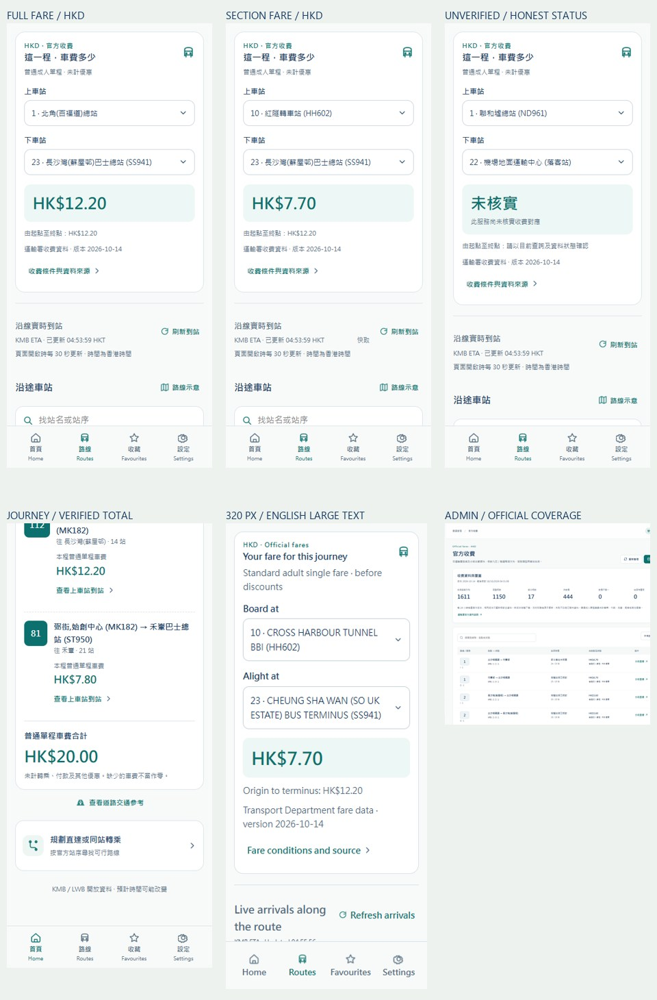

# 港巴通：官方票价与分段计价 / Official fares and section pricing

日期：2026-10-18。范围：实际 Backend、Admin、微信、支付宝、抖音、Android 与正式 H5。旧 prototype、假数据 demo 与其 Vercel 站点不在本次范围。

## 业务约束 / Business rules

| 编号 | 要求 | 实现与验收方式 |
| --- | --- | --- |
| FARE-01 | 金额必须来自官方资料 | 运输署 ROUTE_BUS、STOP_BUS、RSTOP_BUS、FARE_BUS XML；保存来源、版本、下载时间、文件字节数与 SHA-256。实际下载与生产同步分别留证。 |
| FARE-02 | 不按线路号套用价格 | 同时核对 KMB/LWB 营办商、完整方向服务、终点、单调站序；站名及坐标用于跨来源对应。无法唯一对应时金额为空。 |
| FARE-03 | 精确到上下车站序 | 使用 canonical route ID、boardSequence、alightSequence；循环线重复物理车站仍为不同站序。当前客户端同时提交 boardStopId/alightStopId，旧页面站点与当前站序不一致返回 409 FARE_STOPS_CHANGED，提示刷新路线上下文。只提交一个站点 ID、上下车顺序错误返回 422；只准上车/下车的站点不报价。 |
| FARE-04 | 分段及全程普通单程车费 | 读取明确 ON_SEQ → OFF_SEQ 的 PRICE。缺少分段价格不借用全程价、不从相邻站复制、不当作 0。 |
| FARE-05 | 金额与优惠边界 | 以 HKD 整数分运算。只显示普通成人单程基础车费，不推算八达通、转乘、付款、儿童、长者、资格或其他优惠。不提供收款、钱包或支付功能。 |
| FARE-06 | 适用日条件 | 保留官方 DAY_CODE。多个条件价格逐项展示，不自行猜测公假或学校假期。缺失 DAY_CODE 为 null，文案为官方未注明，不写成每天适用。 |
| FARE-07 | 转乘合计 | 每段先核对准确站序。全部段落 available 才产生 totalCents；部分核实仅提供 knownSubtotalCents 及已核实段数。始终注明未计转乘及付款优惠。 |
| FARE-08 | 真实数据同步 | 后端每 24 小时核对官方版本；主资料更新后重新映射。同版复用已校验收费。新版本完整流式解析后 SQLite 事务替换，任何校验失败保留前版。失败后自动重试间隔至少一小时。 |
| FARE-09 | 数据失效与陈旧 | 查询时核对路线上下文及完整站序指纹，变更即停止使用旧映射；48 小时无成功核对、来源超过 45 天或最近同步失败时标记 stale，保留日期和提示。 |
| FARE-10 | 后台维护 | 只读查看版本、来源、完整/部分/未对应覆盖、分段查询与文件摘要；admin/operator 可手动同步，其他角色只读；操作写入审计与任务记录。 |
| FARE-11 | 乘客界面 | 线路页包含上下车选择、当前报价、起终点车费、版本、适用条件、营办商与官方来源；终点不能作为有效上车分段，须明确解释并允许改选。展开车站显示至终点价格；行程逐段列价并给出完整/部分合计状态。切换选择时不沿用上个分段金额，断网提供重试。维持 Accessible Calm Minimal。 |
| FARE-12 | 本机资料与多端 | 不增加乘客账号，不调用 profile 或发送用户认证凭据，不保存精确定位。报价端点不保留离线金额缓存；历史线路资料须标示为旧资料。四个独立客户端保持共享逻辑一致。 |
| FARE-13 | 发布与回滚 | 更新现有后端、实际 Admin 与 H5 域名；保留服务端配置、宝塔登记及既有数据库业务资料。只加 fare_directions/fare_mappings 表，保留 schema user_version=2，旧代码可忽略新增表并回滚。 |

## 官方来源与解释 / Official sources and interpretation

- [运输署公共交通路线及收费资料 XML](https://data.gov.hk/tc-data/dataset/hk-td-tis_14-routes-fares-xml)：官方全程与分段收费资料；更新频率为每月两次。KMB-ETA 本身没有票价字段，TDAS 道路时间不用于计价。
- [XML 数据规范，2026-07-06 版](https://static.data.gov.hk/td/routes-fares-xml/dataspec/ptroutefare_xml_dataspec.pdf)：ROUTE、RSTOP、STOP、FARE 关系及 DAY_CODE。该 PDF 对 RSTOP 与 FARE 的 ROUTE_SEQ 方向描述有相反文字，应用不据此直接转换 O/I，而是按路线与实际完整站序关联并交叉核对样本。
- [地政总署 HK1980 转换参数](https://www.geodetic.gov.hk/common/data/parameter/7P_ITRF96_HK80_V1%28Tra_Chi%29.pdf)：TD 车站坐标为 HK1980，KMB 为经纬度；采用官方七参数转换，并以官方独立检查点验证，转换误差小于 0.2 米。此转换仅用于官方站点匹配，不是乘客精确定位或导航。
- [九巴官方线路查询](https://search.kmb.hk/KMBWebSite/?action=routesearch&route=112&lang=zh-hk)：用于交叉核对真实样本与提供乘客查证入口；实际金额来源仍为运输署 XML。

当前下载版本为 **2026-10-14**，KMB/LWB 及其联营记录共 1,503 个官方方向、452,071 笔收费。下载、离线真实来源重放、单元测试与生产 API 验收是不同检查，不能互相替代。合成输入仅限隔离自动化测试，运行时无 fixture provider。

站序匹配先检查完整序列；允许站名的格式、站牌编号与近距离官方坐标差异。完整对应优先于部分对应；多个完整或部分候选仍拒绝报价。部分对应要求两端已验证且至少 90% 单调站序可唯一对齐，未映射的具体车站不报价；不宣称全港、城巴独营、铁路、渡轮或小巴计价覆盖。

## 接口 / API

| 接口 | 行为 |
| --- | --- |
| GET /api/v1/routes/:id | 原有线路与车站之外增加 fares.fullFare、fares.boardingFares；原 ETA 接口继续独立刷新。 |
| GET /api/v1/routes/:id/fare?boardSequence=1&alightSequence=23&boardStopId=…&alightStopId=… | 明确线路方向、服务、上下车站序和站点身份。两个 ID 可同时省略以兼容旧调用；当前客户端始终完整提交。返回 state、amountCents、options、source、reason、basis、boardStopId、alightStopId 与 officialUrl。 |
| GET /api/v1/fares/status | 公开来源版本、核对状态与覆盖数字，不含个人资料。 |
| POST /api/v1/journeys | 每段增加 fare；每条行程增加 pricing，只有全部核实才有 totalCents。 |
| GET /api/admin/fares | 已认证的版本、覆盖及分页线路清单；支持 q、page、pageSize、state。 |
| POST /api/admin/jobs/fares/sync | admin/operator 权限；202 返回同一个执行中任务，禁止重复并发同步。 |

English: Fares use the TD's official route-and-fare XML, matched to the exact KMB/LWB direction, service and ordered stops. Prices are integer HKD cents and standard adult single fares before all discounts. Missing, conditional, stale and unmapped prices remain explicit. A transfer total is shown only when every leg has a verified amount. Clients retain no passenger accounts or personal cloud profiles. Official IDE, physical-device testing and platform release remain separate from source, build, API and browser acceptance.

## 验收记录 / Acceptance record

正式 [H5](https://hkbus.copypaste.hk/)、[Admin](https://hkbus-api.copypaste.hk/admin/) 与 [API](https://hkbus-api.copypaste.hk/api/health) 已完成发布。后端仍监听 **39410**。H5 版本 `20261017T205331Z-be0ff19f497e`；后端 `20261017T202836Z-a1ec760d8bed`；Admin `20261017T205911Z-63843ad100af`。

本次生产覆盖 1611 个 KMB/LWB 服务方向：完整匹配 **1150**、部分匹配 **17**、未匹配 **444**、歧义 0。部分匹配仅对已核对的具体站对报价；未匹配不以其他线路或旧资料替代。真实例：112 去程全程 HK$12.20，第 10 站至第 23 站 HK$7.70；A43 去程服务 1 当前未可靠对应，显示未核实。

| 验证层 | 结果与证据 |
| --- | --- |
| 源码与需求 | FARE-01～13 已实现，见 [完成清单](assets/fares/2026-10-18/completion.json)。四个客户端共享源码一致；各自配置、依赖及仓库保留。 |
| 官方输入 | 2026-10-14 原始文件摘要、全量真实文件离线重放与生产同步摘要一致；九巴公开查询的 4 个服务方向、86 个上车区段与运输署金额逐项一致。见 [下载](assets/fares/2026-10-18/official-source-download.json)、[全量重放](assets/fares/2026-10-18/official-replay.json)、[营办商交叉核对](assets/fares/2026-10-18/operator-crosscheck.json)。离线重放读入完整文件用于验证，其 RSS 不代表生产流式内存。 |
| 本地编译 | Windows 原生环境；Backend 49 项业务/收费测试 + 3 项 TDAS 出口测试，四客户端各 29 项测试；六工程类型检查和编译通过。Admin 无新增镜像实现的单元测试，采用类型/编译和真实浏览器验证。见 [构建](assets/fares/2026-10-18/builds.json)。 |
| 真实接口 | 37 次生产 HTTPS 请求，12 个报价、3 类真实行程、正确金额/方向/站序/上下车 ID、非法输入、旧页面 409、缺失金额、CORS、管理认证检查通过。见 [API 验收](assets/fares/2026-10-18/api-acceptance.json)。 |
| 真实页面 | 11 组页面、13 组本机喜好回归、5 组详情、13 组收费检查、3 组 Admin 检查通过。覆盖改站查价、断网清除旧报价/重连重试、终点、去回程、未映射服务、转乘/未知合计和后台实际同步。无替换响应。见 [收费](assets/fares/2026-10-18/pricing.json)、[后台](assets/fares/2026-10-18/admin.json)、[页面](assets/fares/2026-10-18/browser.json)、[本机回归](assets/fares/2026-10-18/regression.json)、[详情](assets/fares/2026-10-18/details.json)。 |
| 移动渲染 | 14 页、44 个英文大字响应状态；另测收费卡片 320/430 竖屏与 844 横屏，简体大字由详情回归覆盖。浏览器渲染截图不代表小程序 IDE 或真机截图。 |
| 官方预报边界 | 112 在本次回归窗口没有提供到站预报，页面显示暂无预计；香港时刻的正例使用当时有官方新鲜预报的 `KMB:N182:O:1`，核对 17 个车站。具体来源探测与空状态记录见本机回归报告。 |
| 线上发布 | H5 245 个文件、Admin 6 个文件均通过公网 SHA-256 回读。APK 内置渲染文件与发布 H5 一致，Android Debug 签名已验证。见 [H5 发布](assets/fares/2026-10-18/deployment.json)、[后端发布](assets/fares/2026-10-18/backend-deployment.json)、[Admin 发布](assets/fares/2026-10-18/admin-deployment.json)、[产物](assets/fares/2026-10-18/artifacts.json)。 |
| 宝塔/数据库 | 数据完整性及外键正常；1611 路线、6775 站、36377 站序关系、2 个旧兼容档案、1 个管理员未替换。新增收费表，保留宝塔登记、既有主站配置与扩展配置、服务私有配置、任意来源 CORS 和可回滚版本。见 [最终只读复核](assets/fares/2026-10-18/final-audit.json)。 |
| 官方 IDE/真机/上架 | 本次未执行；三个小程序需要自己的 AppID、合法域名与平台审核。Android 为 Debug APK；未生成 iOS 包或商店发布包。 |

代码构建提交见 [source-build-commits.json](assets/fares/2026-10-18/source-build-commits.json)；其后的 README/验收文档提交不改变源码。最终 7 个分支回读与交付 SHA-256 记录随总包提供，不把文档提交误认为线上编译来源。

## 维护与回滚 / Operations and rollback

后台「官方收费」可查看覆盖、来源哈希、按路线上下车站查价并手动同步。正常每 24 小时核对版本；同版重新校验映射，新版四份 XML 必须日期一致并完整通过才替换。失败可在「同步任务」「操作审计」查看；前版保留但标记陈旧。不要直接手改官方金额或把未对应方向改成零。

后端版本目录 `/www/wwwroot/hkbusgo/releases/`，`current` 指向当前版本；宝塔管理的现有 SQLite 继续位于 `/www/wwwroot/hkbusgo/shared/data/hkbusgo.db`。沿用一致性备份与 root 私有配置，不覆盖数据库文件。回滚前确认备份及目标版本兼容；本次仅增加收费表，原业务 schema user_version=2 保持。H5 使用站点 `.hkbusgo/current`，Admin 使用 `/www/wwwroot/hkbusgo-admin/current`，原子切换至发布报告记录的上一版，并验证真实 HTTPS 后再恢复对外服务。

English: Official fares are now live in the existing backend, passenger route/journey UI and operations console. All prices are ordinary adult HKD single fares before discounts. 1150 services have full stop mapping, 17 partial mapping, and 444 explicitly remain unverified. Real API, browser and native Windows build checks passed independently. No passenger account or cloud profile was introduced. Device-local settings remain local. Six exported artifacts contain three mini-program builds, matching H5/Android Debug builds and Admin dist. Official IDE, physical-device, iOS and store acceptance were not performed.
