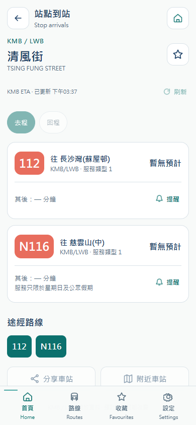

# 港巴通 H5 正式前端 dist · 2026-10-17

> 2026-10-17 后续更新：实际网站现已发布，当前状态见 [H5 正式发布](H5-SITE-LIVE.md)；本文保留早先仅导出时的验收事实。 / The actual website is now published; this document preserves the earlier export snapshot.

已独立导出实际产品的完整 H5 静态构建，固定使用 **https://hkbus-api.copypaste.hk/api/**。产品保持 10 号图形 Logo 与 Accessible Calm Minimal。

## 交付

- `H5 dist ZIP`：749.0 KiB，解压根目录即 index.html、js/、css/、assets/；附双语 README 和 Nginx location 示例。
- `已导出的 dist/index.html`：其所在目录是原始 dist，共 245 个文件，1.79 MiB；需通过 HTTPS 静态服务访问。
- `双语部署说明`、`部署片段`、`完整清单与校验`。

ZIP SHA-256：`d1ab8615b4dcb8c0ccfebb3e534ce3493f6d7a83bd29264d409ad42f311077e1`。

## 构建来源与内容

源码来自 [android 分支](https://github.com/copypasteltd/HKBUS/tree/android) 的 Taro H5 目标，构建基线提交为 `f0075fe5fbbdc51be90726ade2af39755afbc6bb`。该分支同时包含 App 和浏览器 H5 的源码。本次复用上一轮成功编译且已与 APK 内嵌文件逐一比对过的 `dist/h5`，独立导出时 245 个文件完全一致，没有修改压缩代码，也未进行无变化的重复编译。[导出清单](./assets/h5-production/2026-10-17/export.json)记录每个文件的字节数和 SHA-256。

完整 14 页：首页、路线目录、搜索、附近站点、站点到站、路线详情、收藏、设置、服务通告、通告详情、帮助、提醒、行程规划和道路参考。浏览器运行时确认 nativePlatform=false、首页请求 platform=h5；App 原生插件有平台判断，不会要求浏览器具备原生 App 环境。

KMB/LWB 线路、站点、ETA、收藏等使用真实 API。道路参考页保留真实失败状态，TDAS 当前正式环境 502，不能把页面能打开当作道路结果可用。无定位时展示选择车站提示，未填充假位置或假天气。

## 部署要求

本包 `publicPath=/`，静态文件必须部署到网站根目录，例如将宝塔站点根目录设置为 `/www/wwwroot/hkbusgo-h5/dist`。入口为 `/#/pages/home/index`，hash 路由；index.html、js/、css/、assets/ 必须完整上传。直接双击本地 HTML 不属于可用的部署方式。

如果要部署到 `/h5/` 子目录，需在源码统一调整 Taro publicPath、图形/图标路径和 HTML 图标路径后重新构建。现有根路径包不能仅移动 index.html 获得子目录支持。

**后续更新（2026-10-17）：正式后端已设为 `CORS_ORIGINS=*`，接受任意 H5 origin 和自定义请求头，无需为新 H5 网站逐个登记来源。** 包内 README 的白名单描述为导出时配置快照；当前以 [最新跨域策略](https://github.com/copypasteltd/HKBUS/blob/backend/docs/CORS-OPEN.md) 为准。本次只导出文件，没有发布 H5 网站。定位和系统分享/剪贴板需要 HTTPS、浏览器支持及授权；提醒仅在页面开启时接收，不承诺关闭后的浏览器后台推送。

复现构建：Windows 原生 Node 22.14+ / npm 10，克隆 android 分支，`npm ci`，设置 `TARO_APP_API_BASE=https://hkbus-api.copypaste.hk/api`，执行 `npm run build:h5`，读取 dist/h5。未使用 Docker、WSL、虚拟机或模拟器。

## 验证

| 层级 | 结果 |
|---|---|
| 编译来源 | 沿用此前通过的正式 API Taro H5 构建，源码和产物未改动 |
| 导出 / ZIP | 245 个静态文件与已验证构建逐字节一致；ZIP 完整性、内部文件 SHA-256 通过 |
| 浏览器页面 | 本机提供导出的静态文件；全部 API 直接请求正式 HTTPS，不替换响应；14 页逐页加载通过，无缺失资源、无 JS 页面异常 |
| 实际业务 | 真实搜索、线路/站序、KMB ETA、收藏新增及读取通过；首页正确上报 h5 平台 |
| 移动布局 | 390px 页面截图及 320px 无横向溢出，品牌大字控件高度 44px |
| 测试清理 | 工具的删除响应曾超时；后续凭证访问 401，且 SSH 只读确认该测试档案、会话、收藏均为 0 行；已脱敏日志并清空临时凭证 |
| 浏览器资源 | 本次创建的上下文和浏览器已关闭，用户原有页面保留 |
| 公网静态部署 / 真机 | 未进行；不以本机静态加载或桌面移动视口替代 |

[浏览器记录](./assets/h5-production/2026-10-17/browser.json) · [产物核查](./assets/h5-production/2026-10-17/artifact.json)。验证日志不含可用的身份令牌或服务器凭证。现有 5 端交付包保持为前次快照；本次 H5 单独提供 ZIP 和原始 dist。

| H5 首页 | H5 真实到站 |
|---|---|
|  |  |

## English

The production H5 dist is exported separately as a ZIP and an unpacked directory. It uses https://hkbus-api.copypaste.hk/api/ and contains all 14 real product pages. The 245 static files are identical to the preceding verified Taro H5 build from the android branch; compiled code was not patched. Browser mode, real KMB/ETA and bookmarks, all page loads and a 320px viewport were checked. No assets were missing and no page JavaScript errors occurred. The temporary test profile was confirmed deleted through a read-only database check, and all created browser contexts/processes were closed.

Host the complete dist at an HTTPS website root. The current absolute /js, /css and /assets paths do not support dropping the package into a subdirectory without rebuilding. The Backend has subsequently been updated to CORS_ORIGINS=* and accepts any H5 origin; the packaged README captures the earlier allowlist configuration. This handover does not publish a website or claim physical-device acceptance. TDAS road queries remain unavailable on production with 502. The ZIP includes bilingual deployment guidance and a Nginx location snippet; hashes and full file metadata are delivered alongside it.
