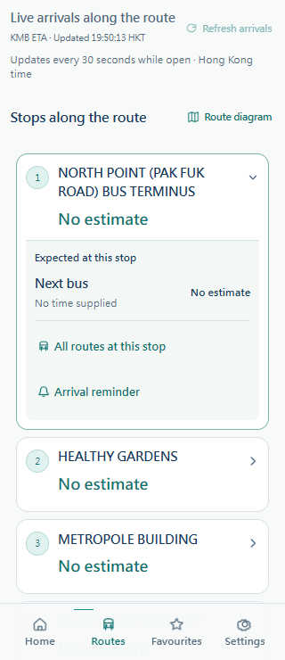

# 港巴通：实际 H5 发布与线路到站验收 / Actual H5 release and arrivals acceptance

检查及发布日期：2026-10-17。生产入口：[港巴通](https://hkbus.copypaste.hk/)；直接验证：[112 线往北角](https://hkbus.copypaste.hk/#/pages/route/index?id=KMB%3A112%3AO%3A1)。真实 API 为 `https://hkbus-api.copypaste.hk/api/`。

## 问题与交付结果

此前实际客户端源码、独立编译包及后端已补齐线路到站，但该域名仍托管旧 H5：入口引用 `js/app.e31a66b4.js`，未包含新增线路到站界面。只有生成 dist 或更新后端，无法更新已上传的旧页面。本次检查宝塔实际配置后，将真实 Taro H5 发布到此站点；当前入口引用 `js/app.11f60f26.js` 与 `css/app.279a84b0.css`。

当前线路详情展示每站下一班、展开后的最多三班、香港时刻及官方备注；按路线、方向、服务类型和重复站序匹配。可见时每 30 秒刷新，可手动刷新，离开页面停止轮询。断网时标明上次真实查询资料并隐藏失效分钟数，恢复联网可重新获取。无 ETA 如实显示「暫無預計」，不推断停驶、不生成车辆 GPS 位置。

这次上线的是实际应用，沿用 Accessible Calm Minimal、10 号「朱印车迹」Logo 和真实 API。[线路到站业务及接口修复记录](ROUTE-ARRIVALS.md)保留完整需求与上一轮编译证据；其中“当时尚未部署网站”是历史状态，本次记录提供正式网站验收。

## 生产路径与版本

| 项目 | 本次实际值 |
|---|---|
| 正式入口 | `https://hkbus.copypaste.hk/` |
| 宝塔站点根目录 | `/www/wwwroot/hkbus.copypaste.hk` |
| 当前原子链接 | `/www/wwwroot/hkbus.copypaste.hk/.hkbusgo/current` |
| 当前发布版本 | `20261017T114748Z-60f6bf69909d` |
| 本次编译源码提交 | Android 分支 `60f6bf69909d97eda762931db52751567acf31a1` |
| 发布目录 | `/www/wwwroot/hkbus.copypaste.hk/.hkbusgo/releases/20261017T114748Z-60f6bf69909d` |
| 宝塔 Nginx 扩展 | `/www/server/panel/vhost/nginx/extension/hkbus.copypaste.hk/hkbusgo-h5.conf` |
| 原站点备份 | `/www/backup/hkbusgo-h5/20261017T114748Z-60f6bf69909d-before.tar.gz` |
| 备份 SHA-256 | `9f8eb681c7497ce6c20ceaaa661b037f111bc33c261fc2acacc07878c757336b` |
| 首页 SHA-256 | `9bb30ae2e1b7a47a18a1bf0effd222a98b10be595943ef4932b6dbb331cd8e8f` |
| 后端运行版本 | `20261017T112442Z-eabd6a04f0f8`，端口 `39410` |
| Admin 入口 | `https://hkbus-api.copypaste.hk/admin/` |

宝塔主域名配置、证书验证目录和日志配置保持原文件，由扩展将应用请求导向当前发布目录。原根目录的旧文件保留，初始备份只允许服务器管理员读取；公网不能读取 `.hkbusgo` 元数据。Backend、环境变量及数据库未被此次静态发布替换。

## 缓存、并发访问与失败回滚

1. H5 编译配置已为 CSS 增加内容哈希，避免新版 HTML 继续命中旧的 `/css/app.css`；JS 已使用内容哈希。
2. `/` 与 `/index.html` 使用 `no-store, no-transform`；哈希 JS/CSS 使用长期缓存；固定名称图片使用 `no-cache, no-transform`。
3. `no-transform` 保证经 CDN 返回的应用文件与编译产物一致，避免额外 HTML 注入。
4. 上传包和每个文件先核对 SHA-256，仅允许发布目录内的普通静态文件。保留旧版懒加载资源，本次增加 17 个兼容文件，旧页面打开后的后续导航仍能取得旧 chunk。
5. 通过临时链接加 `os.replace` 切换当前版本，再进行 `nginx -t`、本机源站检查、245 项公网文件校验和 API 检查。失败会恢复旧链接及原 Nginx 扩展配置。

本次成功发布，未触发故障回滚；失败分支经过源码检查，不将其记为实际回滚演练。旧源站首页 SHA-256 仍为 `5e6026a194a17848e702b5c1612a9050d48f61e592ea8cdd427a8aa38120ab59`，最终审计已确认其未被覆盖。

## 验证证据与边界

| 验证层次 | 本次结果 | 证据 |
|---|---|---|
| Windows 原生编译 | TypeScript 通过、10 项测试通过、H5 构建成功、245 个文件 | [build.json](assets/h5-deployment/2026-10-17/build.json)、[build.log](assets/h5-deployment/2026-10-17/build.log) |
| 实际网站部署 | 245 个文件逐项公网 SHA-256 一致，首页及 API 200，网站 Origin 跨域正常 | [deployment.json](assets/h5-deployment/2026-10-17/deployment.json) |
| 实际公网浏览器 | 11 组功能检查通过，14 页加载通过，7 张截图，88 次真实 API 响应；页面错误及缺失资源均为 0 | [browser.json](assets/h5-deployment/2026-10-17/browser.json) |
| 浏览器到站对照 | 112 线 23 站完整展示；16 个站的数值匹配实时接口，站序 8 展开时上游只提供 1 班，页面展示 1 班 | [browser.json](assets/h5-deployment/2026-10-17/browser.json) |
| 业务交互 | 搜索 112 → 线路详情、方向切换、班次展开/备注/HKT、提醒弹窗、站点所有线路、自动刷新、隐藏页停轮询、断网与恢复均通过 | 同上 |
| 移动布局 | 390px 全页面、320px 简/英大字模式无横向溢出；触控行高至少 44px；已目视查看截图 | 同上及下方截图 |
| 网络真实性 | 静态文件和 API 均来自生产 HTTPS，没有请求拦截或本地响应替换；经自有香港服务器临时 SOCKS 出口，TLS 校验保持开启 | [browser-network.json](assets/h5-deployment/2026-10-17/browser-network.json) |
| 服务及数据保全 | Backend active/enabled，DB integrity=ok、外键错误 0；1611 条路线身份、6775 站、36377 条站序、2 个原有匿名资料、1 名管理员 | [final-audit.json](assets/h5-deployment/2026-10-17/final-audit.json) |
| 清理 | 本次创建的 1 个匿名资料已删除；浏览器、上下文、临时代理、SSH 全部关闭 | 浏览器、网络及传输报告 |
| 官方 IDE／真机／平台上架 | 本次没有执行；浏览器验收不替代这些层次 | 明确未验收 |

构建仍有 Webpack 推荐体积提示：应用入口约 405 KiB、主 JS 约 261 KiB；构建没有失败。这里验证的是功能、文件一致性和移动布局，不将其记为移动网络性能或真机测试。

  

截图来自实际线上域名，是检查时的真实数据快照，不能用作之后班次到站承诺。

## 后续前端更新规则

用户已明确授权后续前端更新自行同步服务器。该偏好已记录到根目录 `AGENTS.md`，Android 工程有独立发布脚本及工程指令。

- 共享移动前端更新：维护微信／支付宝／抖音／Android 中相关源码的一致性，完成适当测试后，在 Android 工程重新编译实际 H5 并自动发布本域名。
- Admin 更新：使用既有 Admin 发布流程，目标仍是 `/admin/`，不将管理后台覆盖到乘客站点。
- 每次发布检查实际宝塔目录、保留回滚版本、核对公网产物，再检查本次涉及的真实页面/API，并将证据放在 `docs/`。
- 小程序平台上传、真机、Android 签名及上架分别验收。旧 HTML 假数据原型、`prototype/` 和其 Vercel demo 不在该授权范围。

Windows 原生构建入口：Android 分支执行 `npm run release:h5`；完整“检查→编译→上传→源站及公网核验”执行 `npm run deploy:h5`。SSH 凭据从私有访问文件或 `HKBUS_SSH_PASSWORD` 读取，固定校验服务器指纹；仓库、编译文件与公开文档不含密码。首次维护环境须安装 Python `paramiko` 并准备经过指纹核对的私有 `known_hosts`。详见各工程 `docs/H5-DEPLOYMENT.md`。

## English

The actual website at [hkbus.copypaste.hk](https://hkbus.copypaste.hk/) still served the old uploaded H5 after the arrival feature had been fixed in source and client exports. We inspected the existing BaoTa domain root and published the real 14-page Taro application there. Route details now display real per-stop predictions, upcoming buses, Hong Kong times and official remarks, with direction/service/sequence isolation and foreground refresh.

Release `20261017T114748Z-60f6bf69909d` was built from Android commit `60f6bf69909d97eda762931db52751567acf31a1`. All 245 public files match their compiled hashes. CSS now uses content hashes; HTML is not stored; old lazy chunks remain available. Publication uses a versioned release and atomic symlink switch with automatic rollback on verification failure. The BaoTa main vhost, Backend runtime and database were preserved.

Native Windows type checking, 10 tests, production compilation, 11 browser check groups and all 14 public pages passed. The browser used actual public HTTPS for every asset and API response, with TLS validation and no response substitution. One test profile was deleted, and all test browser/proxy/SSH resources were closed. Mini-program IDE, physical-device and store acceptance were not performed. Future frontend changes are authorized to be published to the corresponding production website after checks; this excludes the old demo/prototype.
