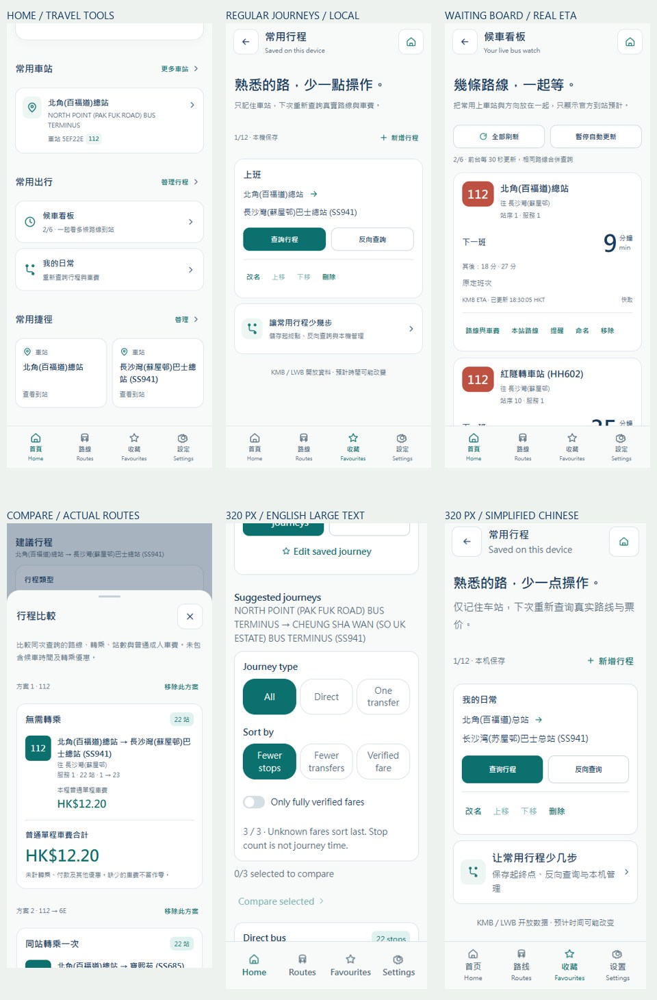

# 港巴通：常用出行与候车交互扩展

日期：2026-10-18。本次是在真实产品上补充完整出行操作流程，覆盖微信、支付宝、抖音、Android 及获授权的实际 H5。维持 Accessible Calm Minimal、已确认的 Logo 10、四项底部导航。旧 prototype、demo、Vercel 与旧 mobile 工程不在范围内。

| 编号 | 用户可完成的事项 | 业务及验收约束 |
| --- | --- | --- |
| EXT-01 | 建立常用行程 | 选择两个不同官方车站、24 字以内名称，本机最多 12 条；同方向相同站对去重；保存的是官方车站元数据，不是定位、票价、预计到站或行程结果。 |
| EXT-02 | 管理和复用常用行程 | 新增、改名、调整顺序、删除、反向查询；在离线状态也可管理。复用时重新载入官方车站和真实规划接口，不能把反向查询解释为已有回程路线。首页按保存顺序提供最多两条常用行程入口，可手动调整顺序。 |
| EXT-03 | 从车站发起出行 | 到站页可“从这里出发”或“到这里去”，填入具体官方车站；深链接无效、车站停用或断网有明确错误，不使用失效的查询结果。 |
| EXT-04 | 筛选和排序候选行程 | 全部 / 直达 / 一次同站转乘；可只看完整核实车费，按较少车站、较少转乘或已核实车费排序。未知金额放后、不当成零；不把较少车站称作最快。 |
| EXT-05 | 比较候选行程 | 同次查询最多选 3 条，比较路线路径、方向服务、上下车站、站数、转乘及完整/部分车费；可移除或清空。新查询、起终点变更或交换会清空旧比较。 |
| EXT-06 | 从行程继续操作 | 每段可打开指定站序的线路详情、查看上车站实时到站、加入候车看板。深链接同时传站点身份，旧站序不能指向另一车站。 |
| EXT-07 | 建立多线路候车看板 | 本机最多 6 项；以线路完整方向服务、物理站 ID 和站序去重。在线核对官方完整站序后加入，循环线的重复车站必须分开。路线页展开站点和到站页提供入口。 |
| EXT-08 | 在一个页面候车 | 同一线路合并请求，显示最多三班真实预报、方向、服务类型、站序与新鲜度；支持全部刷新、暂停/恢复自动刷新、命名、移除、线路详情及提醒。仅前台每 30 秒更新；暂停、离线、陈旧、未预报及站序已变分别说明，不编造巴士位置、满载或发车状态。 |
| EXT-09 | 本机事务与隐私 | 现有 schema 1 完整迁移为 schema 2，新增集合默认为空；保留原存储键并新增本机重设边界标记，旧客户端拒绝写入未知版本；原喜好、收藏、历史、提醒不丢失。写入失败保留旧值并反馈；重设喜好保留行程/候车项，清除全部则一并移除，跨标签页及异步清除同时核对 resetVersion 与本机边界标记，即使外部清空存储后重建相同计数也不能恢复旧操作。无乘客账号、匿名云档案、用户凭据或精确定位持久化。 |
| EXT-10 | 发现和理解新增功能 | 首页、规划、收藏、设置和使用指南有可达入口；繁/简/英齐全；320px 大字、375/430px、横屏无横溢/遮挡，操作触点至少 44px，保留既有无障碍弹层与错误恢复。 |
| EXT-11 | 多端实际交付 | 四独立客户端同步共享实现，分别类型检查、业务测试和目标编译；导出三个小程序 dist、H5 dist、Android Debug APK。实际 H5 自动发布，保留回滚版本并验证公网静态文件与真实 API。Backend/Admin 没有业务改动时不重复发布。 |
| EXT-12 | 分层验收与可维护文档 | 源码、单元测试、编译、实际 API、公网浏览器分别留证；官方 IDE、真机和上架单列状态。README 中英双语更新并使用实际截图，独立分支发布且不包含密钥或用户资料。 |

最终实现与独立验收记录见下文及 `docs/assets/interactive-expansion/2026-10-18/`。

## 产品结构与操作链路

首页保留原有下一班、附近站、收藏和最近查看，增加常用出行区：候车看板数量、最多两条常用行程和管理入口。底部导航仍为首页、路线、收藏、设置。新增 `pages/trips/index`、`pages/watchboard/index`，实际客户端共 16 页；收藏和设置也能进入两项工具，不依赖用户先经过特定页面。

常用行程支持「新增两个车站 → 命名 → 保存 → 当前规划 → 筛选/比较 → 上车站到站或候车看板」。反向查询交换物理站 ID，并重新请求实际服务；对面同名站不会自动替换原物理站，也不承诺一定存在回程。离线时可命名、排序和删除已有本机条目；当前路线和车费仍须联网。

候车看板支持「线路展开具体站序 / 站点到站卡 / 行程每段 → 核对官方站序 → 加入 → 合并刷新 → 需要时设提醒」。同一物理站在循环线的两个站序是两个条目；同线路号的不同方向、服务类型也是不同条目。站序更新时要求重新选站，不自动以相邻车站代替。界面有暂停自动更新与手动全部刷新，前台每 30 秒请求，后台或隐藏页面停止轮询；这些行为不构成后台定位、车辆轨迹或系统推送服务。

规划结果支持本次返回候选的分类、排序和三方案比较。服务当前返回最多五条候选；至少三条直达时不再扩展同站转乘，不能将某次筛选为空理解为全港没有该种行程。比较采用普通成人单程原价，未计优惠；未知、部分、条件及陈旧金额不能成为已核实零元。按站数排序只反映站数，按车费排序仅限当前候选，不宣传最快、最便宜或确定的抵达时间。修改站点、交换和新查询都会失效旧结果；异步响应必须匹配当前请求代次和实际起终点。

## 本机数据与事务

基础喜好可在「设置」直接修改，写入成功后立即应用，下次打开同一前端仍保留。

| 喜好 | 默认值与可选项 | 生效范围 |
| --- | --- | --- |
| 界面语言 | 繁体中文；可选简体中文、English | 当前客户端全部页面和新提醒文案 |
| 大字 | 默认关闭；可开启 | 页面主要文字及适配布局 |
| 到站显示 | 默认倒数分钟；可选香港时刻 | 只切换官方预计的显示方式，不改变原始 ETA |
| 首页车站 | 默认首个收藏车站；可指定已收藏车站 | 首页入口；不存乘客定位、不自动选择同名对面站 |
| 默认提醒 | 默认 5 分钟；可选 10、15 分钟 | 新建提醒；不回写已有提醒的阈值 |
| 最近查看 | 默认开启，最多 20 项 | 关闭立即清除并停止记录；与单次「清除最近查看」不同 |

「重设偏好」恢复以上默认值，保留收藏、最近查看、现有提醒、常用行程及候车项；「清除全部本机资料」须确认，并清除个人集合与查询缓存。不同设备或平台不做云同步。Android 的个人保存由其本机 WebView 存储承担，小程序通过各平台本机存储，H5 使用当前站点的浏览器存储；均不依赖客户端账号。

| 对象 | 保存字段与限制 | 排除内容 |
| --- | --- | --- |
| 常用行程 `trips` | 起点/终点官方元数据、方向站对组合键、24 字名称；最多 12 条，有序保存 | 个人定位、查询结果、价格、ETA、账户凭据 |
| 候车项 `watches` | 官方路线元数据、物理站元数据、准确站序、组合键、24 字名称；最多 6 条 | ETA、可信倒数、价格、乘车状态、车辆位置 |
| 原有个人资料 | 继续保留偏好、收藏、历史和本机提醒及各自容量与行为 | 不新增云端用户或匿名服务端档案 |
| 数据版本 | 沿用 `hkbus-device:v1` 存储键；值升级为 schema 2，保留 revision/resetVersion，增加本机重设边界标记 | 边界标记只用于本机事务，不是账号、追踪 ID 或网络凭据 |

首次读取 schema 1 完整规范化并成功写入 schema 2 后才清理旧缓存；写入失败保留原始资料并显示失败。首次空存储也写入当前版本，使删除存储后重新建立的另一份资料具有不同边界。旧页面对未知 schema 2 会拒绝写入，避免静默丢弃新集合。所有异步新增收藏、提醒和候车操作同时核对重设计数与边界；只比较计数不足以识别外部清空后重新创建的相同计数。

每次本机修改重新读入最新持久值，成功写入才发布可见状态；同源 H5 标签页通过 storage 事件刷新。未知版本不自动覆盖。重设偏好保留所有出行集合；清除全部生成新边界并一并清理集合和查询缓存。不同设备、浏览器、小程序各自保存，不提供账号恢复或自动同步。

新增工具只复用 `GET /v1/stops/:id`、`GET /v1/routes/:id`、`GET /v1/routes/:id/arrivals`、`GET /v1/routes/:id/fare`、`POST /v1/journeys` 等既有公开接口。不向服务端发送名称、收藏集合、候车集合或本机边界；不请求 `/v1/profile`，不发送用户 Authorization。官方站点本身的坐标属于目录元数据，不等于乘客 GPS。

## 验证与发布边界

使用 Windows 原生 Node/Taro、Java/Gradle/Android SDK，不调用 Docker、WSL、虚拟机或模拟器。浏览器仅操作本次创建的独立 Chrome 实例、上下文和页面，并在成功或异常时关闭；实际 API 响应不替换。离线、存储配额失败、旧格式及旧站序输入作为明确的边界场景单列，不能当作真实公交来源。

部署前记录实际站点、后端、数据库完整性和既有配置；仅实际 H5 有更新时原子切换版本。保留上一版及旧哈希资源。schema 2 的个人资料在旧版回退页面中会被保留并提示版本不可读；应优先部署支持当前格式的修复版本，不引导用户通过清除资料来修复旧页面。Backend、Admin 没有业务改动时保留既有运行版本。

小程序官方 IDE、真机定位/提醒、iOS、平台上传和上架不由类型检查、浏览器或 Debug APK 替代，最终记录分别列出。

English: Extend real HKBusGo with local saved stop-pair journeys, direct/transfer and verified-fare filters, comparison of up to three results, contextual planning from a stop, and an exact-stop live waiting board. Reuse public production APIs and official catalogues. Saved journeys and watches remain device-local and contain no ETA, fare, passenger account or precise user location. Missing official data remains explicit. Build, live web/API, official IDE, physical-device and store acceptance are separate.
## 最终验收 / Final acceptance

已发布实际 [港巴通](https://hkbus.copypaste.hk/)，版本 `20261018T101200Z-d253bc593d49`，247 个公网静态文件 SHA-256 全部一致，上一版可回退。Backend 继续使用原官方数据服务、Admin 继续使用已发布收费控制台，本次没有替换其代码、配置或宝塔数据库。

| 验证层 | 本次证据 |
| --- | --- |
| 需求与源码 | EXT-01～12 对应实现完成，见 [完成清单](assets/interactive-expansion/2026-10-18/completion.json)。[四端共享文件一致性](assets/interactive-expansion/2026-10-18/source-consistency.json)。 |
| Windows 原生构建 | 四端各 44 项业务测试、类型检查和目标构建通过；三个小程序各 16 页，APK 内置 247 个 H5 文件与正式网站逐个一致，Debug 签名通过。[构建](assets/interactive-expansion/2026-10-18/builds.json)、[产物](assets/interactive-expansion/2026-10-18/artifacts.json)。 |
| 真实 API 与页面 | 28 组交互、16 页、28 个响应状态；覆盖真实规划、三方案比较、准确站对车费、看板同线合并刷新、完整 30 秒暂停窗口、离线及重连、旧格式迁移、旧站序拒绝、跨标签页、存储失败、重设及完整清除。零 profile 请求、零乘客 Authorization、无 API 响应替换。[实际网站验证](assets/interactive-expansion/2026-10-18/browser.json)。 |
| 网络与清理 | 原生 Chrome 经自有服务器的临时限域 SOCKS 访问真实 HTTPS；保留 TLS 验证，无系统代理变更，浏览器、页面、上下文、临时监听及 SSH 已关闭。[网络记录](assets/interactive-expansion/2026-10-18/browser-network.json)。 |
| 发布与数据库 | 保留原主站配置、扩展和回滚版本；数据库完整性、外键、原业务计数及后端运行版本均复核通过。[发布](assets/interactive-expansion/2026-10-18/deployment.json)、[最终只读检查](assets/interactive-expansion/2026-10-18/final-audit.json)。 |
| 官方 IDE / 真机 / 上架 | 本次未执行；三个小程序须各自 AppID 和合法请求域名。Android 为 Debug APK，不是商店发行版；未生成 iOS 包。 |

以上图片均为实际移动 H5 浏览器截图，不代表小程序 IDE 或 App 真机截图。代码构建提交见 [source-build-commits.json](assets/interactive-expansion/2026-10-18/source-build-commits.json)；后续 README/验收资料提交与运行代码提交分开。最终七分支回读、六项导出产物和总包逐文件摘要随交付包提供。

English: Local regular journeys, the exact-stop waiting board, contextual stop planning, verified-fare filters and up to three journey comparisons are live. Each client passed 44 business tests, type checks and its target build. The actual website passed 28 groups across 16 pages and 28 responsive states with real public APIs and no response substitution. Schema 1 upgrades to schema 2 without losing personal collections; reset markers block late writes after clearing. No passenger account, profile request, credentials or precise-location persistence is introduced. Backend/Admin runtime and the existing BaoTa database are preserved. Official IDE, physical devices, iOS and store submission were not performed.
