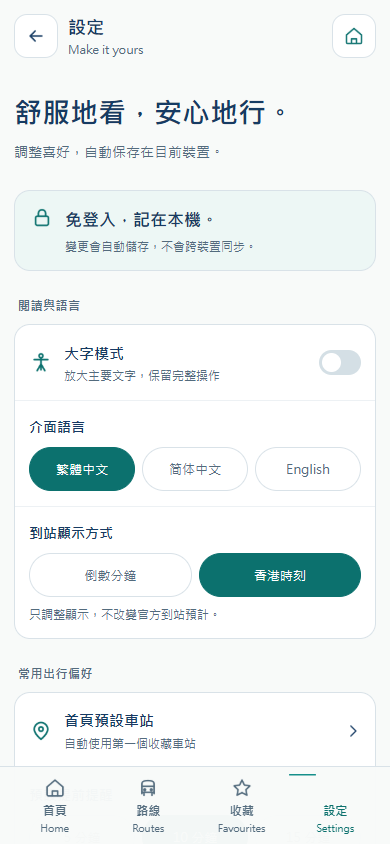
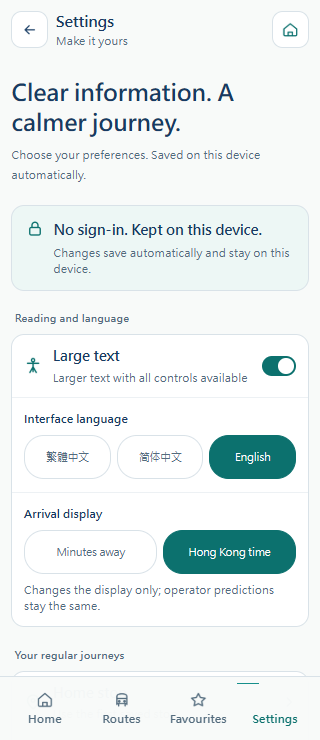
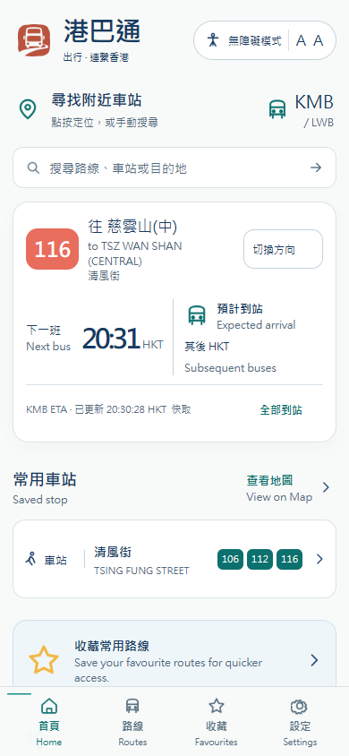
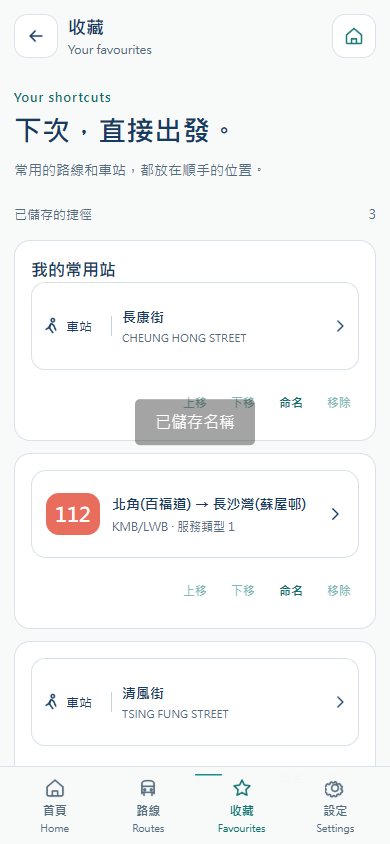
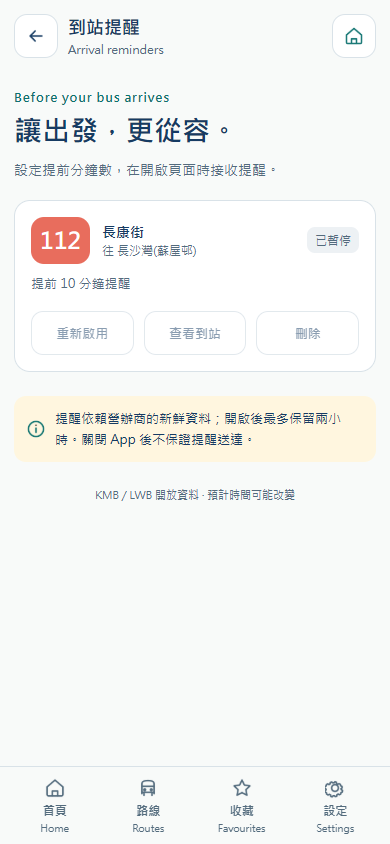
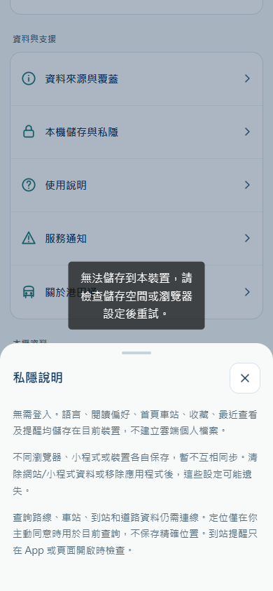

# 港巴通 · 本机喜好与个人资料 / On-device preferences

## 中文说明

2026-10-17 的产品决定：乘客端目前不建立用户账号或用户体系。设置、收藏、最近查看和提醒保存于当前前端设备；公共公交/道路查询继续使用正式真实 API。客户端不创建匿名云端档案、不发送个人会话凭据、不调用 `/v1/profile`。本次更新覆盖独立微信、支付宝、抖音、Android 工程，以及 Android 共用渲染层的实际 H5 网站。管理后台账号体系仍用于运营维护。

此前实际客户端只有语言和大字模式本机保存，收藏、历史和提醒使用匿名装置 API/SQLite。这一行为现由本次文档替代。后端保留旧接口及既有记录，避免破坏兼容性；没有迁移、删除或重建生产数据库。

### 功能需求与默认行为

| 编号 | 功能 | 默认值 / 行为 | 保存与边界 |
|---|---|---|---|
| PREF-01 | 介面语言 | 繁体中文，可切简体中文 / English | 修改立即保存；全局文案及官方名称切换 |
| PREF-02 | 大字模式 | 关闭 | 所有页面共用，保留 320px 操作与布局 |
| PREF-03 | 到站显示 | 倒数分钟，可选香港时刻 | 首页、站点、路线摘要及后续班次同步；时间为 HKT，与设备时区无关；较旧/无预计继续隐藏不可信数字 |
| PREF-04 | 首页默认车站 | 自动使用第一个可用收藏车站 | 可从收藏车站中指定；主动定位时本次位置优先；移除该收藏后恢复自动选择 |
| PREF-05 | 默认提前提醒 | 5 分钟，可选 10 / 15 | 只作用于新建提醒，不更改已有提醒 |
| PREF-06 | 记住最近查看 | 开启，最多 20 项 | 站点/路线真实资料成功载入后记入、去重并置顶；关闭立即清空并停止记录，可独立清除 |
| PREF-07 | 首次喜好入口 | 首页展示，可进入设置或“稍后” | 跳过可正常使用；操作后不再重复显示；完整清除后恢复 |
| LOCAL-01 | 收藏与别名 | 最多 50 项，站点/路线合计 | 新增、取消、最多 24 字别名、上下排序，本机保存；已有资料可离线编辑 |
| LOCAL-02 | 到站提醒 | 最多 10 项，2 小时有效 | 按路线号+方向+服务类型+站点+站序识别，支持暂停、重新启用、删除；重新启用延长至 2 小时 |
| LOCAL-03 | 重设喜好 | 恢复六项默认偏好 | 保留收藏、历史和提醒；不重新弹首次入口 |
| LOCAL-04 | 清除全部本机资料 | 用户确认后清除 | 同时重置偏好/收藏/历史/提醒和当前定位、清理查询缓存，返回首页；防止旧异步操作写回 |
| LOCAL-05 | 本机保存与隐私说明 | 设置、帮助、首次入口说明 | 免登录、各设备独立、不跨端同步；清除网站/小程序资料或卸载可能丢失 |

### 数据、事务和兼容规则

- 本机键为 `hkbus-device:v1`，通过 Taro 同步存储适配：H5 使用当前 origin 的 localStorage，Android 使用当前 WebView 的存储，三个小程序使用各自平台本地存储。逻辑记录为 schema 1、revision、resetVersion、preferences、bookmarks、recent、reminders。不同浏览器/设备/平台不共用；这不是跨端云同步。
- 每次修改先读取持久化最新值，再规范化、写入、发出更新；写入成功才更新可见状态。H5 监听 storage 事件同步同一 origin 的其他标签页；该机制不保证多个浏览器进程的同时写入事务，也不等同服务端并发控制。
- 异常字段回到有效默认值；无效官方标识、错配实体、重复资料、fixture 元数据不会成为有效收藏快照。未知 schema 不自动覆盖，显示错误，允许用户明确清除。配额不足/存储被禁止时保留旧值并提示失败，不能显示已成功保存。
- 收藏和历史仅存官方目录元数据快照（包括官方站点坐标），不存 ETA 或附近距离为个人快照。精确用户定位只用于主动授权后的当前请求，不写入偏好；带经纬度的查询不持久缓存，旧版这类缓存启动时移除。真实公交时刻继续以正式 API 返回值及新鲜度为准。
- 旧 `hkbus-locale`、`hkbus-large` 和当前 API 命名空间下已缓存在设备中的 live 收藏/历史可迁移。成功持久化后再清理旧本机会话与个人缓存。没有本地缓存的旧服务端资料不主动下载；旧服务端提醒不转成本机提醒。迁移失败保留旧缓存。首次升级后用户可重新收藏/设置提醒。
- 完整清除递增 resetVersion；异步收藏/建提醒完成前重新核对，其他标签页清除后的旧操作也被拒绝。查询清除递增缓存 generation；旧请求不能重新填充被清理的查询缓存。
- 到站提醒按路线合并公共请求，每 30 秒在前台检查；方向/服务类型/物理站/站序匹配、首次预计有效且新鲜、处于阈值内才触发。发送前再次核对提醒当前状态、有效期和阈值。离线、较旧、无预计、暂停、过期均不触发。
- H5/小程序使用应用内提示，Android 授权后可加本地通知；页面隐藏、应用进入后台或关闭后停止检查，不承诺后台推送。通知实际 OS 权限及真机送达需另验。
- 原有后端个人 API、管理员认证和历史记录保持兼容，未建立新客户端账号。交通请求仍会经过正常服务日志及上游供应商处理，“本机保存”专指个人喜好/收藏/历史/提醒，不表示网络请求不会到达服务器。

### 实施与验证

实现包括纯逻辑版本化仓储、Taro 存储适配、全局订阅、本机提醒器、公共 API 防护、设置页面与首次入口。四个实际客户端独立同步，不改动旧共享 mobile、prototype 或 demo。UI 沿用已确认 Accessible Calm Minimal 的配色、圆角、触摸目标与大字系统；偏好持久化的设计规则检索未找到特定对应条目，采用明确状态与失败反馈。

验收记录在同目录 `assets/local-preferences/2026-10-17/`，构建、实际网站浏览器、线上服务和发布证据分别记录，不能相互替代。本次结果如下：

| 验收层级 | 实际结果 | 证据 |
|---|---|---|
| 源码与事务测试 | 四端各 22 项通过；持久化、失败不丢值、schema/迁移、元数据隔离、排序/历史开关、站序提醒、清除与异步竞态 | [四端构建/源码指纹](assets/local-preferences/2026-10-17/builds.json) |
| 类型与编译 | 四端 typecheck / test / build 全通过；微信/支付宝/抖音各 14 页，Android Debug APK；实际 H5 单独执行发布门禁 | [H5 构建](assets/local-preferences/2026-10-17/build.json)、[产物/签名](assets/local-preferences/2026-10-17/artifacts.json) |
| 真实 HTTPS 发布 | 245 个静态文件逐个公网 SHA-256 校验，真实线路 API 与网站 Origin CORS 通过，保留上一版本 | [部署](assets/local-preferences/2026-10-17/deployment.json)、[SSH 关闭](assets/local-preferences/2026-10-17/transport.json) |
| 实际网站浏览器 | 13 组交互、14 页加载、三语/320px 大字、离线编辑/持久化、存储写入失败、同源标签页/隔离、迁移与清除通过 | [最终浏览器记录](assets/local-preferences/2026-10-17/browser.json) |
| 真实数据与个人数据隔离 | 62 次真实公共请求；所有个人操作零 profile 请求、零 Authorization；时刻与实际官方 ETA 对齐 | [浏览器请求与断言](assets/local-preferences/2026-10-17/browser.json) |
| 运维与数据库回读 | Backend 保持原运行版本，SQLite 完整性与外键检查通过；1611 路线记录、6775 站、36377 站序、2 旧档案、1 管理员均未改动 | [基线](assets/local-preferences/2026-10-17/baseline.json)、[最终回读](assets/local-preferences/2026-10-17/final-audit.json) |
| 官方 IDE / 真机 / 上架 | 本次未执行，不能由编译或浏览器替代；Android APK 为 Debug 签名，未构建 iOS | 单列为后续验收，不能标为完成 |

本次浏览器为 Windows 原生 Chrome，通过自有香港服务器的临时限域 SOCKS 网络访问真实公网 HTTPS，TLS 保持验证，未拦截/替换页面或 API 内容；仅主动切换离线状态、模拟 localStorage 写入失败来验证错误行为。浏览器、标签页、上下文、临时监听和 SSH 均已关闭，未改变系统代理。[网络与清理证据](assets/local-preferences/2026-10-17/browser-network.json)。首次自动化在 Taro 确认框选择器上超时，修正检查脚本后完整重跑通过；最终结果为 `browser.json`，前次原始记录单列 `browser-attempt1.json`。

现有小程序样式压缩器对 safe-area 的 rpx/calc 表达式仍输出警告，构建退出码为 0；Android Gradle 有依赖弃用提示。原始日志保留在本次证据目录中。小程序各端 safe-area 与原生通知能力仍需官方 IDE / 实机验证。

### 实际网站与交付

- 网站：[港巴通](https://hkbus.copypaste.hk/)；[直接打开设置](https://hkbus.copypaste.hk/#/pages/settings/index)。
- 宝塔域名根目录：`/www/wwwroot/hkbus.copypaste.hk`。版本：`20261017T122707Z-dcef08ea29f3`；实际文件在 `.hkbusgo/releases/`，`current` 原子指向新版。主 vhost 和既有扩展内容均保持一致。
- 可回滚版本：`20261017T114748Z-60f6bf69909d`。保持旧哈希资源供已有页面使用；不替换后端、数据库、Admin 或环境密钥。
- 实际 H5 编译源码：`dcef08ea29f3d3cf27dceba5e6c3022baeeaa1d0`，`build.json` 记录完整源文件和产物指纹；后续文档提交不改变已编译代码。新版 H5、三个小程序 dist ZIP 和 Debug APK 均已重新导出。

| 文件 | 字节 | SHA-256 |
|---|---:|---|
| `hkbusgo-wechat-dist.zip` | 442937 | `de55eda4b377c48c3088b1302dca339c853eca11653780ddf577ce4bd6b5e23c` |
| `hkbusgo-alipay-dist.zip` | 439588 | `5fb0695a3bb9f6f3827e93d588a891310c113a35fddcfc284283fc7b81a7fd0f` |
| `hkbusgo-douyin-dist.zip` | 438274 | `058d5a32834b693eb31fcbc7df517f1ec28abfc234481e163359e80af4b56968` |
| `hkbusgo-h5-dist.zip` | 795760 | `3c79767ecd2ac0103aeff20fad06407691c461aa94015ee378dd27fbb40c3c44` |
| `hkbusgo-android-debug.apk` | 6183436 | `f7f4c66422062623bd63b77501930d09b57bf907e4899913bc5eef314a4c8acf` |

实际 Android APK 内 245 个网页渲染文件已与本次 H5 dist 逐项核对一致，APK 签名验证通过。真实 KMB/TDAS 数据与本机偏好分离；Admin 不需要因本次改造重新编译或发布。Git 分支提交与校验单独见交付目录的 `source-commits.json`。

### 实际网站截图

以下均为真实网站浏览器截图，不是小程序官方 IDE 或手机 App 真机截图。截取当前移动视口，较长的设置页在应用内纵向滚动。

  

  

## English

Passenger accounts are not part of the current product. Language, reading preferences, home stop, favourites, recent views and arrival reminders are stored by the frontend on the current device. Real public transit and road queries continue to use the production API. Updated clients neither create an anonymous server profile nor send a profile Authorization header. Admin authentication remains for operators; existing backend endpoints and records are retained for older clients.

Six basic preferences are available: Traditional Chinese / Simplified Chinese / English; large text; minutes / Hong Kong clock time; automatic or selected saved home stop; a 5 / 10 / 15 minute default reminder; and recent-history opt-in. An optional first-visit home card opens Settings. Values save immediately and restore on reload. Reset preferences keeps saved items, history and reminders. Clear all local data removes every personal collection and query cache, forgets session location and returns home.

The versioned `hkbus-device:v1` repository validates metadata, limits favourites to 50, history to 20 and reminders to 10, and only publishes successful writes. Storage failures remain visible without losing the last saved value. An unknown schema requires explicit recovery rather than silent replacement. A reset generation prevents operations begun before clearing from restoring old personal data, including across browser tabs. Same-origin browser tabs observe storage events; different browsers, mini-programs and devices remain independent. No account-based recovery or cross-device sync is provided.

Only valid official catalogue snapshots are kept for favourites/history. ETA and nearby-distance fields are excluded. Official stop coordinates may be cached; the user's precise location is used only for an explicit session query and is not persisted. Coordinate-bearing queries are not stored in the offline cache. Previously cached live favourites/history and reading settings can migrate; old local session credentials are removed only after successful migration. Server-only records and reminders are not downloaded or deleted.

Local reminders use real, fresh public route predictions, matching direction, service type, stop and sequence. They expire after two hours, support pause/enable/delete, and recheck state before delivery. Polling runs while the page/app is in the foreground, at 30-second intervals; offline, stale, paused and expired reminders do not fire. Native notification permissions and actual device delivery require physical-device acceptance. Closing the application does not provide background push.

Windows-native type checks, meaningful unit tests, compilation, live API/browser checks, official mini-program IDE validation, physical devices and store review are distinct acceptance layers. Browser evidence is from the actual published HTTPS website with real APIs and no payload substitution. Official IDE/device/store acceptance is not implied. The previous mock prototype and Vercel demo remain outside this update.

Windows-native checks passed for all four clients: 22 unit tests per client, type checks and target builds. The actual H5 deployment verified all 245 public asset hashes. Thirteen live-browser groups covered 14 pages, three languages, 320px large text, real ETA clock values, offline saved-item edits, reload, storage failures, same-origin tabs, isolation, migration, reset and clear. Sixty-two public API requests were observed with zero profile requests or Authorization headers. All owned browser/network resources were closed. Production readback confirmed the original backend, database counts, admin account and vhost configuration were preserved.

The release is `20261017T122707Z-dcef08ea29f3` at https://hkbus.copypaste.hk/. The three mini-program archives, H5 dist archive and Debug APK are regenerated with SHA-256 receipts above. The APK's 245 renderer files match the exported H5. Mini-program IDE validation, physical-device notification/location acceptance and store submission remain outstanding. Existing CSS safe-area minifier warnings and Gradle deprecation messages are preserved in the raw build logs. Read the linked JSON records for exact boundaries and evidence.
