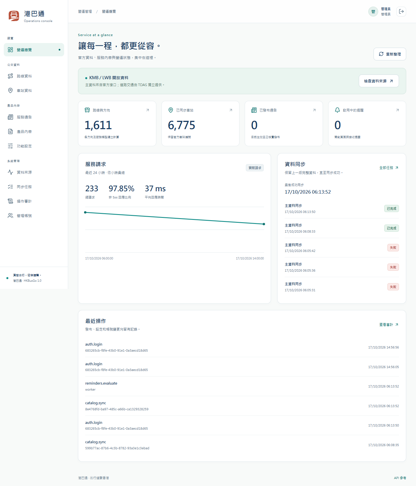
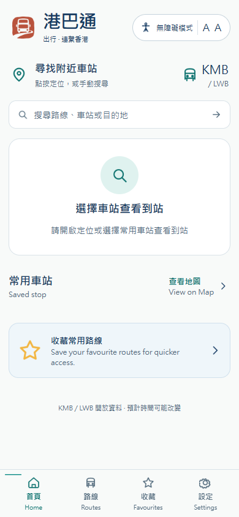
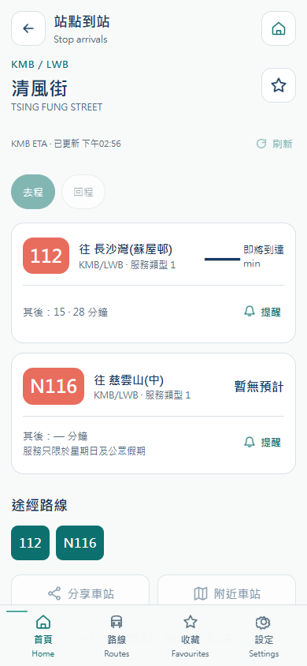

# 港巴通正式 API 与五端编译交付 · 2026-10-17

API 已统一为 **`https://hkbus-api.copypaste.hk/api/`**。四个移动端和管理后台的构建默认值、环境变量样例与产物均指向该地址，内部去掉结尾斜杠后拼接 `/v1/…`，不会产生重复 `/api`。API 变更后需重新编译。10 号纯图形 Logo 和 Accessible Calm Minimal 继续沿用。

## 交付文件

编译包由本次交付目录 `output/production-api-2026-10-17/` 提供；源码分支不提交二进制产物。 / Compiled artifacts are delivered separately; binaries are not committed to source branches.

| 端 | 文件 | 大小 |
|---|---|---|
| wechat | `hkbusgo-wechat-dist.zip` | 0.41 MiB |
| douyin | `hkbusgo-douyin-dist.zip` | 0.41 MiB |
| alipay | `hkbusgo-alipay-dist.zip` | 0.41 MiB |
| admin | `hkbusgo-admin-dist.zip` | 0.08 MiB |
| android | `hkbusgo-android-debug.apk` | 5.79 MiB |

包内不含数据库、服务账号、SSH/管理员密码、.env.local、keystore 或 node_modules。小程序 ZIP 解压根目录就是 app.json 所在目录；微信/抖音编译项目的 miniprogramRoot 为 `./`，保留 URL 校验。详细大小、SHA-256 和文件内容检查见 [产物核查](./assets/production-api/2026-10-17/artifacts.json)。App 本次是现有 Android 工程的 Debug APK，包名 `hk.hkbusgo.app`、版本 1.0.0、最低 Android 7.0/API 24、target 36。没有 iOS 产物。

## API 通达性与运行配置

健康检查 [GET /api/health](https://hkbus-api.copypaste.hk/api/health) 返回 **200 / ok / live**；[API 文档](https://hkbus-api.copypaste.hk/api/docs/) 可访问。`/api/` 是命名空间根路径，正常返回 404，不能拿它替代健康接口。TLS 使用系统信任链校验，未关闭证书验证；校验记录含证书域名与有效期。

已通过 **37 项** HTTPS 检查：官方线路/站点/附近搜索、完整站序、KMB 实时 ETA、无定位及指定站点首页、行程候选、通告读取、匿名档案建立、收藏新增/读取/排序、最近查看、页内提醒、凭证轮换及旧会话撤销、档案和个人资料删除、后台 Cookie 登录/身份/总览/数据源/登出。主数据当前 1,611 个线路方向与 6,775 个站点。ETA 检查取得 10 条真实记录，来源 KMB、状态 fresh；这只是检查时快照。

已将正式 API origin 加入后端允许列表，保留 `https://localhost` 与 `capacitor://localhost`。通过 OPTIONS 预检及拒绝不可信浏览器 origin 检查。管理员 Cookie 的 Secure、HttpOnly、SameSite=Strict 及退出撤销已实测。服务器继续监听 **39410**，原有宝塔 SQLite、账号、数据、备份和 systemd 保留。域名配置脚本位于 Backend 的 `deploy/linux/set-api-domain.py`，服务器副本 `/www/wwwroot/hkbusgo/ops/set-api-domain.py`；私密环境备份不进入仓库。

证据：[HTTPS API 检查](./assets/production-api/2026-10-17/https-api.json)、[服务端域名配置](./assets/production-api/2026-10-17/server-domain.json)、[TDAS 源站检查](./assets/production-api/2026-10-17/tdas-origin.json)。本次测试仅新建自己的匿名档案并最终删除，管理员会话已退出，正常审计/请求指标保留。

## 已知限制

- **TDAS 道路参考仍不可用**：正式域名当前返回 502，Cloudflare 响应是纯文本 `error code: 502`；同一服务器源站接口为 502 / UPSTREAM_HTTP，与上一次官方出口 403 阻塞一致。不能据此宣称 TDAS 已恢复，也不回填假道路时间。KMB 主数据、ETA 和个人业务通过检查。
- **Cloudflare 工具 UA 限制**：早先 Python-urllib/3.13 请求收到 403/1010；本次 HTTP 验证采用产品 UA HKBusGo/1.0，真实 Chrome 页面请求也通过。没有关闭 TLS 或绕过挑战；官方小程序 IDE 和各平台真机 UA/网络尚待验收。
- **发行身份**：微信仍是 touristappid、抖音 AppID 空值，支付宝须在 IDE 关联应用。请登记 `https://hkbus-api.copypaste.hk` 为 request 合法域名并填写真实 AppID、定位/隐私申明。编译包不等于可直接提审的发行身份。
- **Android 签名**：本次为 Debug 证书签名、v2 验签通过，可安装测试；正式商店签名和发布另行处理。[签名证据](./assets/production-api/2026-10-17/apk-signature.txt)、[APK 元数据](./assets/production-api/2026-10-17/apk-badging.txt)。
- **后台静态站点**：本次交付 dist，未部署 Admin 网站。建议同源放在 `https://hkbus-api.copypaste.hk/admin/`；该地址仅是推荐位置。相对资源和 Logo 已支持子目录。其他 Admin origin 须配置精确 CORS，SameSite=Strict 仍限制跨站 Cookie。不可双击 file:// 登录。
- **分享落地页**：本次定稿的是 API 地址；产品分享落地域名没有据此改为 API，已有 shareBaseUrl 仍须后续明确。

## 构建与验证边界

| 层级 | 本次结果 |
|---|---|
| 源码/类型 | 5 个独立客户端类型检查通过；四移动工程各通过既有 7 项回归测试 |
| 编译 | WeChat、Douyin、Alipay、Android Debug 与 Admin dist 全部成功；Windows 原生工具 |
| 产物内容 | 全部内置正式 HTTPS API、无旧 localhost API；三端均 14 页，模板/JSON/JS 齐全；APK 内嵌 renderer 与本次 Taro 输出逐文件 SHA-256 一致 |
| 实际接口 | 37 项 HTTPS 检查通过；TDAS 作为外部故障另列，不计为成功道路结果 |
| 浏览器 | 精确使用本次编译的 Admin 与 Android renderer，静态文件在本机由 Playwright 提供，所有 API 直接访问正式域名；真实登录/退出、目录、收藏、ETA、320px 布局通过 |
| 官方 IDE | 未启动微信、支付宝、抖音官方 IDE；不以编译替代 |
| 真机/原生能力 | 未进行实机安装、GPS、原生分享/通知或平台端到端验收；浏览器 renderer 检查不能替代原生 App 验收 |
| 商店/平台提审 | 未上传、未提审，未提供正式发行证书 |

[构建汇总](./assets/production-api/2026-10-17/builds.json) · [浏览器检查](./assets/production-api/2026-10-17/browser.json)。本次未执行原生 Android Lint；既有 Lint 结果保留为历史记录，不以本次编译替代专项检查。构建保留小程序 PostCSS 对 env 安全区表达式的优化警告、Webpack 体积提示及 Gradle 9 弃用提示；编译退出码均为 0。安全区表达式保留在产物中，平台实际表现仍须官方 IDE 与真机验收，原始日志保留。未启动 Docker、WSL、虚拟机或模拟器；本次浏览器上下文与进程全部关闭，保留用户原有页面。未调整或发布 demo、prototype、Vercel。

## 当前实测截图

以下是本次编译界面连接正式 API 的截图。Admin 静态文件在本机拦截提供，不代表静态站点已部署；指标为服务器实际请求，包含验证流量。Android 图是 APK 同源 renderer 的浏览器参考，不是手机截图。

| Android 首页参考 | Android 真实到站参考 |
|---|---|
|  |  |

## English handover

All five client builds use `https://hkbus-api.copypaste.hk/api/`. HTTPS health, real KMB/LWB catalogue and ETA, profile writes/refresh/deletion and secure Admin login/logout passed. The API namespace root returns a normal 404; use /api/health. The production service still listens on port 39410 and retains the BaoTa-managed SQLite database and backups.

Mini Program ZIPs contain importable compiled directories with 14 pages each. Owners must configure genuine AppIDs and the HTTPS request-domain allowlist in each official platform. The Android artifact is an installable debug-signed APK (Android 7+, target 36), with v2 signature and embedded renderer hashes verified. It is not a store-signed release; no iOS artifact is included. Admin dist uses relative assets for root/subdirectory hosting and should share the API origin for the Strict session cookie. Its static website has not been published.

TDAS remains unavailable from the production server (public 502; origin UPSTREAM_HTTP). No fixture fallback is used. Cloudflare blocks the generic Python-urllib/3.13 User-Agent (403/1010); HKBusGo/1.0 and real Chrome requests passed in this check. Official IDEs, physical devices and store submission are separate acceptance stages. The browser checks fulfilled only local static files; production API responses were not replaced. All created browser contexts/processes were closed and temporary test profiles were deleted. No Docker, WSL, VM, emulator, demo or Vercel work was performed.
